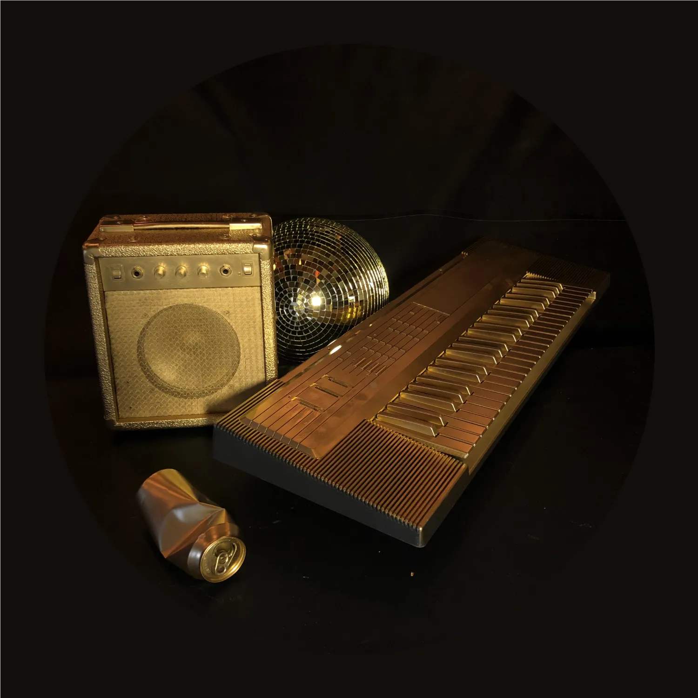
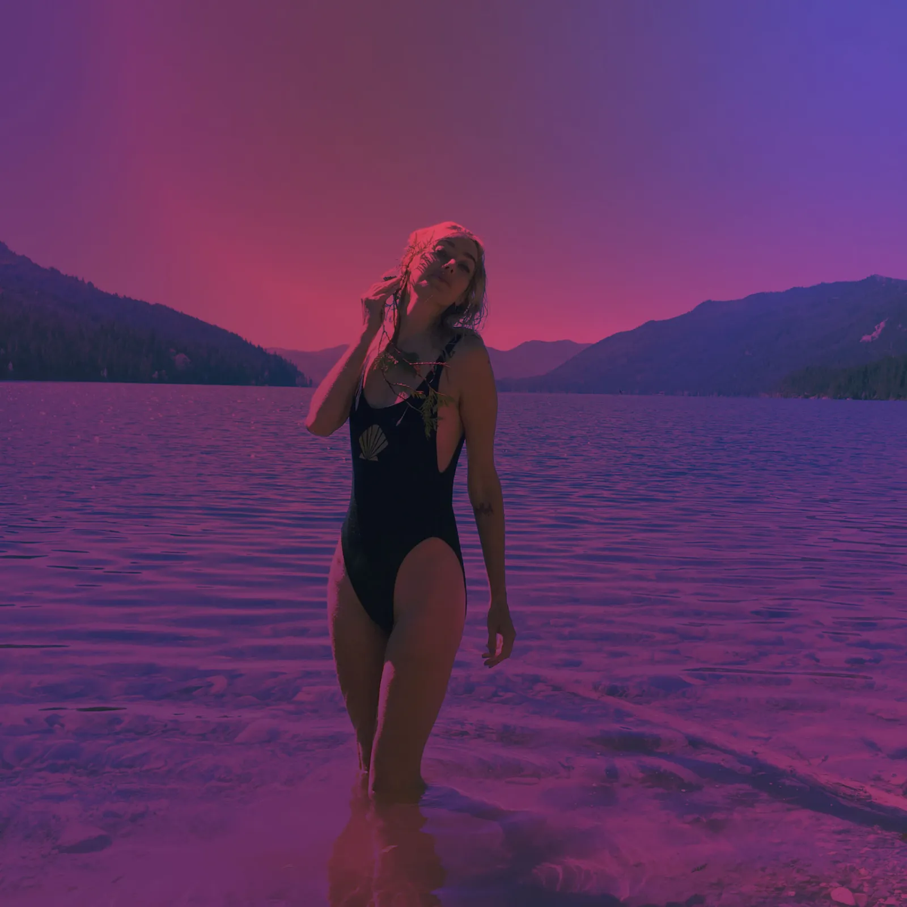
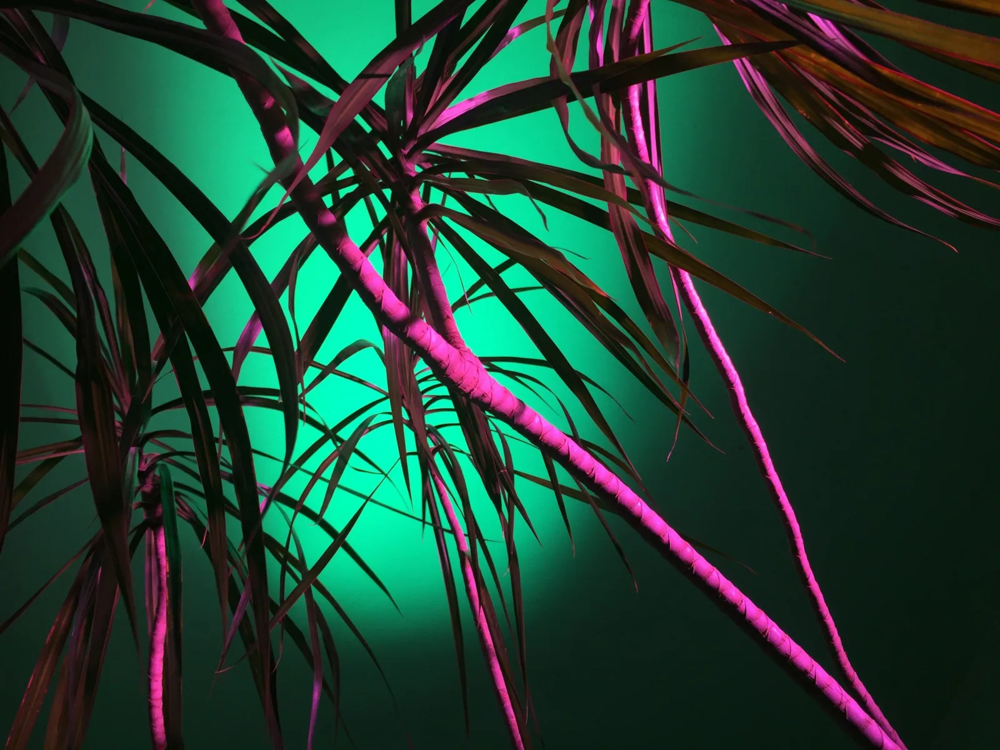
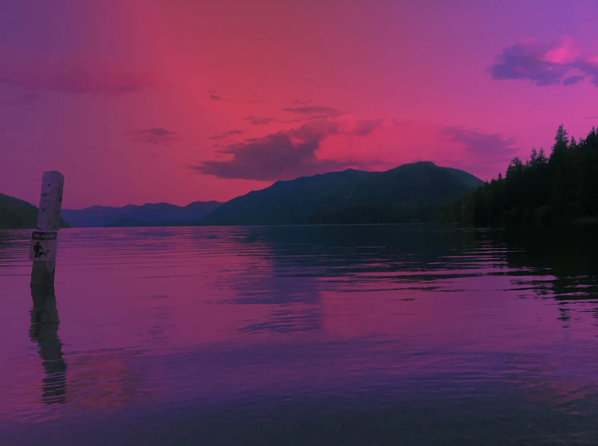
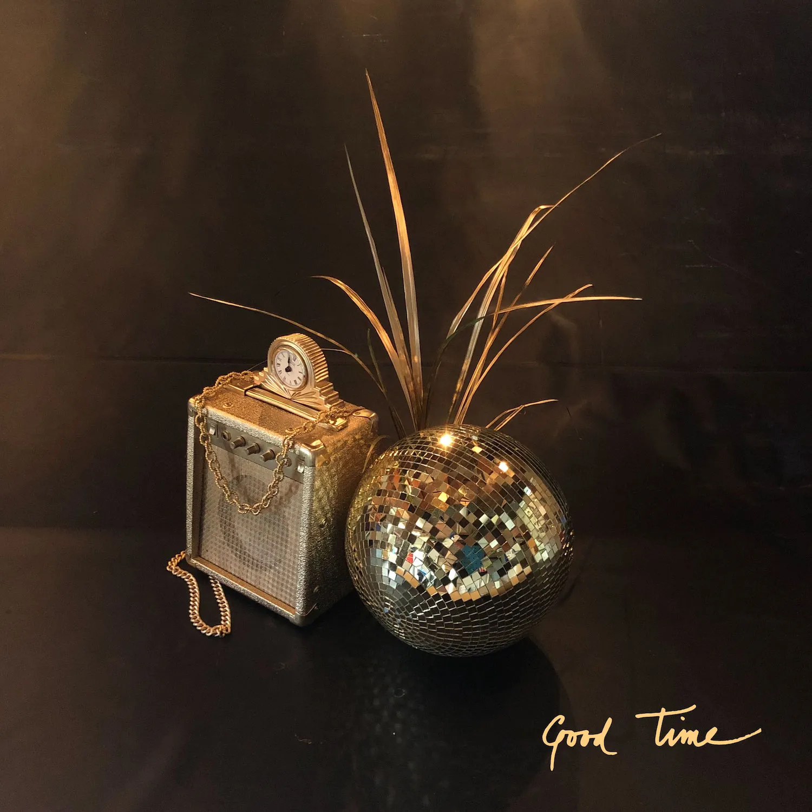
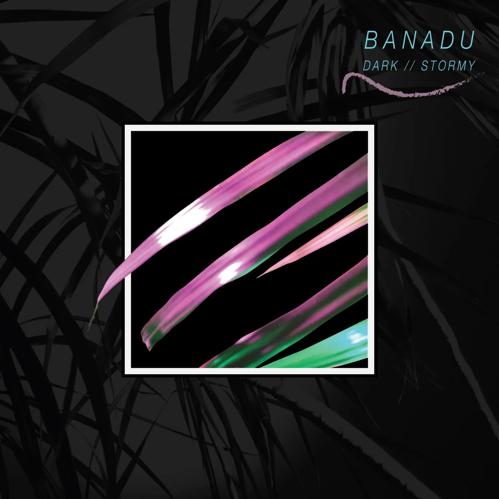

## BANADU

<iframe src="https://open.spotify.com/embed/artist/4fPkcgyXEB93JncKYAcmUv" title="Spotify artist" height="352" loading="lazy" allow="autoplay; clipboard-write; encrypted-media; fullscreen; picture-in-picture"></iframe>

**Banadu**, pronounced like "Xanadu" with a 'B,' is an indie electro project. Banadu uses liquid guitars, funk bass, expansive synth textures and driving drums for a dancey dream funk vibe.

<a class="button" href="https://banadu.bandcamp.com/">Merch</a>

>  “Funky, four-on-the-floor dream/synth pop” 
>
> — Wild Patterns

>  “The synths, playful guitar licks and layers are triumphant in this track, and it drowns you in a way that you will surrender. The track is almost ethereal and trip-inducing” 
>
> — The Violet Wave , Song of the Day

### Airplay

### Press

- BIRP.fm
- Indie & Folk Radio
- Indie Music Nation
- Indiemono

- Blue Bardot
- Wild Patterns
- SSG Music

>  “[BANADU] blends funk bass, synths, distant and textural vocals with shoegaze guitars to depict that dream vacation you’ve been waiting for” 
>
> — SSG Music

Releases:

<iframe src="https://www.youtube-nocookie.com/embed/wGhTETUA01M" title="YouTube video" loading="lazy" allow="accelerometer; encrypted-media; gyroscope; picture-in-picture; web-share" referrerpolicy="strict-origin-when-cross-origin" allowfullscreen></iframe>

