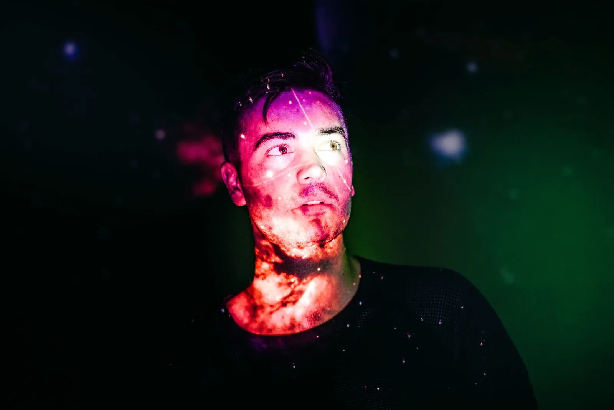

Darksoft is a multi-instrumentalist songwriter and producer who creates dreamy indie rock sounds. Darksoft songs blend shoegaze and dream pop elements, using lush melodic progressions, 80s/90s alternative rock undertones, and deftly executed vocals. Darksoft is a solo recording project sometimes supported by a full band for live shows.

### Listen

[Spotify](https://open.spotify.com/artist/5pD33SUgX5GQ8NvqZ6IdeE?si=7E1SerRgQ-yAM2GTTBrYgA) | [Apple Music](https://music.apple.com/us/artist/darksoft/1438263529) | [Bandcamp](https://darks0ft.bandcamp.com/) | [Deezer](https://www.deezer.com/us/artist/52389072) | [Amazon Music](https://www.amazon.com/Meltdown-Darksoft/dp/B08D5XDF5D) | [YouTube](https://www.youtube.com/channel/UCYGODf2pvnV88yuoNnDFWfw)

### FOLLOW

[Twitter](https://twitter.com/darks0ft) | [Instagram](https://www.instagram.com/darks0ft) | [Facebook](https://www.facebook.com/darks0ft)

>  Nostalgic guitars crunch with a gauze of shimmering shoegaze 
>
> — Ohestee.com

<iframe src="https://www.youtube-nocookie.com/embed/vCc4XzNZLoY" title="YouTube embed" loading="lazy" allow="accelerometer; encrypted-media; gyroscope; picture-in-picture; web-share" referrerpolicy="strict-origin-when-cross-origin" allowfullscreen></iframe>

<iframe src="https://www.youtube-nocookie.com/embed/pTzoGJ6mlvs" title="YouTube video" loading="lazy" allow="accelerometer; encrypted-media; gyroscope; picture-in-picture; web-share" referrerpolicy="strict-origin-when-cross-origin" allowfullscreen></iframe>

### Bio

Darksoft is a multi-instrumentalist songwriter and producer who creates dreamy indie rock sounds. Darksoft songs blend shoegaze and dream pop elements, using lush melodic progressions, 80s/90s alternative rock undertones, and deftly executed vocals. Darksoft is a solo recording project sometimes supported by a full band for live shows.

To date, Darksoft has released several conceptual albums. His most recent, Grayscale (2023), was released by Spirit Goth records. His previous record, Beigeification (2023), is a postmodern dose of surfy sounds and beigey moods. Beigeification was #1 for radio station adds on NACC (1/17), got the #1 debut in its debut week (1/24), and reached #9 on the NACC Top 200 chart. Beigeification was released by Look Up Records with tapes printed by 2060 Records. In 2023, Darksoft toured the west coast and the northeast US.

Cryo (2022) also received national radio attention, charting on both NACC and Sub-Modern Charts. 'Looking Backward' was added to Spotify's Indie Fresh Finds editorial playlist. Also in 2022, Darksoft toured the Pacific Northwest and New England. His previous records, Meltdown (2020) and Brain (2018), are in constant limbo between digital futurism and watery introspection, communicated through the language of computer viruses, algorithms, and human emotion, pure enough to pass the Turing Test.

Darksoft is originally from Seattle, where he participated in the local music scene for years. In 2021 he moved his family to Portland, Maine. Besides producing Darksoft, he has produced music under several other monickers. Darksoft also tries to support other musicians too. He manages Look Up Records, a small independent music label and blog.

<iframe src="https://www.youtube-nocookie.com/embed/LiEdi0L9kRA" title="YouTube video" loading="lazy" allow="accelerometer; encrypted-media; gyroscope; picture-in-picture; web-share" referrerpolicy="strict-origin-when-cross-origin" allowfullscreen></iframe>

<iframe src="https://www.youtube-nocookie.com/embed/HtLHN8mhWG0" title="YouTube video" loading="lazy" allow="accelerometer; encrypted-media; gyroscope; picture-in-picture; web-share" referrerpolicy="strict-origin-when-cross-origin" allowfullscreen></iframe>

### PRESS

- Independent Music Reviews: [Looking Backward by Darksoft](https://independentmusic.reviews/emo/looking-backward-by-darksoft/)
- PostPunk.com: [Seattle Shoegaze Act Darksoft Debuts Video for Looking “Backward” From New Album “Cryo”](https://post-punk.com/seattle-shoegaze-act-darksoft-debuts-video-for-looking-backward-from-new-album-cryo/)
- [AmericanPancake: "Darksoft's track "Cybersecurity" is an evocative piece of dream theater with grunge leanings"](https://www.americanpancake.com/2019/12/darksofts-track-cybersecurity-is.html)
- [JanglepopHub - New Music Recommendations 12/17](https://janglepophub.home.blog/2019/12/17/beat-the-delete-0036-new-music-recommendations/)
- [Comeherefloyd: FIVE // Bliss Motel : Darksoft : linelions : Melanie Sandford : CK Field](https://comeherefloyd.com/five-bliss-motel-darksoft-linelions-melanie-sandford-ck-field/)
- [Dan's Tunes: Photo Story: Look Up Fest – Mars](https://danstunesseattle.com/2019/09/23/photo-story-look-up-fest-mars/)
- [Eclectic Music Blog: Darksoft Album Review: “Brain”](https://eclecticmusiclover.com/2019/02/15/darksoft-ep-review-brain/)
- [Eclectic Music Blog: New Song of the Week: DARKSOFT – “WannaCry”](https://eclecticmusiclover.com/2019/07/25/new-song-of-the-week-darksoft-wannacry/)
- [Rock The Pigeon: Darksoft’s ‘Mydoom’ Is Slow, Straightforward and Sad Alt Rock](https://rockthepigeon.com/2018/10/23/darksofts-mydoom-is-slow-straightforward-and-sad-alt-rock/)
- Ohestee: [DARKSOFT LAMENTS OVER THE UNKNOWN IN DEBUT “MYDOOM”](http://ohestee.com/music/pop/darksoft-laments-over-the-unknown-in-debut-mydoom/?utm_source=twitter&utm_medium=social&utm_term=&utm_content=&utm_campaign=darksoft%2Bmydoom)
- [Comherefloyd: INDIEFOLK415 // Indie Fascination.](https://comeherefloyd.com/415-indie-fascination-the-rungs-du-blonde-misty-mtn-ganser-sleep-state/)
- Dan's Tunes: [Photo story: SWYM, Sealife, Darksoft, Daycones](https://danstunesseattle.com/index.php/2018/12/24/photo-story-swym-sealife-darksoft-daycones/)
- [With Guitars: Darksoft single Mydoom is out on Look Up Records](https://www.withguitars.com/darksoft-single-mydoom-is-out-on-look-up-records/)
- It's Not Records: [Darksoft “Elk Cloner”](https://itsnotrecords.com/2018/10/29/darksoft-elk-cloner/)
- Plastic Mag: [Darksoft releases single ‘Mydoom’](http://www.plasticmag.co.uk/news/darksoft-releases-single-mydoom/)
- Jammerzine: [Daily Dose: Darksoft – Mydoom](https://jammerzine.com/daily-dose-darksoft-mydoom/)
