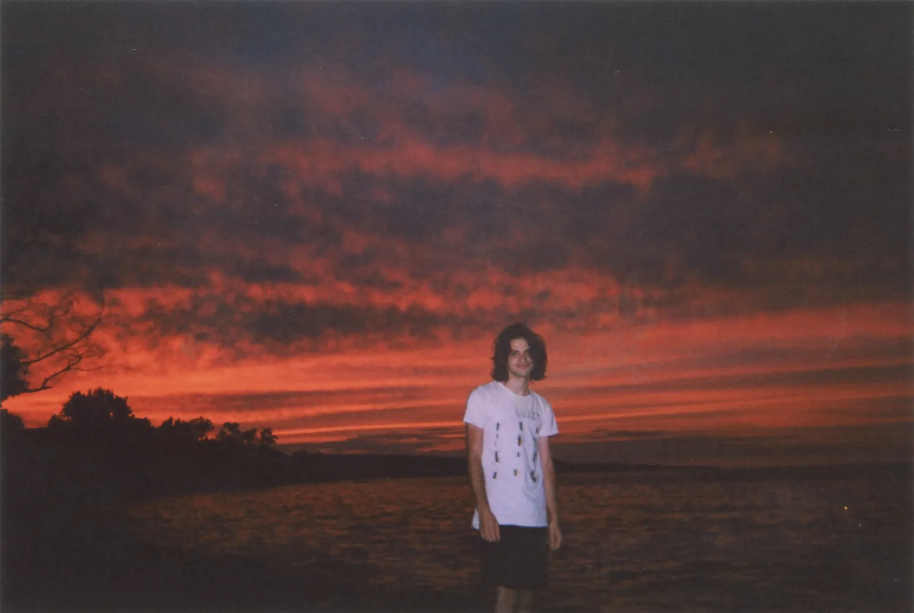
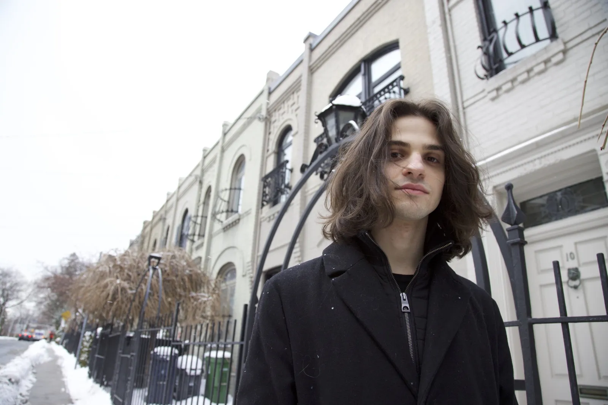
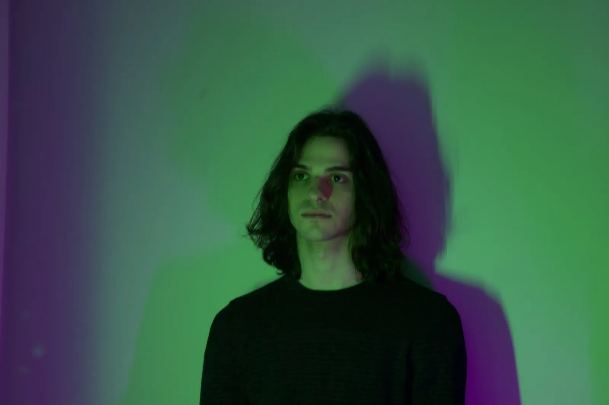
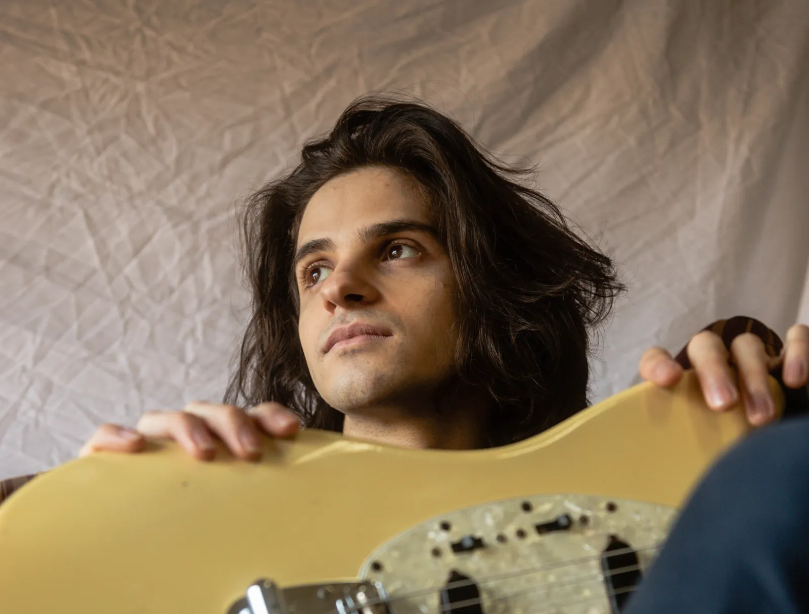
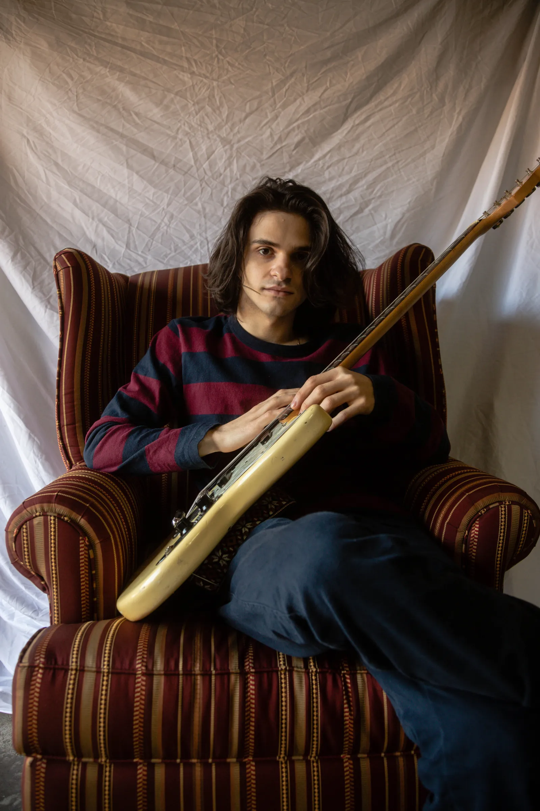

### Listen

[Spotify](https://open.spotify.com/artist/1Txs9MqxrFGGQpS4j5iFdu?si=54d24c6ce9504453) | [Apple Music](https://apple.co/3bup6De) | [Bandcamp](https://elephantsanddogs.bandcamp.com/album/you-wont-be-seeing-me-around) | [Deezer](https://www.deezer.com/us/album/204341112) | [Amazon Music](https://www.amazon.com/gp/product/B08VJJJWWB/ref=dm_ws_sp_ps_dp) | [YouTube](https://youtu.be/kfsCTMlKSQA)

Led by Joe Narducci of Toronto, Elephants and Dogs is a syrupy trip of saturated melodies and chill dream pop arrangements.

### FOLLOW

[Twitter](https://twitter.com/dogselephants) | [Instagram](https://www.instagram.com/dogselephants) | [Facebook](https://www.facebook.com/dogselephants)

### Releases

>  a big chunk of highly catchy, gossamer light dream pop. 
>
> — Fadeawayradiate.com

<iframe src="https://www.youtube-nocookie.com/embed/Qcjc_4v9H_g" title="YouTube embed" loading="lazy" allow="accelerometer; encrypted-media; gyroscope; picture-in-picture; web-share" referrerpolicy="strict-origin-when-cross-origin" allowfullscreen></iframe>

### Bio

Elephants and Dogs, named after the mnemonic for memorizing guitar strings, is the solo project of Toronto-based artist Joe Narducci. The theme of their debut EP ‘You Won’t Be Seeing Me Around’ can be summed up by the lyric, "I hope my stormy skies don't ever clear, cause they will be my ticket out of here." Sadness is often the best inspiration. Elephants and Dogs recorded these songs over a couple of late nights at the now-defunct Soleil Sound Studio in Toronto.

On ‘You Won’t Be Seeing Me Around,’ Elephants and Dogs began as a guitar and vocal demo, recorded one sonic layer at a time, and Joe tracked the majority of the instruments. Joe had some help from his longtime friend and musical partner Jack Davies, who contributed Bass on the title track and Pine Valley. Many artists inspired this EP, including Mac Demarco, Goth Babe, Crumb, Slowdive, and Radiohead. Joe got his start playing music in the clubs of Kingston, ON Canada, with his two bands Bo Welland and JIMBO. When Joe is not making music, he's looking at pictures of cute possums and raccoons on the internet.

Look Up Records is excited to release the first full-length album by Elephants and Dogs, ‘Everybody's Smiling Nobody's Happy,’ on Friday, September 9, 2022.

### NEWS
