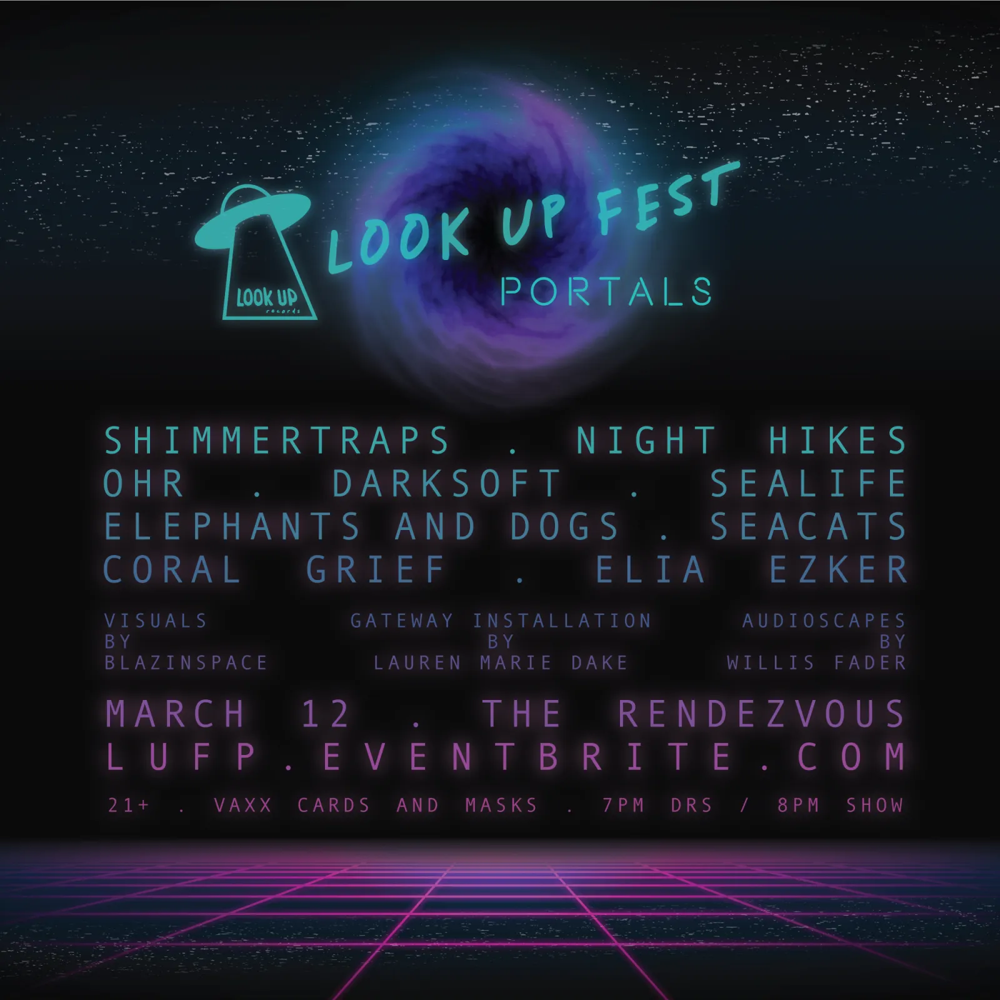

## March 12, 2022

### Rendezvous, BelLtown, Seattle

2322 2nd Ave, Seattle, WA 98121

<a class="button" href="https://lufp.eventbrite.com">BUY TICKETS</a>

### 21+ - 7PM DRS / 8PM SHOW

*Masks & Proof of Vaccination or a Negative COVID19 test within 72 hours required for entry.*

Look Up Fest, the PNW’s lodge for high strangeness, is back for its fourth mani*fest*ation. Get transported with sonic vibes and trippy visualizations as we channel the unknown in harmony.

Look Up Fest: Portals is an artist-run, DIY, sponsor-free mini music fest. We’ve invited nine great bands to play across two stages in Seattle’s best intimate haunted setting, The Rendezvous.

<a class="button" href="https://www.facebook.com/events/505414783859576/">RSVP</a>

<iframe src="https://www.youtube-nocookie.com/embed/rFR4bGfDK4c" title="YouTube embed" loading="lazy" allow="accelerometer; encrypted-media; gyroscope; picture-in-picture; web-share" referrerpolicy="strict-origin-when-cross-origin" allowfullscreen></iframe>

* * *

## Lineup

<figure>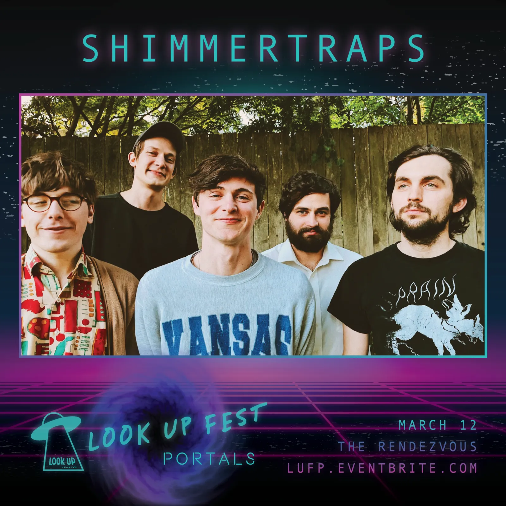<figcaption>Shimmertraps After quietly releasing their debut album in 2017, Shimmertraps spent the next two years pouring their time and creative energy into what they consider to be, “our most collaborative album yet.” With the addition of 2 new members to the project, “LOOK!“ (2020) became an exciting change of pace for the band. Together, they wrote, recorded, mixed and produced the entire album in their outskirt Bellingham living room. Evolving from their dreamy soundscapes and fuzzy lofi production, Shimmertraps boldly introduces their punchy, disco-focused rhythms paired with a plethora of wide and luscious-sounding synths across the sonic journey of “LOOK!”. The band has proven to blend a variety of different genres and sounds into a captivating concoction, further defining the sound of Shimmertraps.</figcaption></figure>

<figure>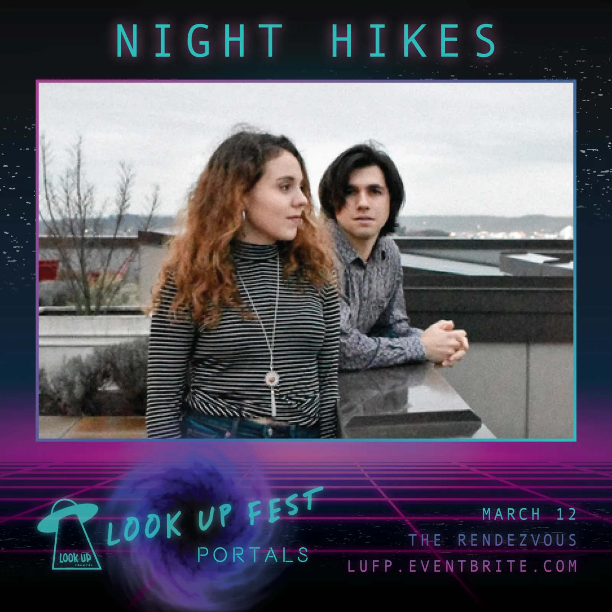<figcaption>Night Hikes Night Hikes began in a garage on an autumn day in northern Indiana. <strong>Olivia Godby</strong> and <strong>Matthew Farrell</strong> met their first year at Notre Dame, only to discover a vivid musical connection as seniors. After spending 2016’s winter writing music, they went on to play a number of underground shows with local rap collective Trybe and to perform in South Bend’s festival Riverlights. Upon graduating, the duo moved to Southern California to begin work on their debut LP. Their music flickers on the cusp of the inner and outer worlds, navigating the tensions of wanting to be very much a spectator and a participant at the same time.</figcaption></figure>

<figure>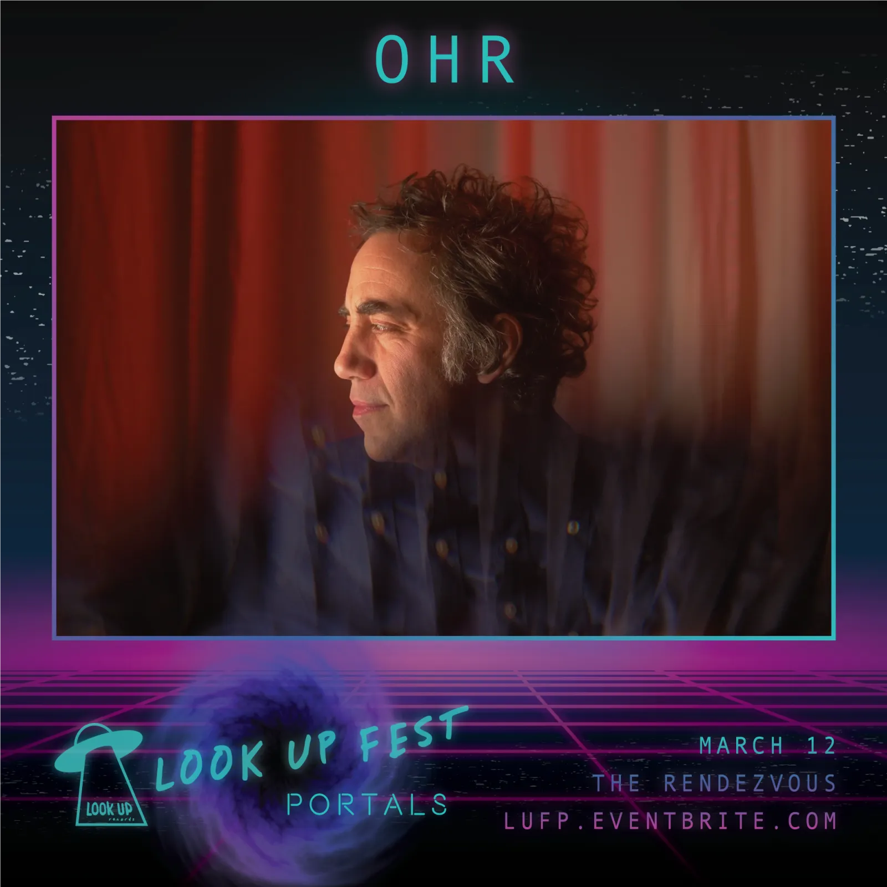<figcaption>Ohr From the opening celestial synth streams on the debut album by Ohr, followed by stacks of voices intoning from the void, one knows this is going to be a journey. On the double LP opus, "Walk in the Light," songs assemble and deconstruct out of existence, with backwards textures flowing in and out of the soulful, sun-gazing tunes. Recurring motifs appear and disappear throughout like dappled light through the forest canopy. There's clearly a directorial vision at work here, and behind the lense is Craig Klein, who wrote, produced and provided vocals and nearly all of the instruments on the 17 track album. Klein was formerly the main songwriter for Chicago art-rockers The Race.</figcaption></figure>

<figure>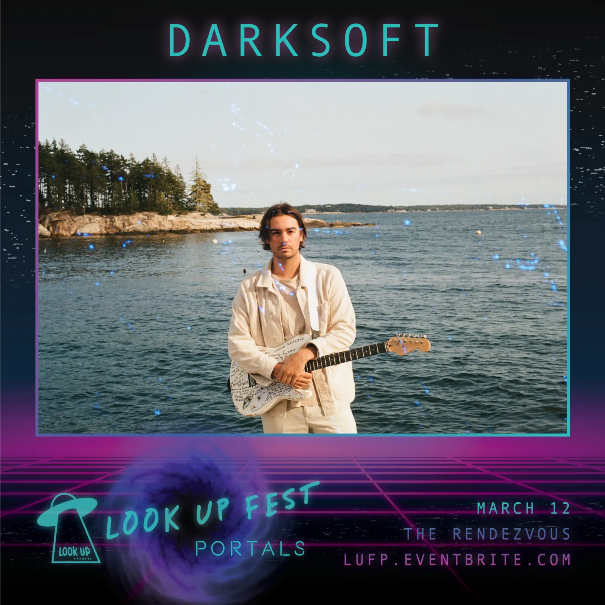<figcaption>Darksoft Darksoft is a multi-instrumentalist and songwriter, creating dreamy alternative rock sounds. Darksoft recently put out his third full-length album, Cryo (2022). Darksoft is supported live with a full band at shows. If given a portal, Darksoft would probably chase his shadow through some sort of fantasy forest.</figcaption></figure>

<figure>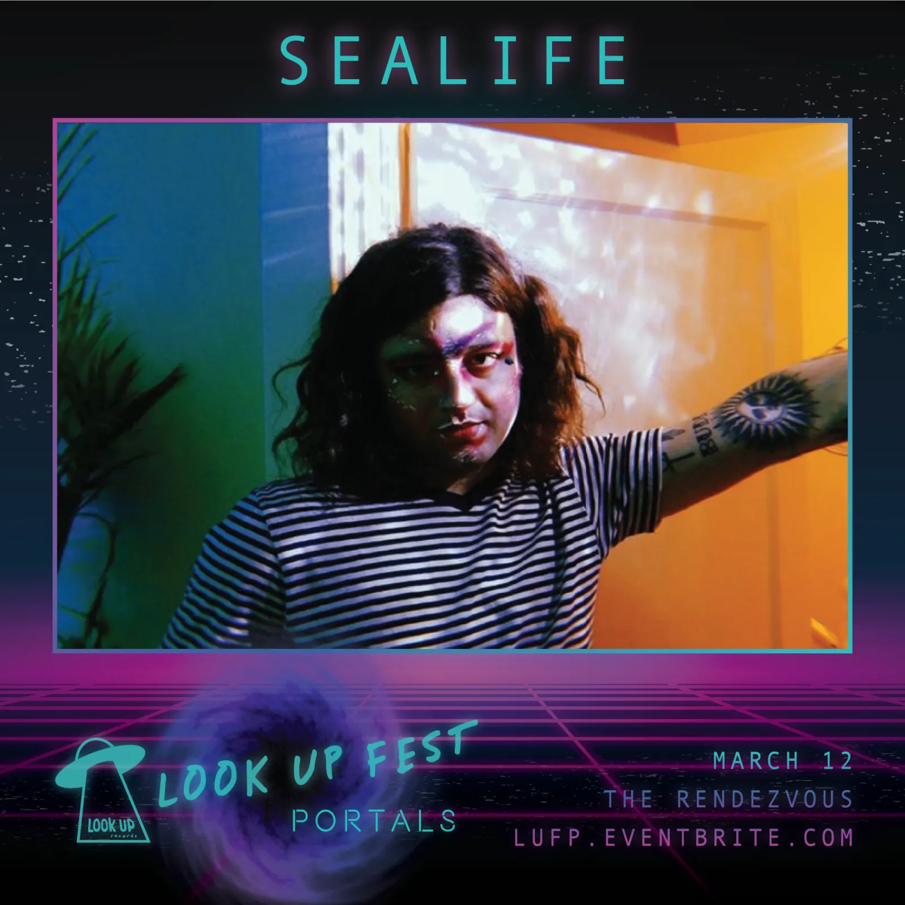<figcaption>Sealife Sealife brings love-coated psychedelic pop from Seattle straight to your heart. Their sonic storytelling paints a landscape of vulnerable lullabies. Originating from bedroom pop and stream-of-consciousness songwriting, Sealife pulls from Sade, Steely Dan, The Smiths, and others to craft lush sonic dreams. With a nod to Seattle grunge, Sealife is no stranger to fuzz or esoteric lyrics. Brennan Moring, lead for Sealife, also sings and plays keys for Seattle psych poppers Peyote Ugly.</figcaption></figure>

<figure>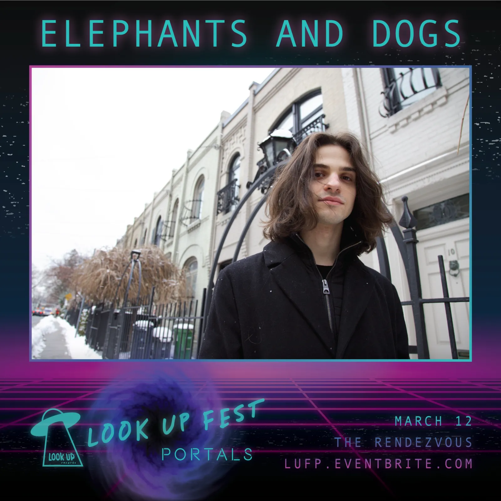<figcaption>Elephants and Dogs Led by Joe Narducci of Toronto, Elephants and Dogs is a syrupy trip of saturated melodies and chill dream pop arrangements. Joe got his start playing music in the clubs of Kingston, ON Canada, with his two bands Bo Welland and JIMBO. When Joe is not making music, he's looking at pictures of cute possums and raccoons on the internet. Look Up Released Elephants and Dogs’ debut EP ‘You Won’t Be Seeing Me Around’ in mid-2021.</figcaption></figure>

<figure>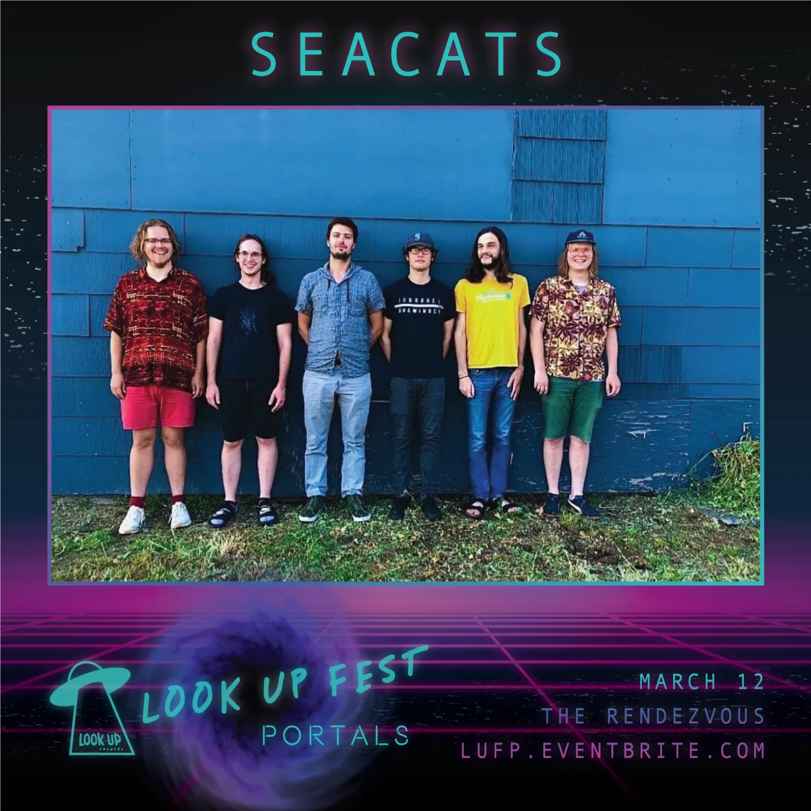<figcaption>Seacats Where would you like to portal? Seacats: “I love to portal in games so I guess I would like to play portal in VR. Also I would love to do a portal themed set, and I think I will likely do something to portal us to a time period. Perhaps I will portal during the set to the early 2000s and play some of that music in a partially ironic fashion that is gradually growing more earnest as I age. Also what’s up bill hope you are well.”</figcaption></figure>

<figure>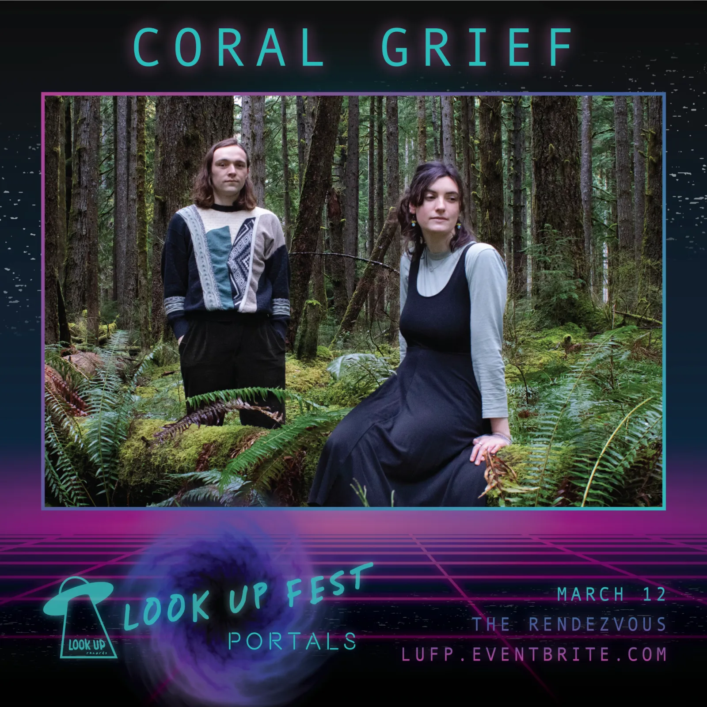<figcaption>Coral Grief Coral Grief is the Seattle-based dream pop project of Lena Farr-Morrissey and Sam Fason. Their debut self-titled EP was written and recorded by the band at home from March - August 2020 and released in May 2021 on Den Tapes. Since the reopening of many venues in July 2021, Coral Grief has established themselves as one of the most exciting up and coming acts in Seattle. With drummer Cam Hancock, the has played with acclaimed local bands like Versing and Somesurprises, and opened for touring acts such as Indigo De Souza.</figcaption></figure>

<figure>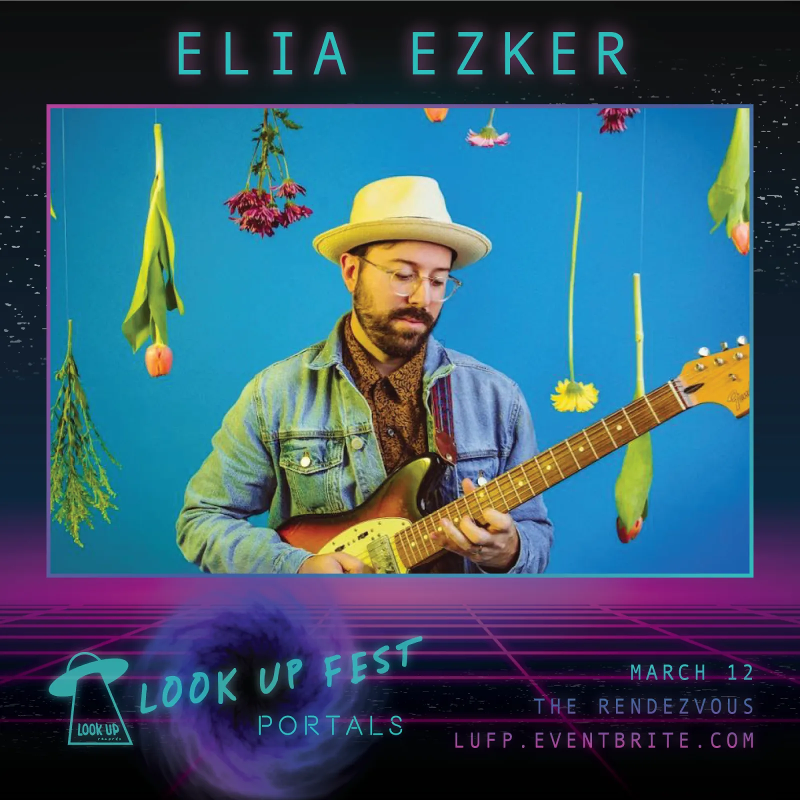<figcaption>Elia Ezker Ecuadorian singer-songwriter Elia Ezker has cut his teeth in the Seattle underground for nearly a decade, steadily morphing the rock band-anchored sound of his early releases in a more playful synth pop direction. The earnest, organic textures of 2014’s Sentir EP were stripped back even further on the soaring Futuro Humano, where Ezker alchemized raw grief into meditative, cathartic cuts like “Este Amor Es Del Más Puro” [“This Love Is Of The Purest Kind”]. While still introspective, teasers “Arcoíris” and “Flora” from his forthcoming sophomore LP glisten with sticky sweet synthesizers and newfound levity, hinting at a sunny new chapter in his career.</figcaption></figure>

## Also Featuring

<figure>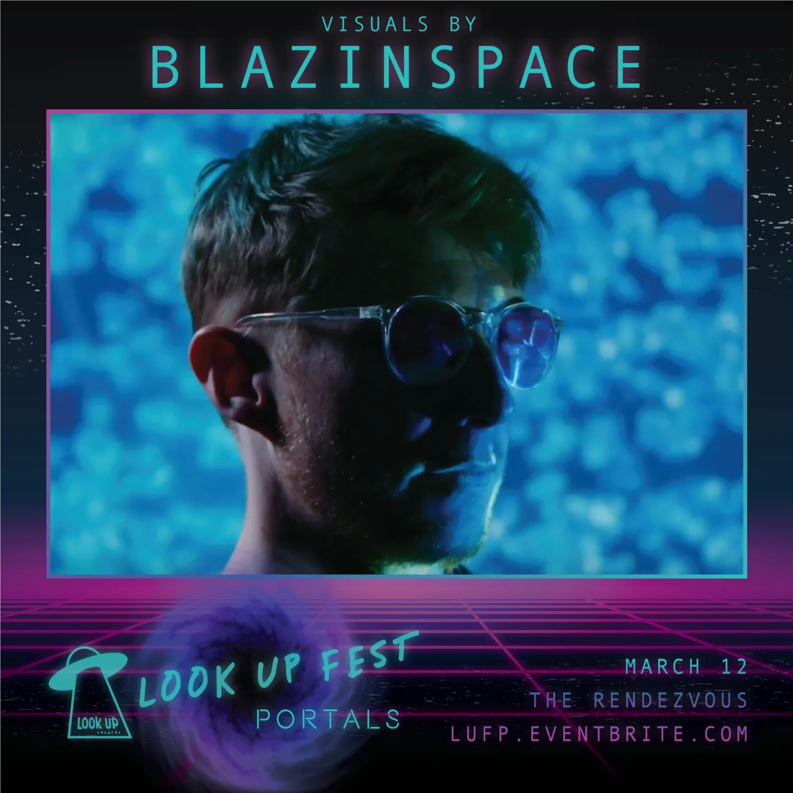<figcaption>Visuals by <strong>Blazinspace</strong> Blazinspace is a local VJ that creates great live visuals, music videos, and stories. At Look Up Fest: Portals they’ll set things ablaze, teleporting our minds with stunning projections.</figcaption></figure>

<figure>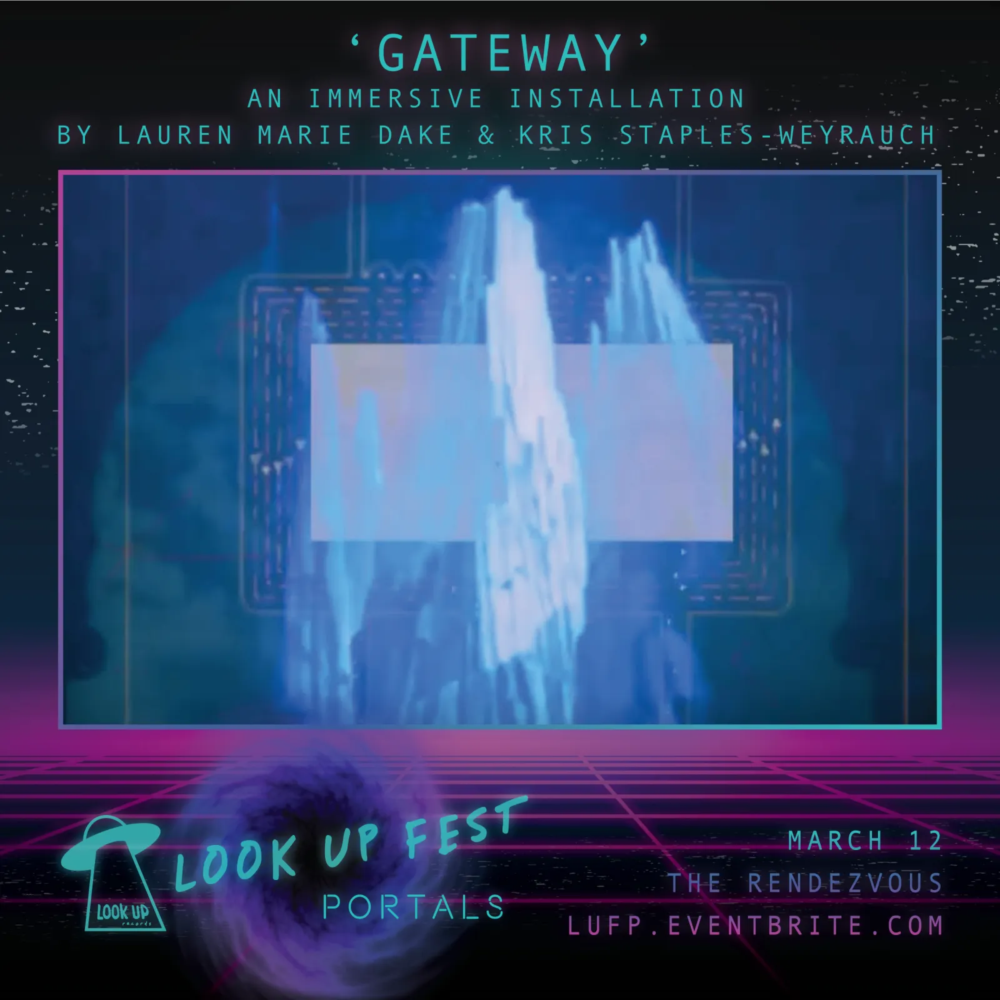<figcaption>‘<strong>Gateway</strong>’ Art Installation <strong>Lauren Marie Dake</strong> and <strong>Kris Staples-Weyrauch</strong> will be debuting their immersive Gateway installation for fest-goers to zone out in. Enter it for experiences around portals, chasms, openings, voids, and unknown places.</figcaption></figure>

<figure>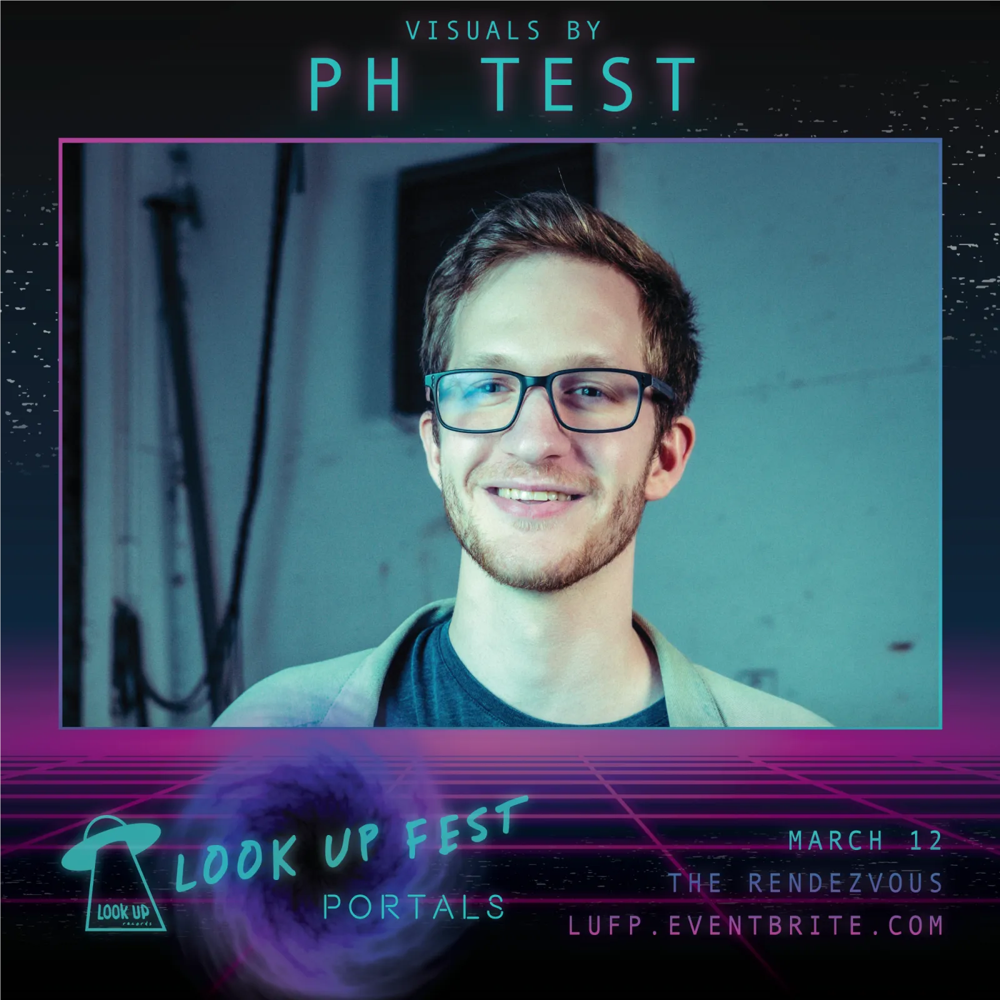<figcaption>Visuals by <strong>PH TEST</strong> PH TEST is handmade audiovisual creations by Phil Homan. At Look Up Fest: Portals, PH TEST will be lighting up the Grotto stage area with creative visuals.</figcaption></figure>

<figure><a href="https://emojipedia.org/large-green-square/">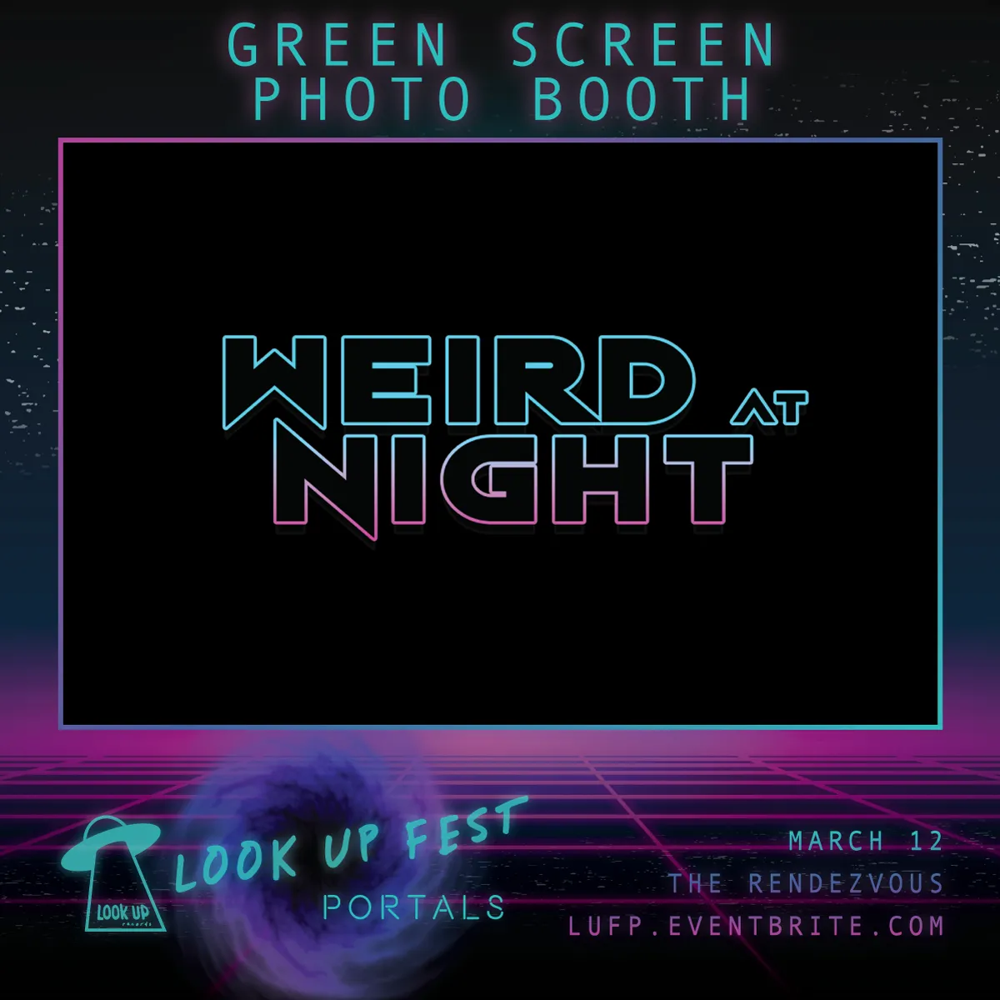</a><figcaption><a href="https://emojipedia.org/large-green-square/">🟩</a> Green Screen Photo Booth by<strong> Weird at Night</strong> At Look Up Fest: Portals, WEIRD at NIGHT will run a green screen photo booth that transports the visitor to the realm of their choice. WEIRD at NIGHT is a surreal, art share, live stream hosted by Patrick Galactic every Saturday at 10 pm PT. The show has four key principles: Time over money; People over profit; Art is the antidote; attack with Love. Visit weirdatnight.com for more details.</figcaption></figure>

<figure>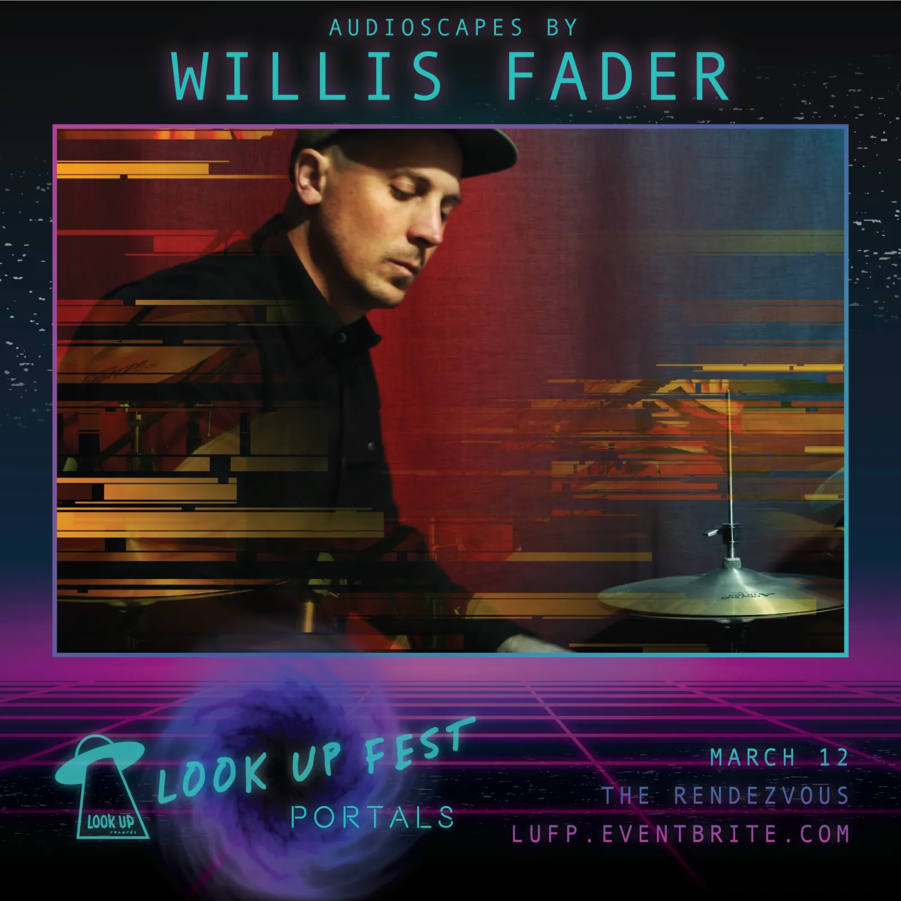<figcaption>Audioscapes by <strong>Willis Fader</strong> Between sets, we’ll be spinning transportive jams from none other than Willis Fader, your multidimensional audio-friend. Yes. That's right. Just chill. Think. Feel. Focus. Converse. Share moments with friends and loved ones. Let the sensuous beds of Willis Fader audioscapes enmesh your world.</figcaption></figure>

### media Partners

<figure>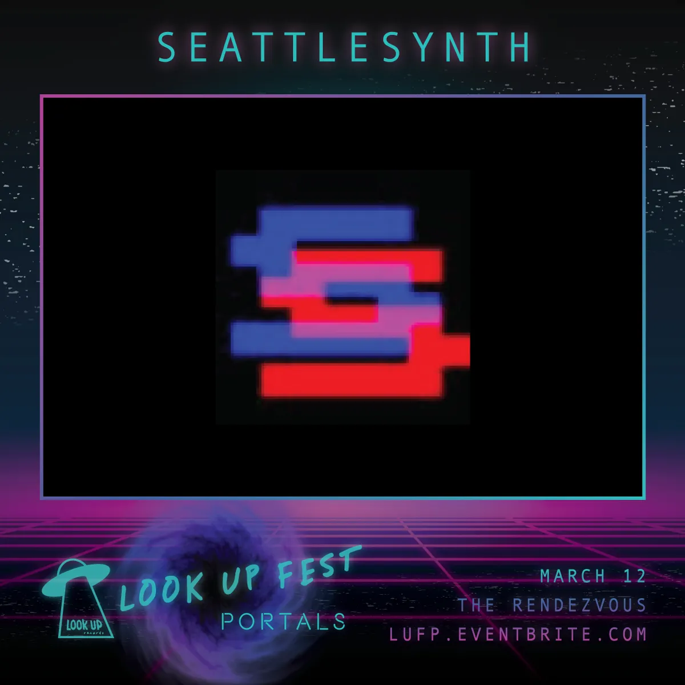<figcaption>SeattleSynth SeattleSynth is an electronic music resource for people to keep updated on concerts, local artists &amp; news. You can follow @SeattleSynth on Twitter and Instagram.</figcaption></figure>

<a class="button" href="https://twitter.com/seattlesynth">Twitter: @SeattleSynth</a>

<figure>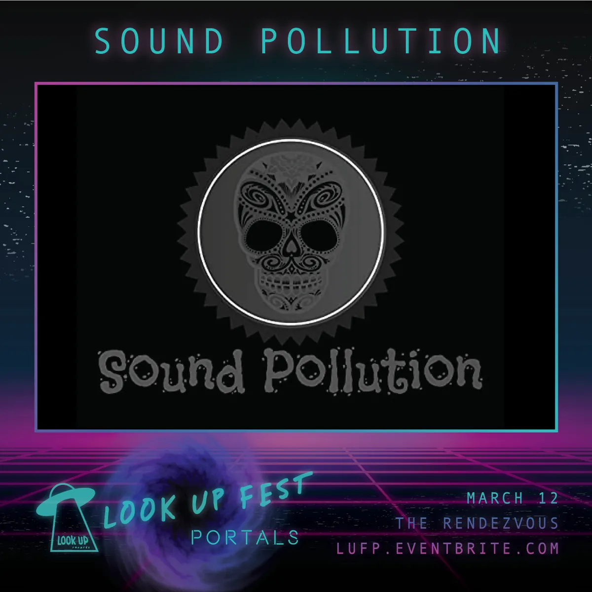<figcaption>Sound Pollution Sound Pollution is a podcast where independent musicians share their inspirations, songwriting processes, and upcoming projects/shows. Sound Pollution is your home for open conversations, awesome music, and maybe even a little advice from trailblazers in the field. Sound Pollution has interviewed a few Look Up artists to date.</figcaption></figure>

<a class="button" href="https://www.soundpollutionpodcast.com">About Sound Pollution</a>

**Musicians: Submissions are closed**

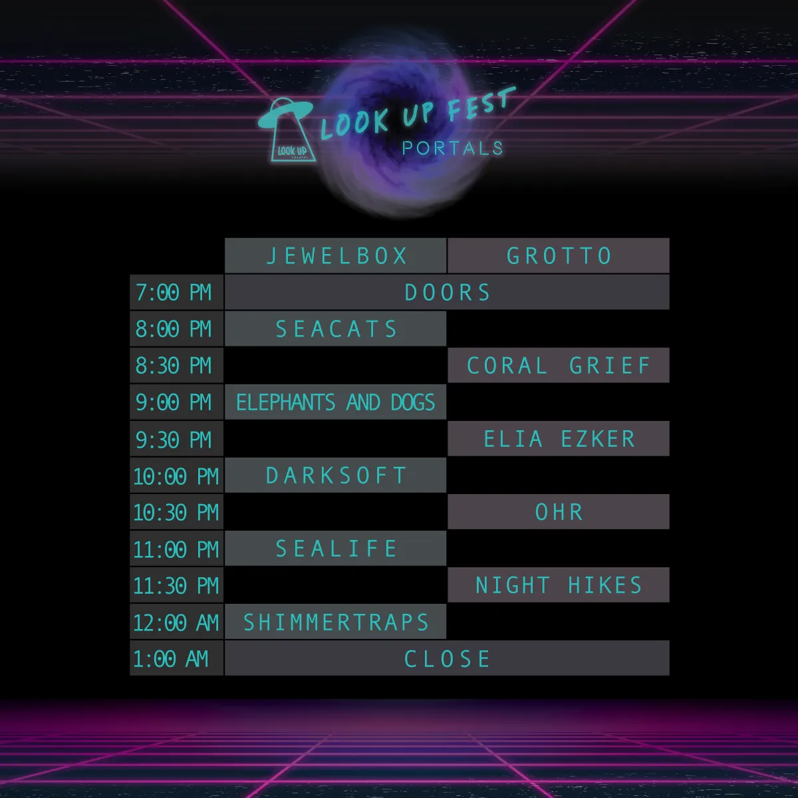

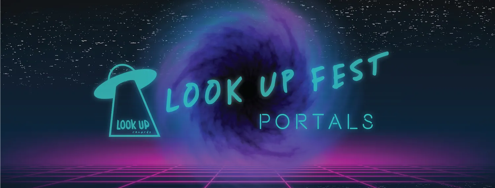

## ABOUT look up fest

Look Up Fest is a community-run single-day mini music festival that curates a lineup of indie musicians from the PNW and beyond. We started in 2018 and have since held three Look Up Fests at various venues in Seattle. In addition to great bands and electronic artists, each one of our events has had a unique theme, with live visuals, immersive installations, a photo booth, a fundraiser for a specific cause, and other surprises.

In addition to featuring artists from our label, we have always held open submissions for other bands. So far we've featured Hibou, Scott Yoder, Baja Boy, La Fonda, Moon Darling, Shimmertraps, Whitney Ballen, Antonioni, SHT GHST, Jupiter Sprites, Medejin, Peyote Ugly, Sea Salt, and others.

**All attendees, crew, volunteers, and artists are expected to follow our** [**Code of Conduct**](/code-of-conduct)**.**

### Mars

<iframe src="https://www.youtube-nocookie.com/embed/AE7Gtzm6dCo" title="YouTube embed" loading="lazy" allow="accelerometer; encrypted-media; gyroscope; picture-in-picture; web-share" referrerpolicy="strict-origin-when-cross-origin" allowfullscreen></iframe>

### Underwater

<iframe src="https://www.youtube-nocookie.com/embed/qKNYnysvJrQ" title="YouTube embed" loading="lazy" allow="accelerometer; encrypted-media; gyroscope; picture-in-picture; web-share" referrerpolicy="strict-origin-when-cross-origin" allowfullscreen></iframe>

### Paranormal

<iframe src="https://www.youtube-nocookie.com/embed/mFSAFWMkvx0" title="YouTube embed" loading="lazy" allow="accelerometer; encrypted-media; gyroscope; picture-in-picture; web-share" referrerpolicy="strict-origin-when-cross-origin" allowfullscreen></iframe>

