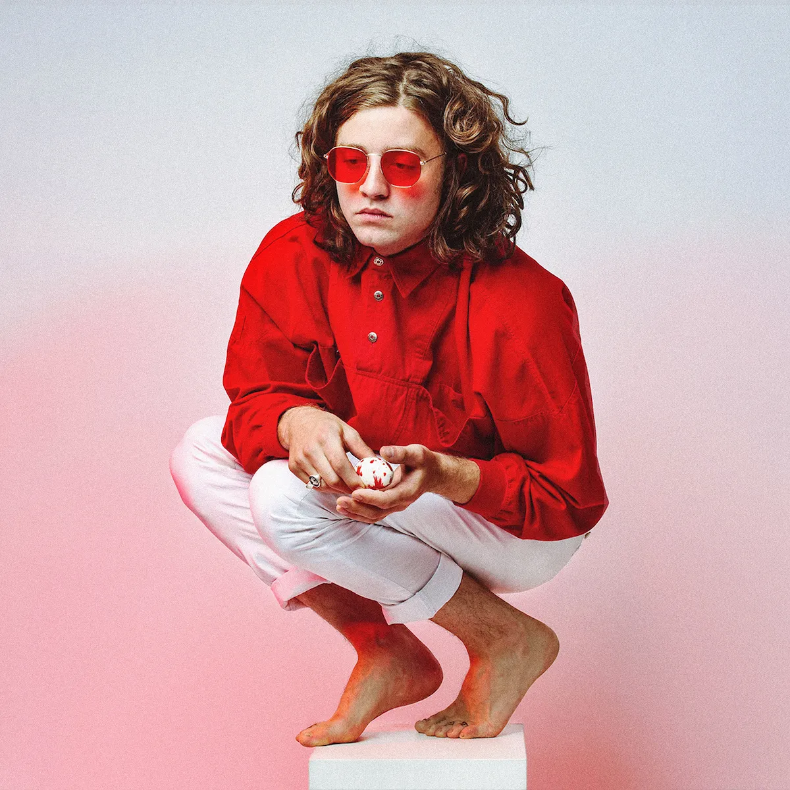
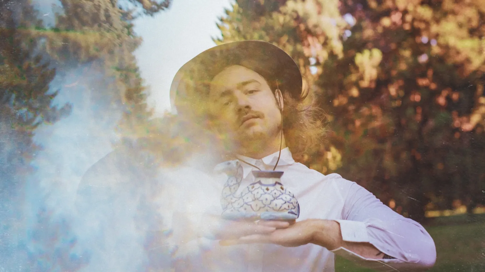
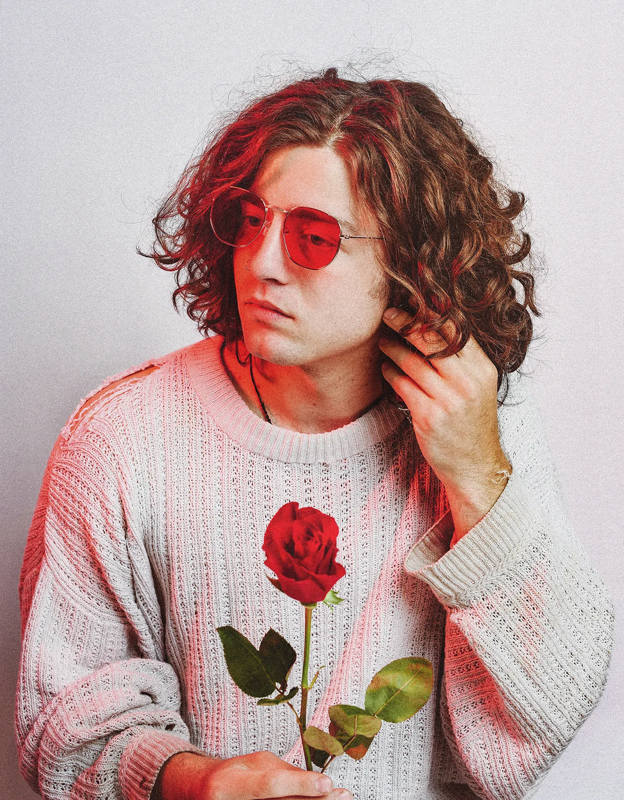
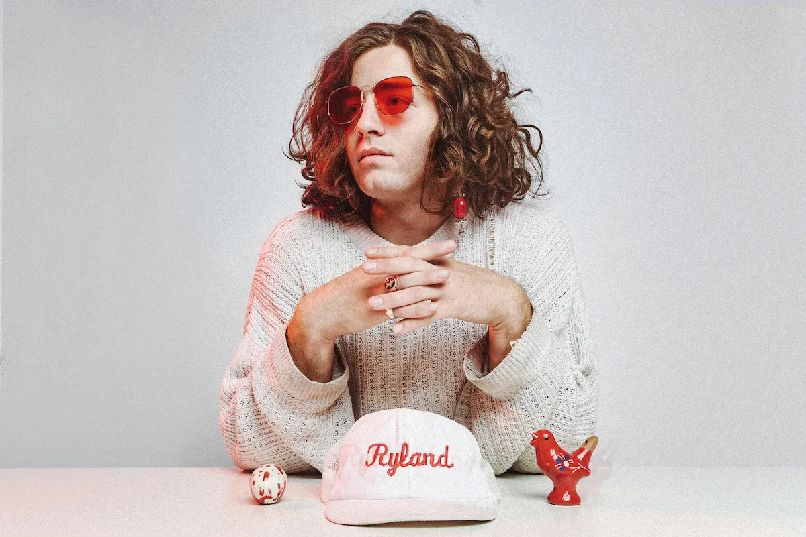
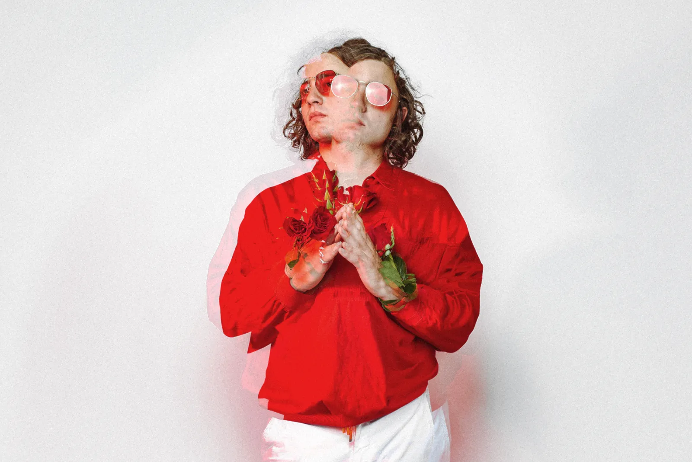
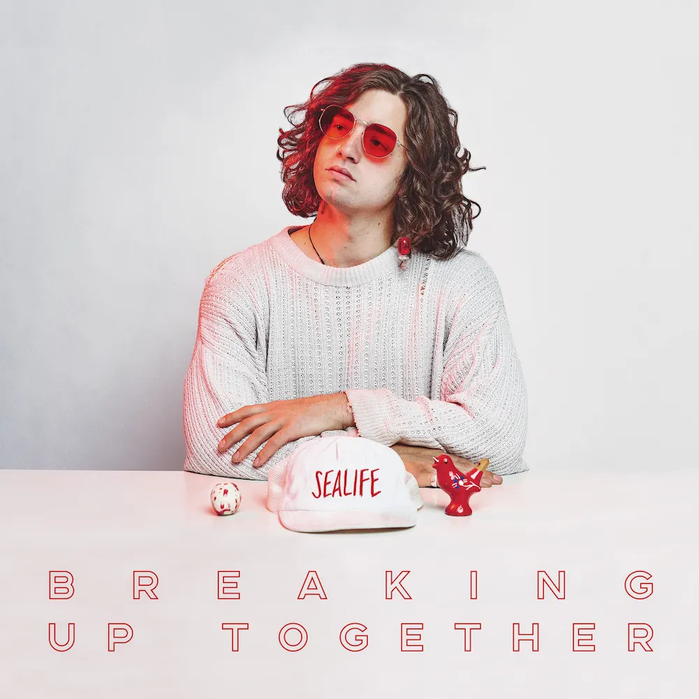
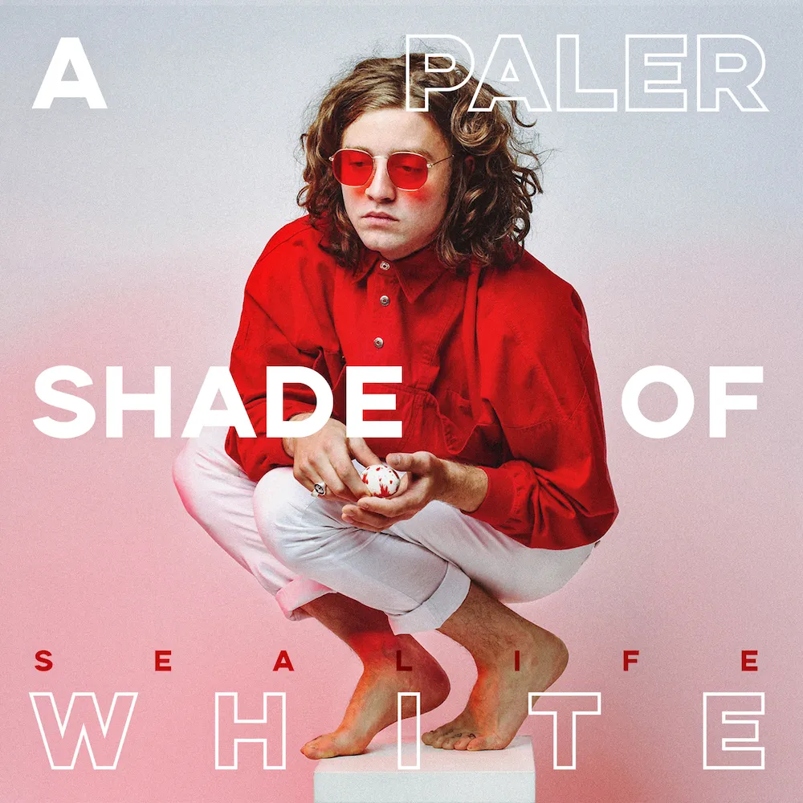
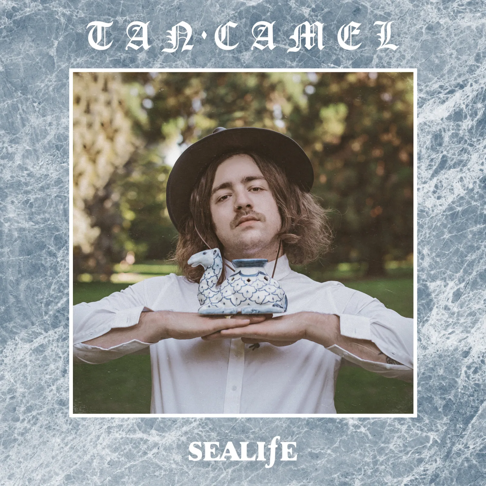
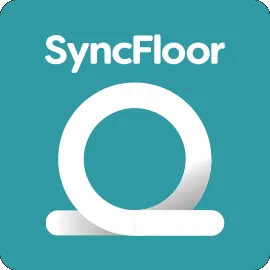

Sealife brings a love-coated psychedelic pop from Seattle straight to your heart. Sealife, a project led by Brennan Moring, tastefully meshes synth textures, bluesy rock, and folk.

### Releases

### Listen

[Amazon Music](https://www.amazon.com/Tan-Camel-Sealife/dp/B0847CMSN3) | [YouTube](https://music.youtube.com/channel/UCtVp_ZyJAt1V-GO6tLDZwOg) | [Spotify](https://open.spotify.com/artist/70hDlhAk9WX3XPtaCzarlx?si=Dlfe6sP4QLW2HpQ8FIX3yw) | [Apple Music](https://music.apple.com/us/artist/sealife/286570592) | [Bandcamp](https://sseeaalliiffee.bandcamp.com/) | [Deezer](https://www.deezer.com/us/artist/50583972)

### FOLLOW

[Twitter](https://twitter.com/sseeaalliiffee) | [Instagram](https://www.instagram.com/sseeaalliiffee_/) | [Facebook](https://www.facebook.com/sseeaalliiffee)

>  Breaking Up Together sways at exactly the right pace, and every second of it is masterfully produced 
>
> — Max	Schoenfeld

### Bio

Sealife brings love-coated psychedelic pop from Seattle straight to your heart. Their sonic storytelling paints a landscape of vulnerable lullabies. Originating from bedroom pop and stream-of-consciousness songwriting, Sealife pulls from Sade, Steely Dan, The Smiths, and others to craft lush sonic dreams. With a nod to Seattle grunge, Sealife is no stranger to fuzz or esoteric lyrics.

Brennan Moring, lead for Sealife, also sings and plays keys for Seattle psych poppers [Peyote Ugly](https://peyoteuglyseattle.bandcamp.com/). Brennan began writing poetry and playing guitar at an early age, but after learning piano, he began a conquest for total instrumental control in his songwriting and storytelling. Now, with Sealife, he’s writing love songs from the perspective of the ghost that quietly waits up for you at night.

<iframe src="https://www.youtube-nocookie.com/embed/DqwBUs_9i-Y" title="YouTube video" loading="lazy" allow="accelerometer; encrypted-media; gyroscope; picture-in-picture; web-share" referrerpolicy="strict-origin-when-cross-origin" allowfullscreen></iframe>

<iframe src="https://www.youtube-nocookie.com/embed/6KwLVFFEWz0" title="YouTube video" loading="lazy" allow="accelerometer; encrypted-media; gyroscope; picture-in-picture; web-share" referrerpolicy="strict-origin-when-cross-origin" allowfullscreen></iframe>

<iframe src="https://www.youtube-nocookie.com/embed/a5GMAEeVuPw" title="YouTube video" loading="lazy" allow="accelerometer; encrypted-media; gyroscope; picture-in-picture; web-share" referrerpolicy="strict-origin-when-cross-origin" allowfullscreen></iframe>

<iframe src="https://www.youtube-nocookie.com/embed/PDTBiVudn4k" title="YouTube video" loading="lazy" allow="accelerometer; encrypted-media; gyroscope; picture-in-picture; web-share" referrerpolicy="strict-origin-when-cross-origin" allowfullscreen></iframe>

### Sync Licensing

Want to use a Sealife song in a pdocast, film, or ad? Rad! You can easily license the rights with SyncFloor:

<figure></figure>

### Radio

Are you a radio DJ wanting to play Sealife? [Contact Us](/about) for a free MP3 download link.

### Press

- Sounds: Sealife // Breaking Up Together - LeftBankMagazine
- [Sealife “2 Night Stand”](https://web.archive.org/web/20191118004451/https://itsnotrecords.com/2018/10/01/sealife-2-night-stand/)
- [Comeherefloyd](https://web.archive.org/web/20181102044717/http://comeherefloyd.com:80/2018/10/415-indie-fascination-messimer-isadora-eden-andrew-lipow-kites-with-lights-destroy-boys/)
- [[REVIEW] Sealife // Beat Queen (5 Minute Album)](https://web.archive.org/web/20210116143858/https://leftbankmag.com/2020/09/13/sounds-sealife-beat-queen-5-minute-album/)
- [Sounds: Sealife // Night Flower [official video]](https://web.archive.org/web/20210121181541/https://leftbankmag.com/2020/05/19/sounds-sealife-nightflower/)
- [Photo story: SWYM, Sealife, Darksoft, Daycones](https://danstunesseattle.com/2018/12/24/photo-story-swym-sealife-darksoft-daycones/)
