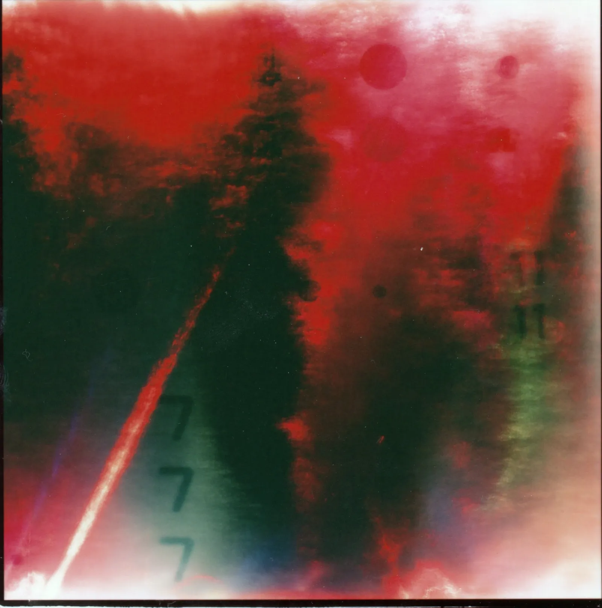
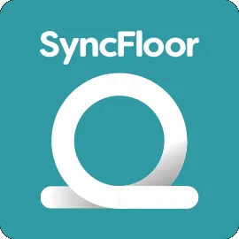

### Listen

[Spotify](https://open.spotify.com/album/5zjLHlEGpfsMOLODDKoIP2?dl_branch=1&si=5Fj0z_-gQHmXN5Fdk5hCUQ) | [Apple Music](https://music.apple.com/us/artist/sightings/1572499902) | [Bandcamp](https://sightingsmusic.bandcamp.com/album/sightings) | [YouTube](https://www.youtube.com/watch?v=uBUzflBSI8k) | [Soundcloud](https://soundcloud.com/lookuprecords/sets/sightings)

Combining freeform jazz and indie pop, Sightings’ lush instrumental tunes are like a mellow weekend on Mars.

### Releases

>  like a mellow weekend on Mars 
>
> — sp

<iframe src="https://www.youtube-nocookie.com/embed/uBUzflBSI8k" title="YouTube embed" loading="lazy" allow="accelerometer; encrypted-media; gyroscope; picture-in-picture; web-share" referrerpolicy="strict-origin-when-cross-origin" allowfullscreen></iframe>

<iframe src="https://www.youtube-nocookie.com/embed/9DH3YW5d5jY" title="YouTube embed" loading="lazy" allow="accelerometer; encrypted-media; gyroscope; picture-in-picture; web-share" referrerpolicy="strict-origin-when-cross-origin" allowfullscreen></iframe>

### Bio

Sightings’ lush instrumental tunes fuse freeform jazz and indie pop. Good for playing in the background at the beach or while you scan the night sky for strange lights.

Released on World UFO Day, July 2, 2021, Sightings’ debut self-titled 5-song EP delivers 20 minutes of warm themes. This chillwave cherry-picks some classic hip-hop beats, dream-pop guitars, overlaid with smooth jazz tones that feel abducted from some mall of the ‘90s. Some moments, like in Revelations, presents sparse flashes of shooting stars. The record ends with Greys, which almost sounds like a lost Tears for Fears instrumental.

The Sightings EP was inspired by a larger batch of demos recorded in the Summer of 2016 throughout a weeklong haze of alone late-night early AM studio recordings. This mini-album was then rediscovered and recut by Darksoft in the Spring of 2021. It was mixed and mastered by Living Fang Audio (stacking pennies), who offered an amazing helping hand.

### NEWS

### Sync Licensing

Want to use a Sightings song in a podcast, film, or ad? Rad! You can easily license the rights with SyncFloor:

<figure></figure>

### Radio

Are you a radio DJ wanting to play Sightings? [Contact Us](/about) for a free download link.

### Press

- Coming soon
