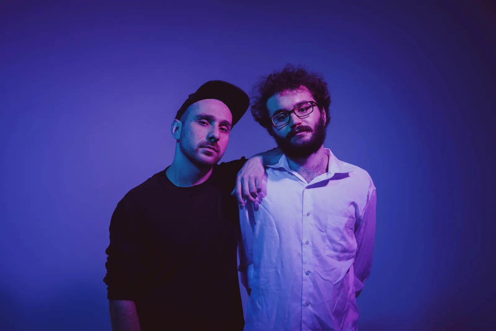
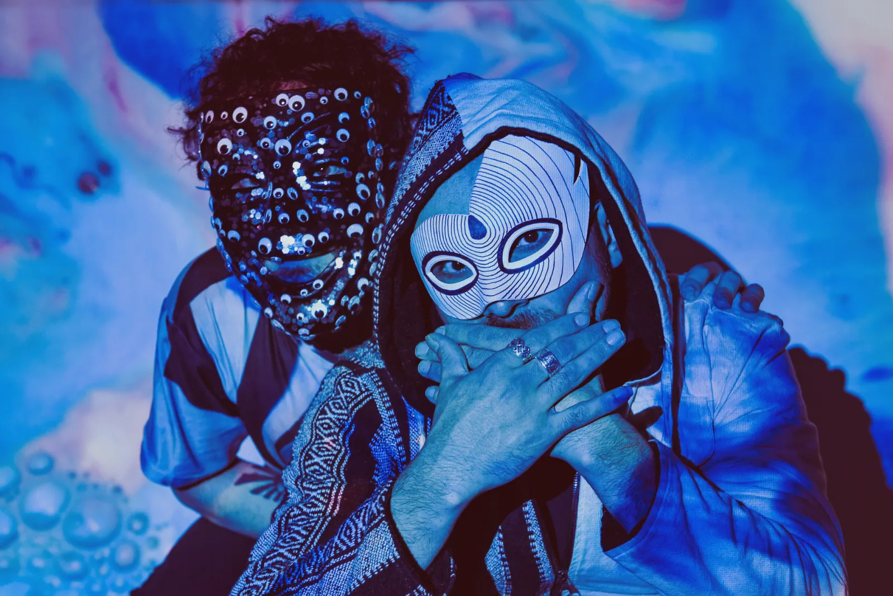
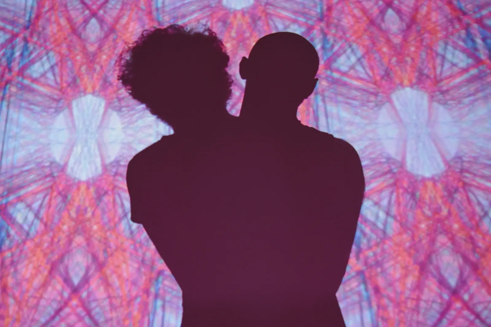
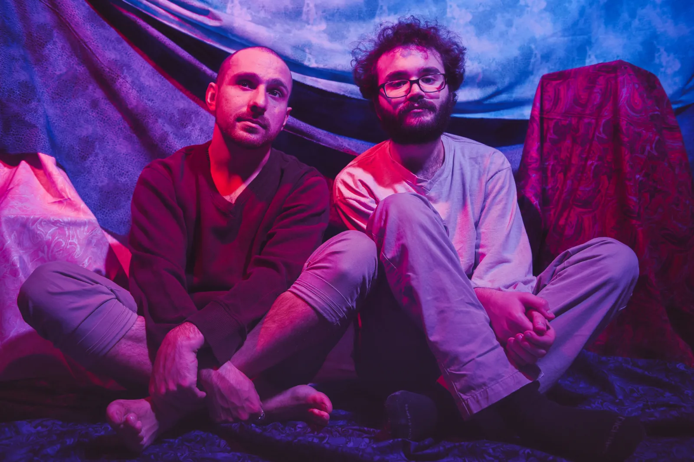
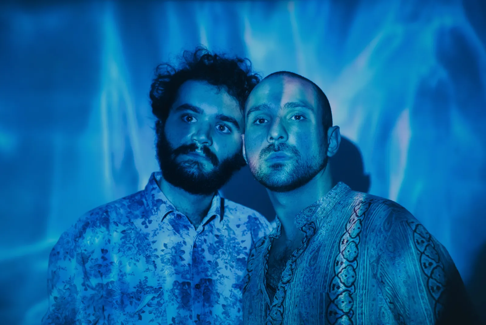
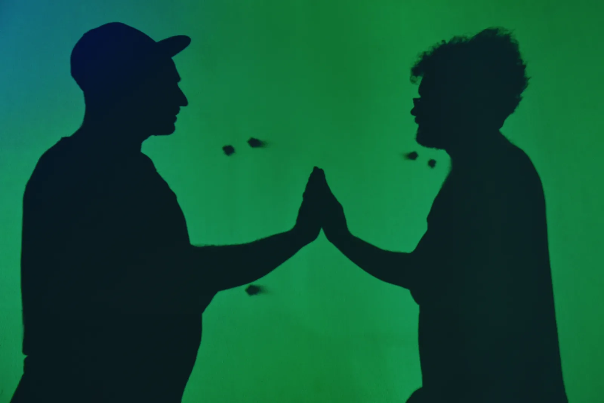
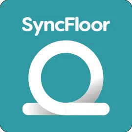

Alt-psych rock duo SWYM brings swirling delays, stratospheric reverb, and phase-shifted everything. Get ready to get lost, submerge into a sonic sea and float away into the void.

### Releases

### LISTEN

[Spotify](https://open.spotify.com/artist/0zEVFsgknDLxViwtwczNkE) | [Apple Music](https://music.apple.com/us/artist/swym/1330665433) | [Bandcamp](https://swym.bandcamp.com/) | [Amazon Music](https://www.amazon.com/gp/product/B07KYVLVWK) | [YouTube Music](https://music.youtube.com/playlist?list=OLAK5uy_kHslJZ68i_buc2q5Oia_Yz1JBr7dnY6wI)

### FOLLOW

[Twitter](https://twitter.com/SWYMMERS) | [Instagram](https://www.instagram.com/SWYMMERS/) | [Facebook](https://www.facebook.com/SWYMMERS)

>  Mirror Box is a lo-fi streaked daydream from the kaleidoscopic duo SWYM 
>
> — MAX SCHOENFELD

### Bio

SWYM is the manifestation of Jesse Holden and Ryan Brum in sonic form. Since meeting in high school during the late 2000s the duo has evolved from their jazz & folk roots to swirling, dreamy psychedelic rock.

Originating from Somerville, Massachusetts, SWYM’s journey has taken them across the country — quite literally through the mid-west, where they traipsed through the cornfields of Nebraska, mountains of Colorado, and forests of Utah. As an ultimate vessel of reflection, Mirror Box was borne from that adventure. Now settled amongst the cloudy backdrop of the Pacific Northwest, SWYM will continue to meld their visions with their follow up EP, Strange Hallucinations.

On Strange Hallucinations (2019), get ready to get lost, submerge into a sonic sea and float away into the void. Strange Hallucinations is SWYM's latest visionary voyage into the realms of consciousness; where self-reflection stems from loss; where timid love blooms; where everything is just being.

*"Live from orbit and direct to tape, Mirror Box is a lo-fi streaked daydream from the kaleidoscopic duo SWYM. If Galaxie 500 and Boards of Canada took a time-trip back to the ’70s together, Mirror Box gives you a window into what those sessions might sound like,"* - Max Schoenfeld, Look Up Blog.

### SYNC LICENSING

Want to use a SWYM song in a pdocast, film, or ad? Rad! You can easily license the rights with SyncFloor:

<figure></figure>

### RADIO

Are you a radio DJ wanting to play SWYM? [Contact Us](/about) for a free MP3 download link.

### Press

- [REVIEW: "MIRROR BOX" BY SWYM](/blog/review-mirror-box-swym-album)

- [REVIEW: "ANAMNESIS " BY SWYM](/blog/review-anamnesis-by-swym)
