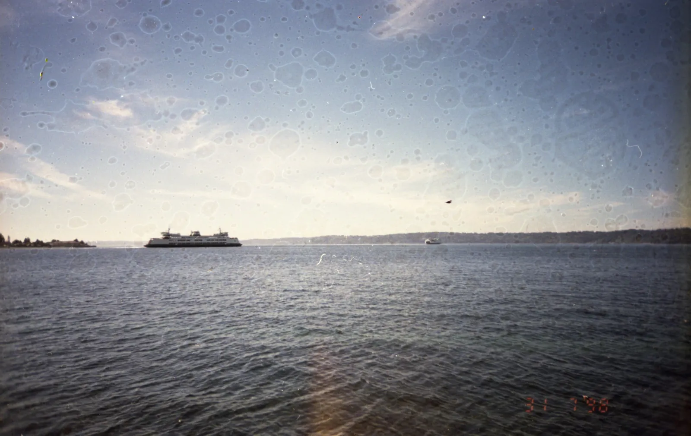

For new bands **touring** through Seattle, it can be a little hard to break into. Maybe it’s the "Seattle freeze" or just too many band requests for bookers to handle. Have no fear though, there's a lot of stages throughout the city, and some cool folks may actually want to host your band.

With the growth of the city and the growing number of **small-medium sized venues** that cater really well to emerging bands, it's becoming easier to add Seattle to a **West Coast** tour; you just need to know who to ask.

Check out our list of small "**underground" venues** that could be perfect additions to a DIY tour. These **15 small to medium Seattle music venues** are generally easy to book with, and are all in the **50-200 attendee** capacity range.

## Substation

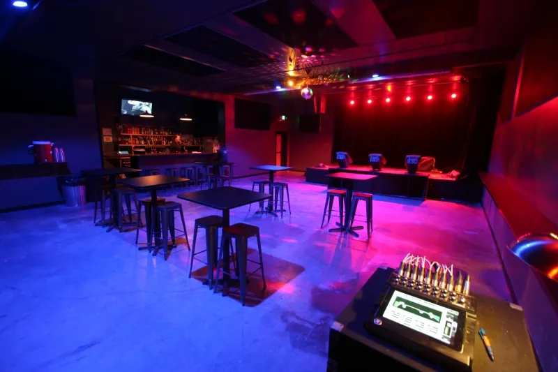

Located in Ballard, [Substation](http://www.substationseattle.com/) is a venue that brings in a diverse assortment of music, from indie, electronic, hip-hop, metal, etc. It's got a surprisingly quality sound system. The stage area, intimate vibe, and bar makes it a good place to showcase your project for the 21+ crowd. They also have 2 stages and another side room for varying crowd sizes. The bookers are supportive of emerging talent. The only downside is location is off, making this especially difficult to pull an audience to.

Booking: [booking@substationseattle.com](mailto:booking@substationseattle.com)

* * *

## Timbre Room

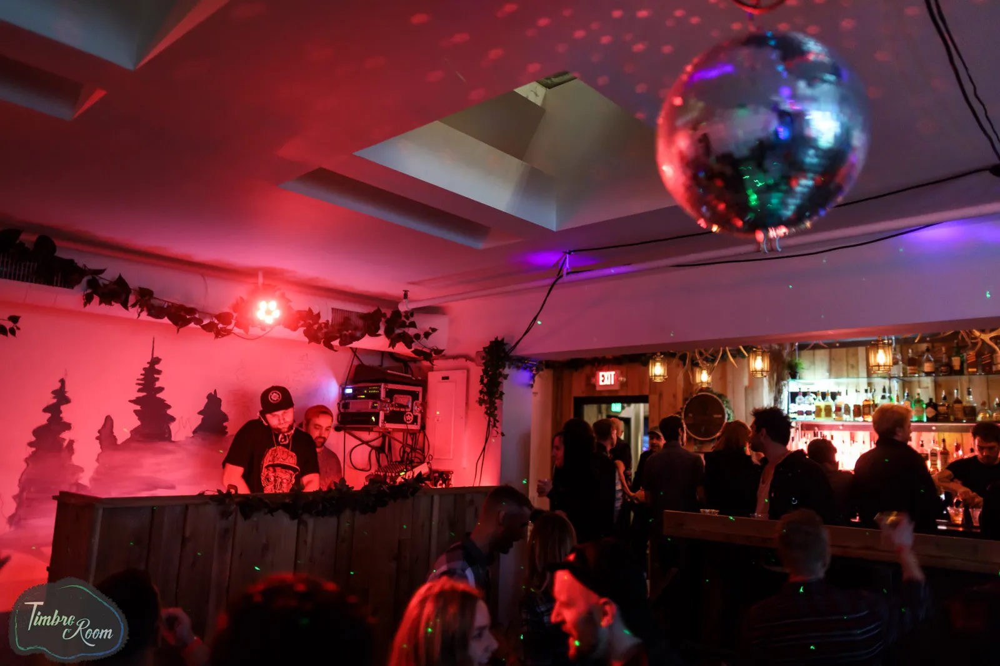

The [Timbre Room](http://www.timbreroom.com/) feels juxtaposed in the Denny Triangle / South Lake Union tech complex hi-rises, but it's another space to consider. It's a new venue, with a small stage overlooking an intimate reflective listening room. It's located above Kremwerk, a popular electronic/goth scene. "Timbre" is pronounced like 'tamber' and has nothing to do with logging.

Booking: [nick@kremwerk.com](mailto:nick@kremwerk.com)

* * *

<a class="button" href="/blog/how-to-self-release-your-album">Also read: how to self-release your album</a>

* * *

## Lo-Fi

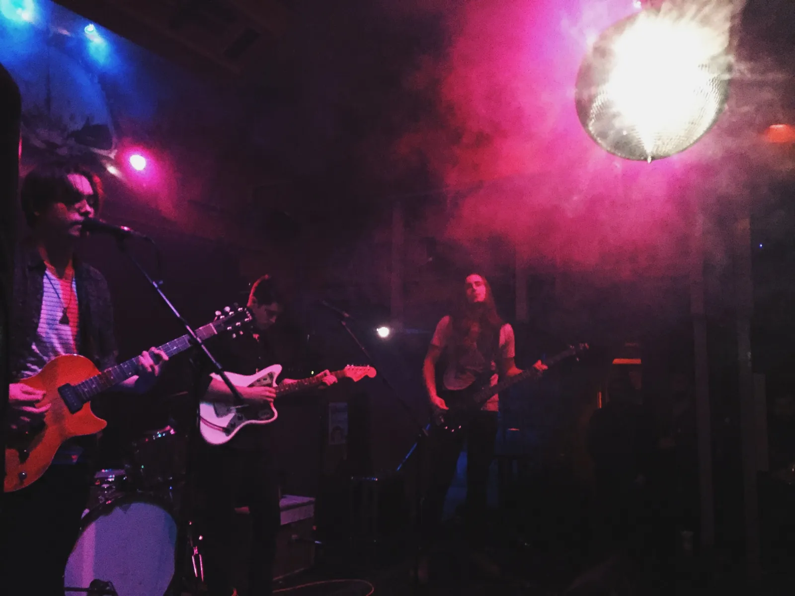

[Lo-Fi Performance Gallery](http://thelofi.net/) is a frequent spot for indie touring groups. Events here are often listed in [The Stranger](http://www.thestranger.com/). The sound is wide, the stage is elevated, and the venue has high ceilings and an upstairs viewing area. If you don't have a draw for the main stage, no sweat, they often host shows in the front room bar too.

For bookings contact Scott: scott@thelofi.net[t@gmail.com](mailto:introcut@gmail.com)

Or Mamma Casserole: cometbooking@gmail.com

* * *

<figure><a href="https://elasticstage.com/es/referral/3YJ57FIV">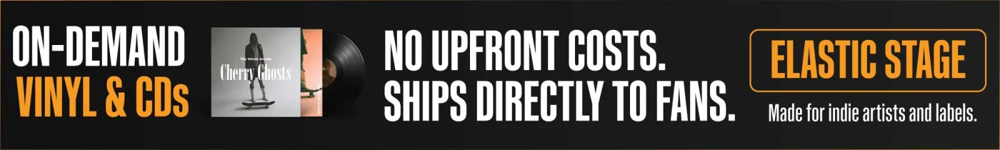</a><figcaption><a href="https://elasticstage.com/es/referral/3YJ57FIV"><strong>Elastic Stage</strong></a> lets indie artists sell vinyl with no upfront costs, inventory, or shipping. <a href="https://elasticstage.com/es/referral/3YJ57FIV"><strong>We use it and recommend it</strong></a>.</figcaption></figure>

## Barboza

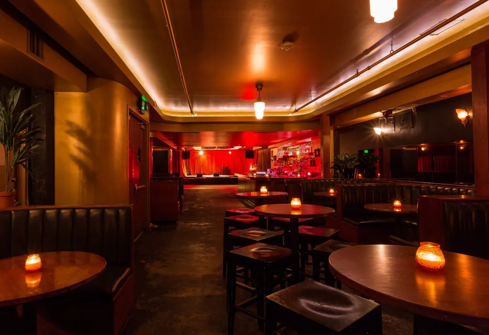

[Barboza](https://www.thebarboza.com/) is a venue located under the iconic Neumos. It's operated by the same crew, who put on amazing live shows with pristine sound. The room is smaller than Neumos upstairs, that being said, it's still a higher capacity space than others on this list, so judge accordingly. Weekend band shows typically end early here, to make way for the moneymaking dance nights.

National bands seeking holds: eli@neumos.com

Local bands seeking holds: evan@neumos.com

* * *

<figure><a href="https://www.atomicdisc.com?bg_ref=is13kGgPQR">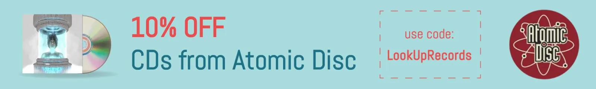</a><figcaption>Get 10% off CD or merch orders with <a href="https://www.atomicdisc.com/?bg_ref=is13kGgPQR"><strong>AtomicDis</strong>c</a> using our code <a href="https://www.atomicdisc.com/?bg_ref=is13kGgPQR"><strong>LookUpRecords</strong></a>.</figcaption></figure>

* * *

## The Sunset

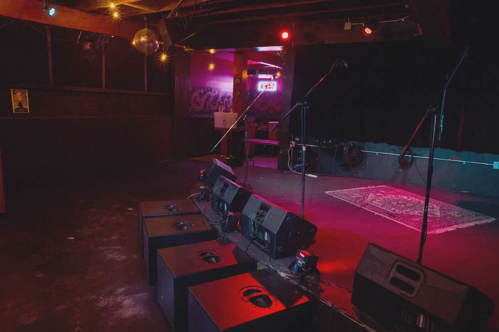

[The Sunset Tavern](http://sunsettavern.com/), in Ballard, has been doing shows since 2000. One of my favorite spots, it hosts many local showcases and occasionally touring bands. The sound guys do a great job here! The space feels intimate but can sound huge. A door separates the front bar from the stage area, adding to the showcase vibe. Since it’s a bar as well, The Sunset receives a little foot traffic. Good experiences with bookers here.

[BOOKING GUIDELINES](http://sunsettavern.com/booking/) - booking@sunsettavern.com

* * *

<a href="https://www.atomicdisc.com?bg_ref=is13kGgPQR">Get 10% off at Atomic Disc for CDs &amp; Vinyl</a>

* * *

## Chop Suey Lounge show

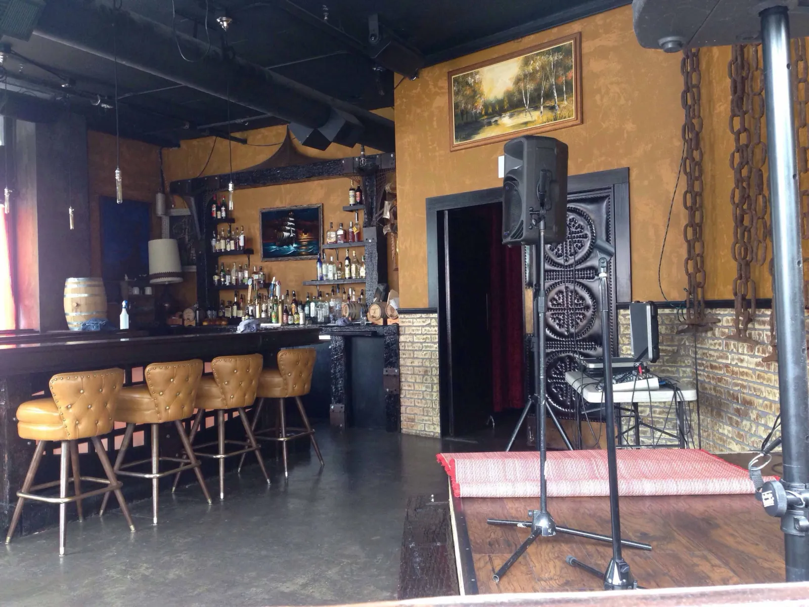

[Chop Suey](https://www.chopsuey.com/) is a larger capacity venue with diverse taste. They host DYC, a big dance night ever Saturday. They’re trying to keep the indie band thing alive with some sidebar lounge shows. It’s rare, but occasionally they open the main stage to DIY bands for shows that reach a certain # of event RSVPs.

Booking: [booking@chopsuey.com](mailto:booking@chopsuey.com)

* * *

## Cafe Racer

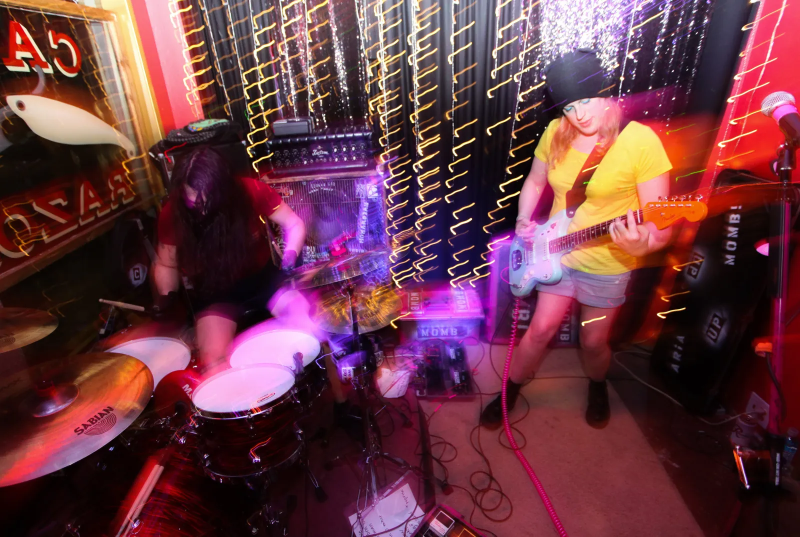

[Cafe Racer](https://www.caferacerseattle.com/) is a small quirky cafe. An “iconic surviving art bar,” Cafe Racer has an intimate, chill vibe. It’s somewhere where a hipster band might have a debut tape release for 15 friends or so. 70s velvet wall art, Super Mario Bros in a loft lit with Christmas lights, and more make Cafe Racer a sweet spot.

hello@caferacerseattle.com - [Booking request form](https://www.caferacerseattle.com/show-or-event-request)

* * *

## Tim’s Tavern

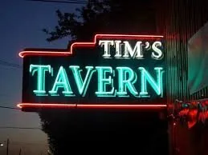

[Tim’s Tavern](https://timslivemusic.com/) is a local hang for the folks of north Greenwood. It’s a dive bar, with nightly local music on a small stage that is a tight fit for a 3-piece band. It’s got an outdoor patio and friendly staff.

[BOOKING](https://timslivemusic.com/contactbooking)

* * *

*Hot tip:* ***Radio promotion*** *can be a great addition to your tour. I highly recommend working with* ***Pirate!*** *for college & community radio promo.*

[***Contact Steve Theo (steve at piratepirate dot com) from Pirate! to learn more.***](mailto:steve@piratepirate.com?subject=Reaching%20out%20about%20radio%20promo%2C%20referred%20by%20Look%20Up&body=Hi%20Steve%2C%20I%20heard%20about%20Pirate!%20on%20the%20Look%20Up%20blog%20and%20am%20curious%20to%20know%20more%20about%20your%20services.%20Thank%20you!&cc=bill%40look-up-records.com) ***Say Look Up sent ya, and they’ll treat you well.***

* * *

## The HighDive

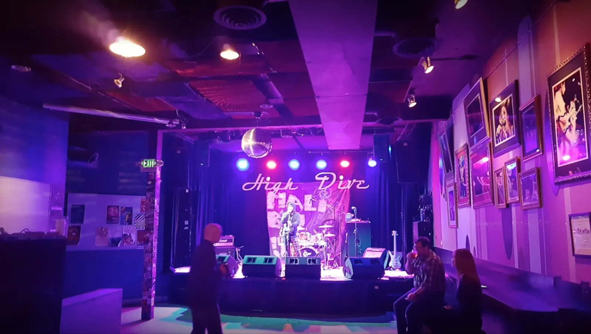

The [HighDive](https://www.highdiveseattle.com/), in Fremont, is pretty well-established as a venue for local bands. Out of towners may have some luck here too as capacity isn't that large. They bring in a wide variety of genres, and are a featured venue in [Do206.com](http://do206.com/)

Booking: [kimo.highdivebooking@gmail.com](mailto:kimo.highdivebooking@gmail.com)

* * *

## The Central Saloon

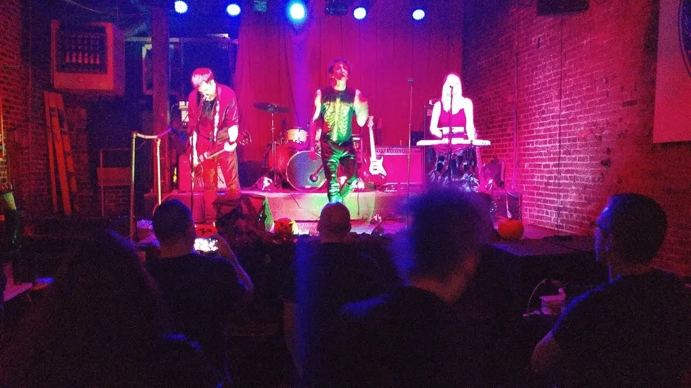

Lately, The [Central Saloon](https://www.centralsaloon.com/) has really impressed me! They renovated the stage and it looks and sounds great. Central Saloon wins for tallest stage on my list. Central Saloon also may be the **only venue/bar with a built in audience in Seattle**. It’s historic too. All the 90s grungers played here and they have posters to prove it. Central is at the heart of Pioneer Square, a touristy neighborhood and close to sports stadiums. So, the crowd is diverse. Good nights here!

[CONTACT](https://www.centralsaloon.com/contact)

* * *

## Clock-out lounge

I haven’t played here yet, but the space is cool. It’s a new(ish) pizza bar and event space. They host a lot of drag, comedy, gear sales, and trivia nights, and also put on shows with local bills, and occasionally host touring acts. Love that logo. Location may be difficult to pull to.

[BOOKING REQUEST FORM](https://www.clockoutlounge.com/booking/) - booking@clockoutlounge.com

* * *

## The Highline

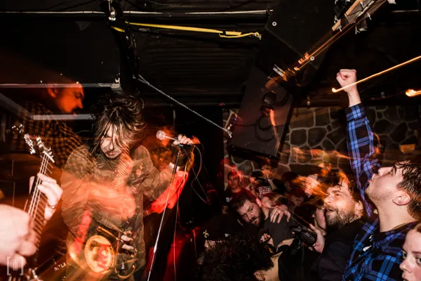

[The Highline](https://www.highlineseattle.com/) is a common destination for out-of-towners. With a professional sound system, it often caters to hard metal and punk, but I've also seen electronic, indie, and shoegaze present too. There’s also a militant vegan attitude. Situated in the heart of Capitol Hill, the Highline is in a decent location.

Booking: [highlinevolume@gmail.com](mailto:highlinevolume@gmail.com)

* * *

## Vermillion

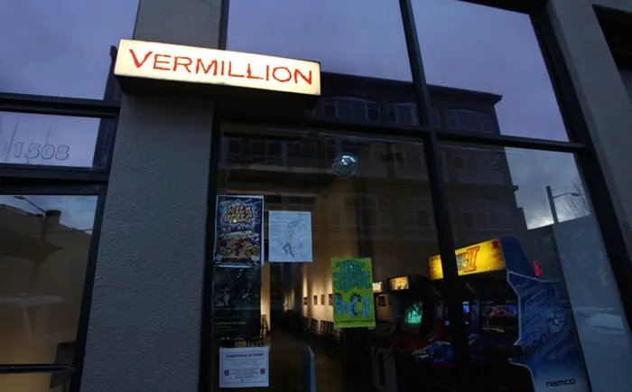

[Vermillion](http://vermillionseattle.com/) is an art gallery and bar located in the busiest street of Capitol Hill night-life. The attendance here for music is spotty. The sound system is weak, more designed for poetry readings than a live band. Nonetheless, they have live music occasionally. Playing on the bar floor is an intimate setting, like a house show.

Booking: [email@vermillionseattle.com](mailto:email@vermillionseattle.com)

* * *

## The Jewelbox Theater, At Rendezvous

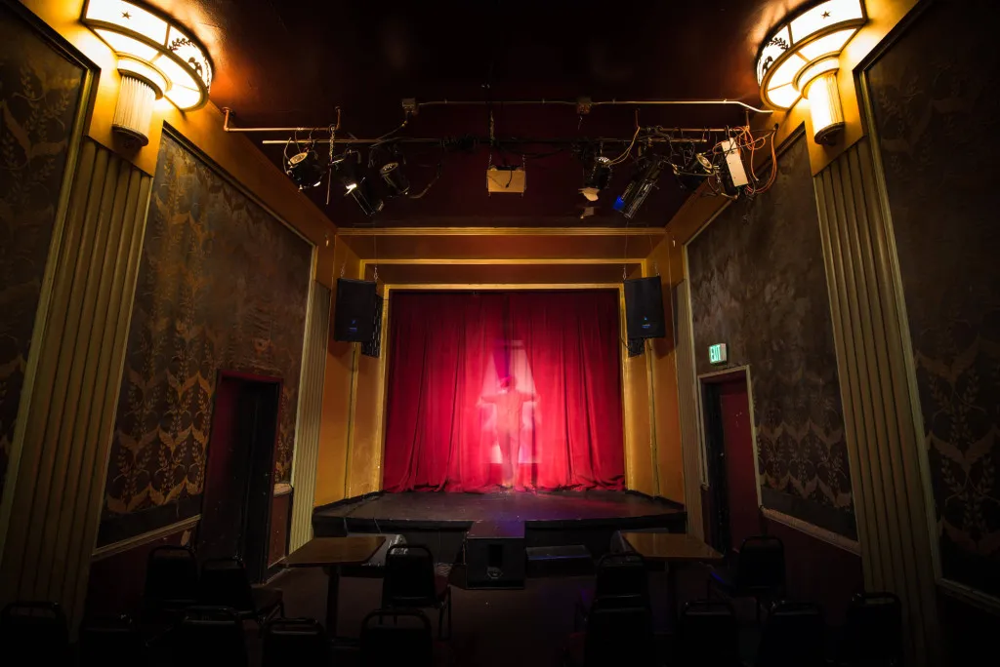

The [Jewelbox Theater](http://www.therendezvous.rocks/) at the **Rendezvous** in Belltown does everything from comedy, short film, to cabaret/burlesque. They have a professional PA system and occasionally host bands. It's a good area for a **low draw** due to its tiny stage and close-quarters viewing area. As this is typically rented by private parties, the Rendezvous staff doesn't promote/organize shows. Bands most often play here by working through a third party booker/promoter/agent. In the past, I’ve had negative experiences with a rude sound engineer at Rendezvous. So, watch out for that.

* * *

## Black Lodge

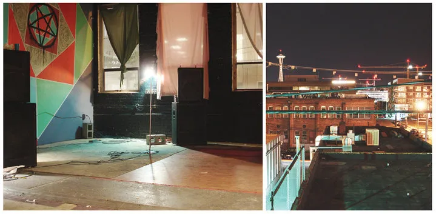

‘member Twin Peaks u guyz? Walk with fire at [Black Lodge](https://www.facebook.com/pg/black.lodge.9/), an artist-run, all-ages, non-profit house venue of some kind that for some reason gets away with hosting shows and has survived throughout the ages of surrounding Amazonian gentrification. Last time I played here my band sound-checked ourselves, lol, so idk, they have an engineer sometimes. Some nights it’s a jam-packed scene. Good for punk, all-ages, college kids, hardcore. Bookers are hard to pin down. It’s on the same strip as Lo-Fi and Victory Lounge. Often weekend nights will have 3 bills running simultaneously on this smokey side-street!

* * *

### Honorable Mentions:

- Victory Lounge: Divey floor stompin’
- Vera Project: Good for all ages bands with a draw

* * *

## Booking in Seattle's Small Capacity Spaces

These are all small and mid-size venues that may appeal to emerging artists that have a small Seattle draw. If you're booking DIY and not through an industry agent, I recommend not contacting bigger names like **Neumos**, or **Showbox**. Mid-size venues like The **Sunset**, **Tractor Tavern**, **Chop Suey** main-stage, or **Barboza** could be a good fit depending on how established the group is.

Something unique about Seattle is that **no music venue really has a built-in audience for indie rock**. I don’t know where it went. There are rare exceptions, like Central Saloon on a weekend. This can be detrimental for out of town bands that want more fans. It's rare that venues do any show promotion other than social media event posts and occasionally local press listings, so the work is on you to promote.

Of course, general booking advice applies. When requesting hold dates, I recommend not overstating your pull, suggest **bands to play with**, and include **streaming links** to music, **press** notes, estimated draw, artists you've played with, and social links.

Good luck booking! Do you know of any other spaces in Seattle? Comment below!

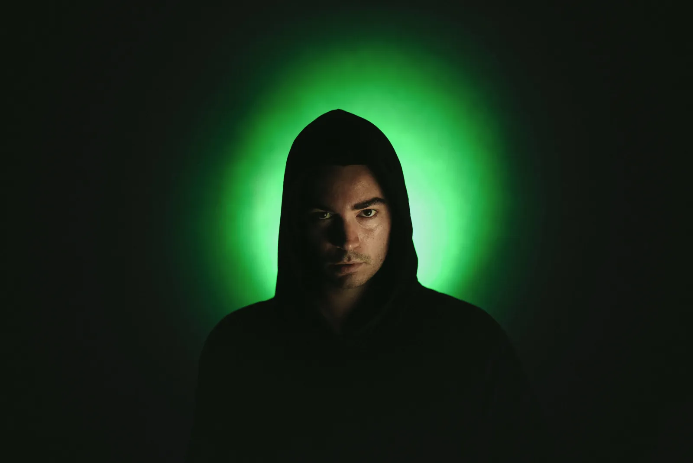

*Hi, Darksoft here. Hope this helps you and I wish you the best in Seattle! Would you consider returning the favor by helping other musicians out? Like, when bands reach out but you can’t play, don’t ghost - actually respond. Recommend some venues and related artists. Or prepare a list and have it handy to share. Let’s raise the bar a bit and help each other out, yo.*
