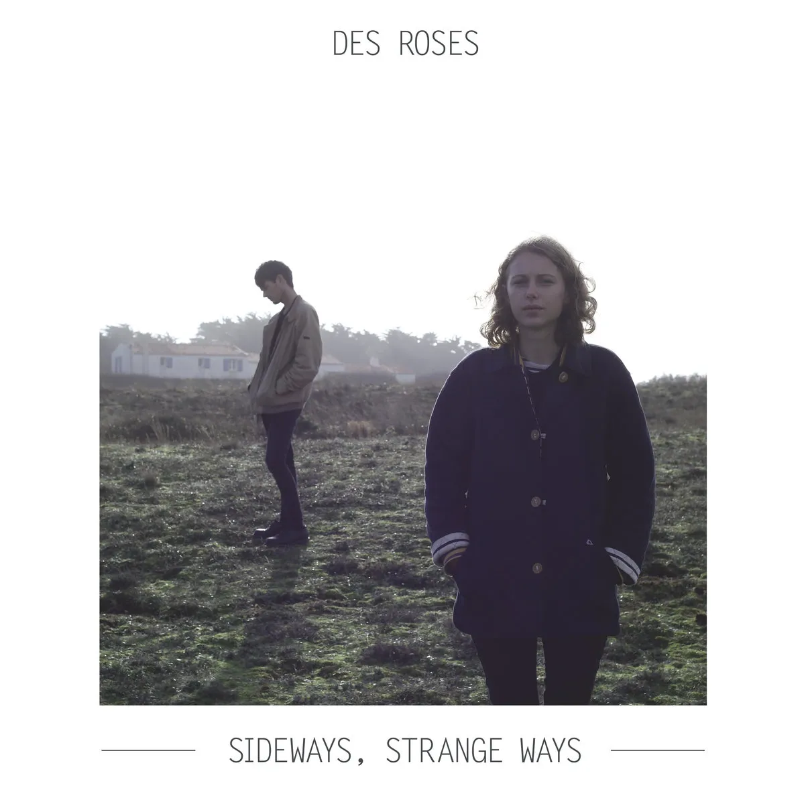

"H.P.S." by Des Roses is a song I fell for while listening to [DKFM](https://decayfm.com/) (online radio I highly reccomend). It's off their Sideways, Strange Ways EP. The entire song is beautiful, but for me, this one is **all about the chorus**.

It enters with a melancholic organ sound reminiscent of **Beach House**. The descending chords evoke a slow, silent feeling.

<iframe src="https://bandcamp.com/EmbeddedPlayer/album=3839951270/size=large/bgcol=ffffff/linkcol=0687f5/tracklist=false/artwork=small/track=3550884892/transparent=true/" title="Bandcamp player" height="120" loading="lazy"></iframe>

A cymbal wash and we’re in. Toms beat a slow tempo funeral march over bright synth pads, and crashes accentuate an intense, introspective state. A guitar with heavy delay supports, tuned to the hollow sound of **The Cure**.

The verse is deliciously **minimal;** whole note synth bass and dark electronic percussion, all with heavy reverberation. The female vocals are subtle and cryptic:

> “You’ve been somewhere in the crowd // No one has to know your soul”

A lower male joins in, and rhythm alterations break the march. The energy dissipates completely, but only briefly…

Coordinated crash, bass, and grandiose synth enter with drama on the scale of a Arcade Fire, but with more saturated effects. They support a simple, yet whimsically catchy chorus:

> “You know that there is nothing like you, I can be myself // There is nothing with you, where I should run away”

The vocal melody and off-beat hits are reminiscent of parts I’ve heard before, but that I know I couldn't place. I think that’s a sign of great songwriting.

The song settles down again into an even spacier verse with oscillating synth. This part gradually escalates into an awesome bridge on a major key resolve, using cascading string pads and multiple voices with octave unison vocals.

There are rare occasions where a song gives me chills. When I first heard H.P.S I had it on repeat for a few days.

My only only critique is that transitions feel a little choppy, like the movement out of the bridge and into the final chorus, where a high synth pad is abruptly cut. The chorus, which is very uplifting, fades into darkness with a minor tag, which felt unnecessary.

What “H.P.S.” does really well is **dynamic contrast**. Verses are silent, controlled, slow, and the anticipation generated verges on manipulation.

Des Roses is a group in Nantes, France. You can listen to H.P.S. and the entire 3-song EP by Des Roses, Sideways, Strange Ways (2016), [here on Bandcamp](https://desroses.bandcamp.com/album/sideways-strange-ways-2016). They released a remix of H.P.S. on [St. Vincent (2017)](https://desroses.bandcamp.com/album/st-vincent-2017), but personally I feel the 2016 mix is better.

Des Roses: [Facebook](http://facebook.com/desrosesband) / [YouTube](https://www.youtube.com/watch?v=8Gbv_pAk5V8) / [Twitter](http://twitter.com/desrosesband) / [Instagram](http://instagram.com/desrosesband)

They also have a music video up for "H.P.S." on YouTube:

<iframe src="https://www.youtube-nocookie.com/embed/wCZqhbdXVxE" title="YouTube video" loading="lazy" allow="accelerometer; encrypted-media; gyroscope; picture-in-picture; web-share" referrerpolicy="strict-origin-when-cross-origin" allowfullscreen></iframe>

