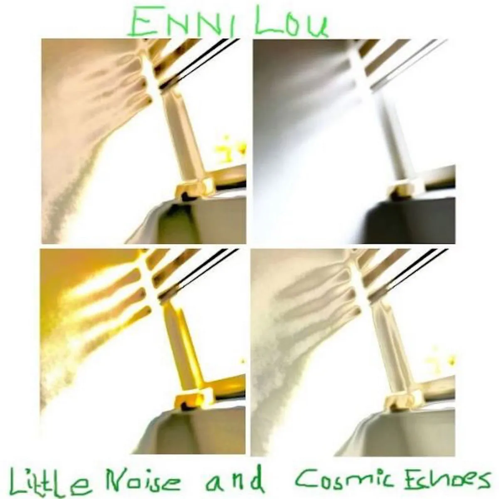

*Open your eyes.* Enni Lou’s new **dreamy** song seems to depict the state between waking and moving; a pleasant sleep paralysis where the vibe just keeps on blurring out.

Enni Lou creates a repetitive surrealism throughout the use of panned synthesizer layering, echo-ey guitar, and tremolo-ridden voice. The end result is an experimental, lo-fi, and earnest take on what "confusion" sounds like.

<iframe src="https://bandcamp.com/EmbeddedPlayer/album=1341919836/size=large/bgcol=ffffff/linkcol=0687f5/tracklist=false/artwork=small/track=757817978/transparent=true/" title="Bandcamp player" height="120" loading="lazy"></iframe>

> "Oh my vision is blurred  
> the tunnel is moving"

Hardly any words make it out of the semi-lucid haze, but the ones that resonate accentuate a floating semi-consciousness and forlorn love:

> "Oh there is love  
> I see it looming"

The monotone musical drone, and the drenched use of effects is an aesthetic borrowed much from **Animal Collective,** or the more trippy **MGMT** bouts.

You can listen to **Open Your Eyes** and other songs off [Little Noise and Cosmic Echoes](https://ennilou.bandcamp.com/releases) on Bandcamp.

Follow Enni Lou: [Soundcloud](https://soundcloud.com/user-940139708) - [Twitter](https://twitter.com/enni_lou) - [Bandcamp](https://ennilou.bandcamp.com/releases)
