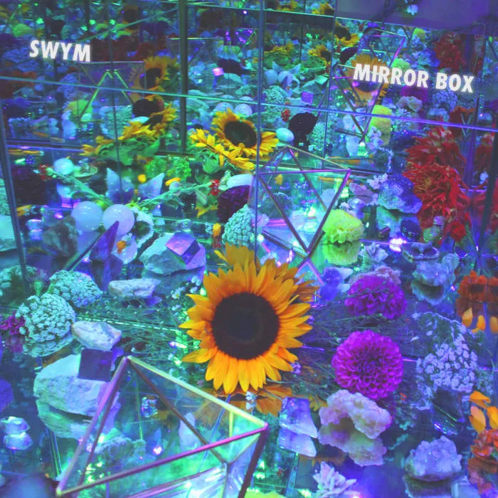

Have you ever seen a fleeting image from a past life? If you ventured into that and opened it up, where would it take you?

"Anamnesis" is defined as *the remembering of things from a supposed previous existence.* It's the name chosen for the 4th song on **Mirror Box**, an expansive record by Seattle's kaleidoscopic duo **SWYM**. On Anamnesis, we explore a moment that "isn't real." It's a reflective, spacious journey.

<iframe src="https://bandcamp.com/EmbeddedPlayer/album=1582969972/size=large/bgcol=ffffff/linkcol=0687f5/tracklist=false/artwork=small/track=4212065952/transparent=true/" title="Bandcamp player" height="120" loading="lazy"></iframe>

Acoustic guitar picking fades into a relaxing scene. Drums beat sparsely, while a **Fleet Foxes** style vocal delivery laden with luscious reverb and delay describes lying awake in bed.

Ghostly vocals ask open-ended questions that fuel a constant search and progression through time that the entire song encapsulates:

> *The moment isn't real... do you even feel?*

The melody has the timbre and movement that would make **Tame Impala**'s Kevin Parker proud. Cosmic textures support the piece as it builds and rises. From an instrumentation and songwriting perspective, Anamnesis is very controlled. Bass doesn't come in until 1:00, for example, emphasizing the first chorus.

At around 1:50 the track explodes into a quickening drum line, and instrumentation rises but is severed at 3:04, sucked down to the opening acoustic guitar.

Overall, Anamnesis feels like a slow descent onto some fascinating discovery of the mind. Epic surges of adrenaline are carefully built but are abruptly cut, as moments cease and time begins anew.

> *Anamnesis:* the remembering of things from a supposed previous existence

Overall, the song lives up to the concept well. As the introduction describes a character lying in bed, we enter a dream-like journey that digs deeper into their existence. There's a brief moment in the piano outro that feels borrowed from the **X-Files** theme, beckoning the metaphysical.

From the vintage production tones, heavy use of delay, to a tastey bass fuzz solo, the 60s/70s rainbow psychedelia sound is present throughout Anamnesis, and consistent on the entire album too. Check out "K-Nynes" as well; a modern comparable sound is the **Holydrug Couple**.

Looking forward to hearing more from **SWYM**. You can listen to **Mirror Box**, released on November 20, 2017, for free on [their Bandcamp page](https://swym.bandcamp.com/album/mirror-box-2).

SWYM - [Facebook](https://www.facebook.com/SWYMMERS/) / [Soundcloud](https://soundcloud.com/swymmers) / [Bandcamp](https://swym.bandcamp.com/)
