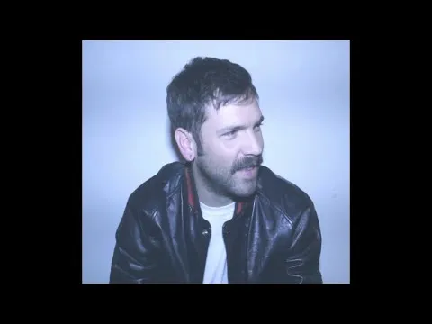

<figure><figcaption>"Get Off The Road" is a fresh single by France's VedeTT</figcaption></figure>

"Get Off The Road" is a melancholic journey, like an introspective lone walk in the middle of the night.

It opens on shimmering guitar chords over a swung **dub-like** beat. On vocal delivery, imagine a slow, drunk Matisyahu. We're in the pacing of a ballad, but it's too dark to dance to.

From the jangle-y guitar strums to the reverberating bass, VedeTT uses surf sounds that have come to envelop modern indie music. But instead of nostalgia, the blues painted here are in the colors of regret and loss.

The simplistic bridge is reminiscent off **Slowdive**, and the mid-range synth line reminds me of **TR/ST**.

> Feel higher, Feel higher // Get off the road, Get off the road

Its simple and well-executed, nearly gothic in its sparse intent. The song could use a little more creative lyrical exploration, as the "Get off The Road" hook becomes a bit overplayed without much variation.

In the music video, the singer is literally not going anywhere, he's off the road, and maybe encouraging others to do the same when they have too much shit to deal with.

[**VedeTT**](https://soundcloud.com/vedetttobogganrecords) is another artist we received through our new SubmitHub presence! Submit your stuff [here](https://www.submithub.com/blog/look-up-records) for review consideration.

if you want to watch a video of a man staring at you for 5 minutes, check this out:

<iframe src="https://www.youtube-nocookie.com/embed/YkfBwbeuTzk" title="YouTube video" loading="lazy" allow="accelerometer; encrypted-media; gyroscope; picture-in-picture; web-share" referrerpolicy="strict-origin-when-cross-origin" allowfullscreen></iframe>

