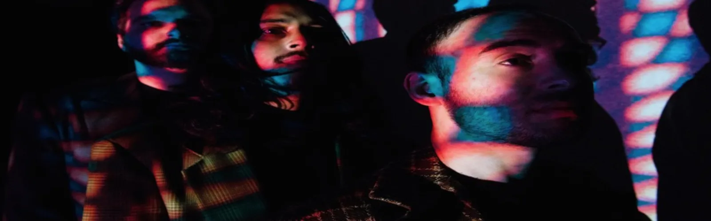

<figure><figcaption>We review the surfy song "Slow" by Young Creatures.</figcaption></figure>

<iframe src="https://w.soundcloud.com/player/?url=https%3A//api.soundcloud.com/tracks/338478274&amp;color=%23ff5500&amp;auto_play=false&amp;hide_related=false&amp;show_comments=true&amp;show_user=true&amp;show_reposts=false&amp;show_teaser=true&amp;visual=true" title="SoundCloud player" height="300" loading="lazy" allow="autoplay"></iframe>

*There's something creeping around*... an eerie yet energetic sense of premonition is created on "**Slow**," a track from LA-based **Young Creatures**' sophomore album, **The Future Is Finally Now**.

It's a haunting dreamy sensation that combines shoegaze, surf, and pop sensibility to create a radically energetic tune. Guitars use minor accidentals found in Middle-Eastern music scales, as pioneered by king of surf guitar **Dick Dale**. The eerie vibe is further punctuated by atonal guitar bends drenched in verb.

In the verses, a crunchy guitar lays a drone on the root note, while vocals portray unanswered questions:

> *Where do you go when you want to be alone? Where do you go when you just want to go home?*

In the choruses, drums use a classic surf beat; driving ride, double snare hits. Lead guitar outlines psychedelic licks, over a saturated thundering like **The Ventures** on full blast. Direct vocals are reminiscent of **Arctic Monkeys** (without the British accent).

> *When all of the days and night go slow... so slow*

In all, "Slow" is a twisted modern reinterpretation of surf; as a lot of original surf groups who used the harmonic minor scale were instrumentalists, it's unique to hear the style used in a pop song structure with vocals.

For when all of the days and night go slow, listen to Young Creatures for a surefire kick in the ass out of your current malaise.

Young Creatures is a [proud DIY band](https://www.youngcreatures.com/epk/) out of Los Angeles. You can follow Young Creatures here: [Website](https://www.youngcreatures.com) / [Facebook](https://www.facebook.com/YoungCreatures/) / [Soundcloud](https://soundcloud.com/youngcreatures) / [Twitter](https://twitter.com/young_creatures)
