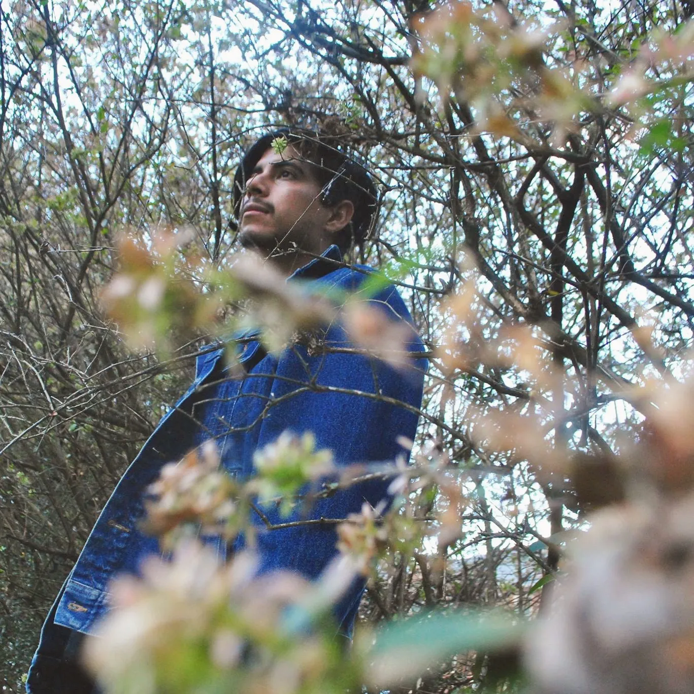

<iframe src="https://w.soundcloud.com/player/?url=https%3A//api.soundcloud.com/tracks/349451874&amp;color=%23cb9990&amp;auto_play=true&amp;hide_related=false&amp;show_comments=true&amp;show_user=true&amp;show_reposts=false&amp;show_teaser=true" title="SoundCloud player" height="166" loading="lazy" allow="autoplay"></iframe>

<figure><figcaption>Danny Bozella is Washington D.C. - based Vivian Fantasy</figcaption></figure>

"Deep.Honey." is like living a day in slow motion, with all you see filtered through a kaleidoscope. Immediately reminiscent of **Baths**, Vivian Fantasy creates a disillusioned landscape that slowly caresses the mind.

In "Deep. Honey." Vivian Fantasy uses an experimental chillwave style, supported by heavily side-chained synth pads. It's speckled with liquid mid-range guitar hooks and a sleepy vocal delivery like peaceful chanting.

Found-sound percussion samples like clicks, knocks, and taps seem to be recorded straight from the artists's personal habitat, evoking a sense of intimacy and lost time. Distorted drums and synth hooks create a mesh of colors that enter and fade away.

"Deep. Honey." certainly excels in its use of aesthetics, however this impedes variance in song structure and in picking out specific lyrics on a first listen. Words are hard to hear, as the vocals are consciously muddy, shrouded in chorus, and at times heavy pitch-shifted. (I know, it's the style right now). However, one phrase does stand out, and it carries a lot of weight:

> "When you put on the knife, I'll just lie in the color with you"

Deep honey seems to be a metaphor for the blood of the voice's companion, implying shared tribulations amongst the characters involved. Perhaps it's the acceptance of a shared fate that the song intends to capture sonically.

Vivian Fantasy is a D.C.-based project by Danny Bozella, whose EP was released by Seattle-based [Hush Hush Records](http://hushhushseattle.com/), a label helmed by **KEXP** DJ **Alex Ruder**.

Vivian Fantasy: [Soundcloud](https://soundcloud.com/hush-hush-records/vivian-fantasy-deep-honey) / [Spotify](https://open.spotify.com/album/0yaIOIdxqLvnHHLgH7po0r) / [Bandcamp](https://vivianfantasy.bandcamp.com/) / [Facebook](https://www.facebook.com/chemistsva/)

Check out Vivian Fantasy and other artists on this playlist of songs we've reviewed on the blog:

<iframe src="https://open.spotify.com/embed/playlist/7hHyuev0jvp5SIMzLYnm4X" title="Spotify playlist" height="352" loading="lazy" allow="autoplay; clipboard-write; encrypted-media; fullscreen; picture-in-picture"></iframe>

