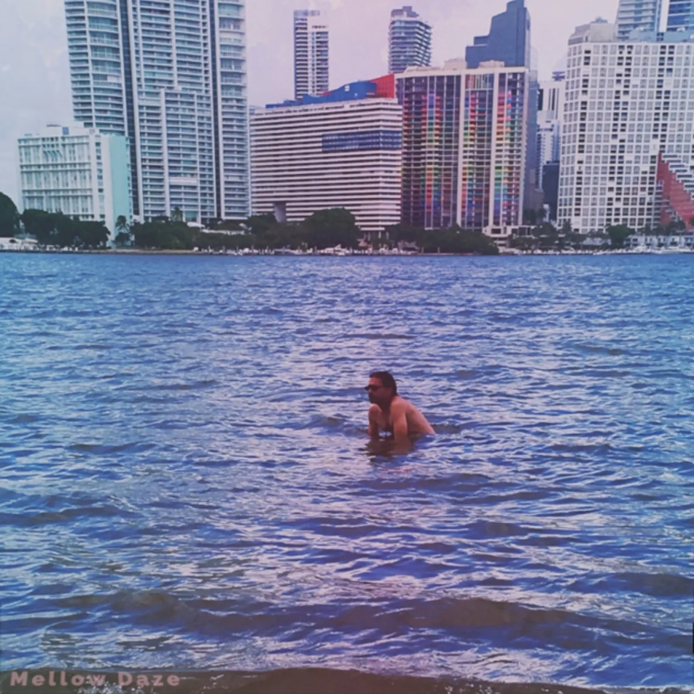

<iframe src="https://w.soundcloud.com/player/?url=https%3A//api.soundcloud.com/tracks/368275286&amp;color=%23cb9990&amp;auto_play=true&amp;hide_related=false&amp;show_comments=true&amp;show_user=true&amp;show_reposts=false&amp;show_teaser=true&amp;visual=true" title="SoundCloud player" height="300" loading="lazy" allow="autoplay"></iframe>

*Fade in on a Miami afternoon.* You drive your sports car to the beach, where your friends are awaiting to chill, take a dip, and just be themselves.

**"Feel Like You" by Mellow Daze is rapidfire sunny psychedelic, with catchy guitar hooks, retrowave sensibility, and smart songwriting.** It's a head-bopping ride that is instantly accessible, but may take a couple listens to fully embrace.

Delayed guitar layers fade into the background, creating a spacey feeling reminiscent of **Wild Nothing**. Driving, 70s-styled muted drums support some heavy use of effects, while the song ventures into nuanced chord changes and harmonies.

> "We know we do, we want to feel so good, it's true, you want to feel like you, it's understood..."

It's rare to hear artists nowadays in this style using song structures with real momentum. What stuck out on "Feel Like You" was its unabashed **pop song structure**. The pre-choruses have a clear, definite rise, juxtaposed to an emptier, clean chorus that accentuates the vocals and offbeat funk bass lickage. In all, it goes something like:

### A, B, C, A, D, B, B, C, C, A, C-solo, A

We hear recurring elements of the previous sections, but it's not copy-and-paste repetition. Each section carries a trademark as well as a lot of variability; from strong leads, to funk rhythm guitar, to huge filter sweeps.

It definitely has a strong psychedelic element. Lyrical intent is a wash of rainbow:

> How many times do we think all about  
> The people all around when there talking aloud  
> The lies and the things that they do like to say  
> Its easy to be when you don’t even grow

We're always wondering what others are thinking of us. But at the end of the day, you want to feel comfortable being you; "*you wanna feel like you*."

Mellow Daze is a solo project by Miami-based Julian Aaldn: [Facebook](https://www.facebook.com/mellowdaze/) / [Twitter](https://twitter.com/mellow__daze) / [Soundcloud](https://soundcloud.com/mellow-daze/) / [Instagram](https://www.instagram.com/mellow__daze/) / [YouTube](https://www.youtube.com/channel/UCAG4km08SCtFgGB7V_1u7_w)
