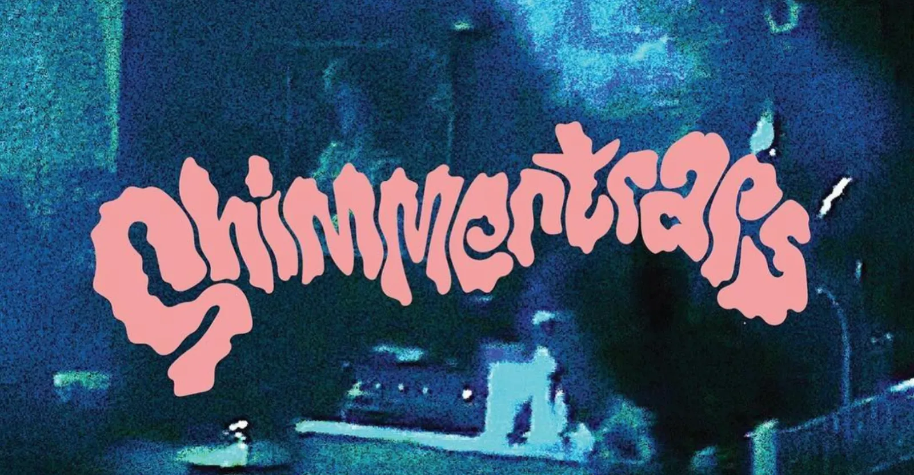

<iframe src="https://open.spotify.com/embed/track/0WNZ7dighDzi3KefBClTBE" title="Spotify track" height="152" loading="lazy" allow="autoplay; clipboard-write; encrypted-media; fullscreen; picture-in-picture"></iframe>

**“All We Are Is So Close” is a nostalgic groovy reverb trip that takes you on a nocturnal drive down a summer highway into the unknown**. Drawing an immediate comparison to **DIIV**, the dreamy sounds of this cut ebb and flow, bursting into colorful, washed out moments you’ll want to put on repeat.

Bellingham-based 5-piece **Shimmertraps** starts “All We Are Is So Close” with haunting reverb-drenched vocal “oohs,” tight drums, and a moving bass line that locks in the groove immediately with an impressive melodic flair. Throughout the track, wide filtered pads add atmosphere as lightly gritty electric guitars skitter and jump with the beat, while the relaxed lead vocals cascade with delay and slight distortion to add a hazy lo fi depth.

At the **2:00** mark, the song explodes into the first chorus with tight, crunchy rhythm guitar, with the bass still providing colorful melodic touches, as the lead vocals give their most catchy delivery yet, drenched in a huge wave of reverb.

While the **wavy psych pop** instrumentation shimmers and shines, the lyricist seems to be exploring their own wavy ins and outs: a complicated relationship with an uncertain demise. Feeling dizzy and confused, they admit:

> “Lately I find  
> While your head winds  
> Mine aches”

Later in the song, after recalling the depth of knowing the other person so intimately, (“we’re so close, we’re so close”) they express a feeling of acceptance of the relationship slipping through the cracks, with a matter-of-fact, nonchalant delivery:

> “You and I fade,  
> but it’s all the same,  
> and you wouldn’t know”

What the vocals might lack in passion, the instrumentation makes up for it in spades by carrying the emotional final chorus into a hazy, fade-out finish.

Sometimes relationships can be hazy and can fade out too, but there’s always a new thrill waiting around the corner if you search for it and “All We Are Is So Close” is the perfect soundtrack to finding your way to the next adventure.

<figure><figcaption><strong>Shimmertraps:</strong> — Shimmertraps are a 5-piece band from Bellingham, WA on the Gauzy Vox Collective label featuring Zack Moses, Ian MacPhee, Brodie Cole, Justin Klipping, and Kyle Trostad-Menne. "All We Are Is So Close" is off their album <a href="https://open.spotify.com/album/5Nc9Ribm28VyhDy6ImCKSw">Zap</a>. Follow Shimmertraps: <a href="https://open.spotify.com/artist/22mUyP1olHZ6mfObPpEbjI">Spotify</a> | <a href="https://shimmertraps.bandcamp.com/track/all-we-are-is-so-close">Bandcamp</a> | <a href="https://www.facebook.com/ShimmertrapsOfficial/">Facebook</a> | <a href="https://www.instagram.com/shimmertrapsband/">Instagram</a></figcaption></figure>
