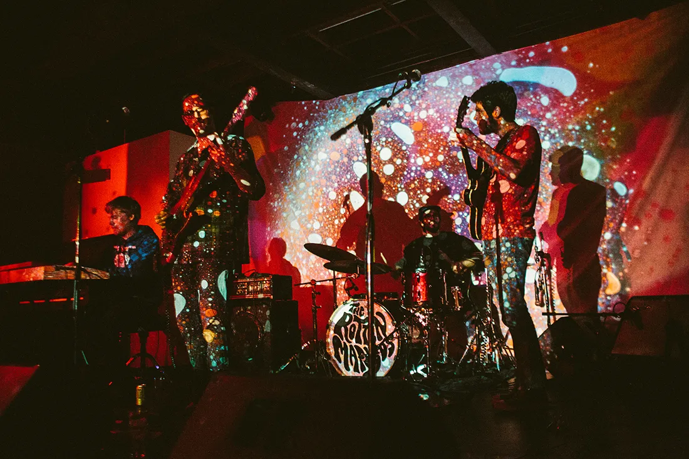

<iframe src="https://open.spotify.com/embed/track/7CUxy37I0OjCY0xtQdfdCm" title="Spotify track" height="152" loading="lazy" allow="autoplay; clipboard-write; encrypted-media; fullscreen; picture-in-picture"></iframe>

*Burning in the heat of the sun, and loving it*. Join **The Rotten Mangos** in honoring the mid-day in "**In Love With The Afternoon**"; a timeless diurnal anthem saturated in lo-fi tape distortion.

It opens with wide panned acoustic strumming, shimmering in amp fuzz. Middle-eastern sounding guitar licks lead the daze, while a compressed kit keeps a solid drive.

The lyrics are terribly simple:

> "In love with the afternoon, but it leaves me much too soon / I wish i could get it to stay, but there's nothing I can do"

It's a song about a time of day. Can't get more timeless than that. I've talked with some friends lately about a growing trend around the return to simple, real songwriting, and "In Love With The Afternoon" captures that.

At 0:45 on *'it's going away*,' there's a bridge with escalating vocal harmonies and quick chord turns. What follows are plenty of **Beatles*-***esque quick turns throughout. Each section ventures into new vocal harmonies, guitar solos, and breaks, all in a 60s psychedelic mood comparable to modern contemporaries **Holy Wave**.

> "I know it will return, but the morning sun will burn me / before I can see it again, the day will be half dead"

What if we never slept? There's definitely a yearning to soak in the daylight. So enjoy the light while you can. **Flow with the noontide**, reach your apex, and enjoy the meridian where there is no shadow. Get baked.

Keep swirling in flower dresses and kaleidoscopic colors, but you may want to keep a hand on the holster on some days too, because others move quick at high noon.

<iframe src="https://www.youtube-nocookie.com/embed/F5rbrBL_OLo" title="YouTube video" loading="lazy" allow="accelerometer; encrypted-media; gyroscope; picture-in-picture; web-share" referrerpolicy="strict-origin-when-cross-origin" allowfullscreen></iframe>

<figure><figcaption>The Rotten Mangos: Are a psychedelic rock band from McAllen TX. <a href="https://soundcloud.com/the-rotten-mangos">Soundcloud</a> / <a href="https://therottenmangos.bandcamp.com/">Bandcamp</a> / <a href="https://www.facebook.com/pg/therottenmangos/about/">Facebook</a> / <a href="https://twitter.com/therottenmangos">Twitter</a></figcaption></figure>
