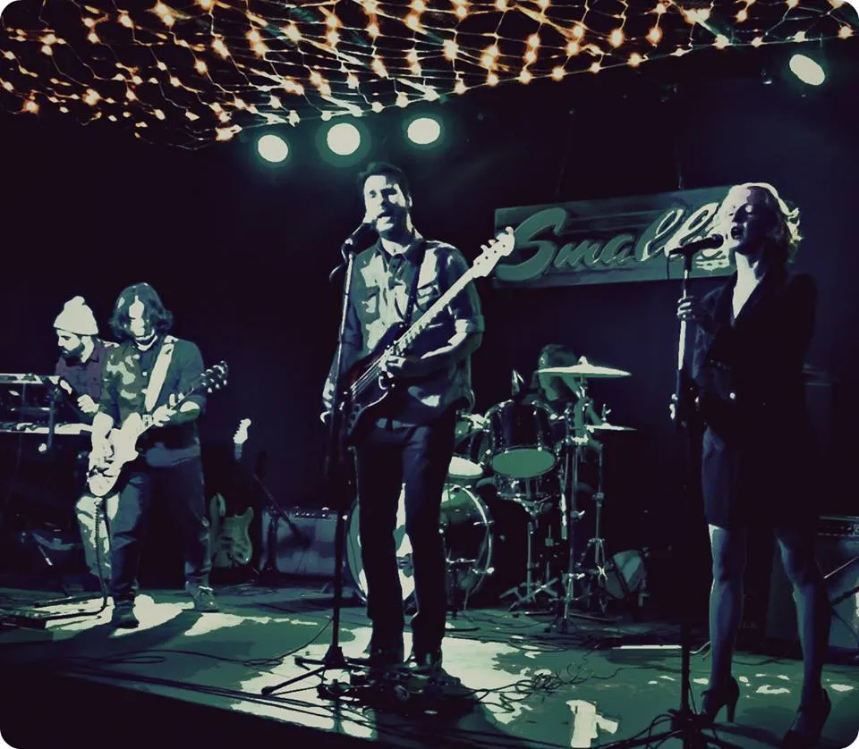

<iframe src="https://www.youtube-nocookie.com/embed/e_nbeLy1Mjo" title="YouTube video" loading="lazy" allow="accelerometer; encrypted-media; gyroscope; picture-in-picture; web-share" referrerpolicy="strict-origin-when-cross-origin" allowfullscreen></iframe>

"Brilliant Violence" by VSTRS is a grungy psychedelic trance with an equally trippy visual collage accompaniment.

The song begins with a bold 30 seconds of feedback - classic. Next come the grungy chords, and then a lead guitar and tom-heavy beat droning with the confidence of **Alice in Chains**.

A soft vocal delivery enters, describing a search for truth among some sort of reflective echo chamber.

> I've been talking into mirrors  
> things are not as they appear  
> now it's time to stop pretending

The bass is playful, filling out space in the instrumental breaks. In general, there's a really full production with wide panning. It's lush, but each part comes through clearly.

A bold triplet tom fill propels the song into a chorus of sorts; *"had to let it go."* Loving the slow acoustic strum on the downbeat entering this section; it's a simple touch but adds a lot.

*Had to let it go* employs a darker chord change, and ends in a nearly post-punk rapidly picked bass line. This resolves into a drone sounding like **Brian Jonestown Massacre**.

Sludgy offbeat toms, crisp production, 70s psych vibes, catchy guitar riffs, and interesting turns in and out of minor modes; The sonic combination on "Brilliant Violence" is delicious.

The accompanying music video complements the otherworldliness well. It's a barrage of found footage,  ink textures, kaleidoscopic colors, driving through the snow, faces of people on the streets, and more from two short experimental films from the 60s.

A strong first encounter with VSTRS.

Are you *visited*?

<figure><figcaption><strong>VSTRS</strong> — Detroit quintet VSTRS recently released their second LP - Pandemonium Seesaw. <a href="https://visitorsarehere.bandcamp.com/">Bandcamp</a> | <a href="https://visitorsarehere.bandcamp.com/">Facebook</a></figcaption></figure>
