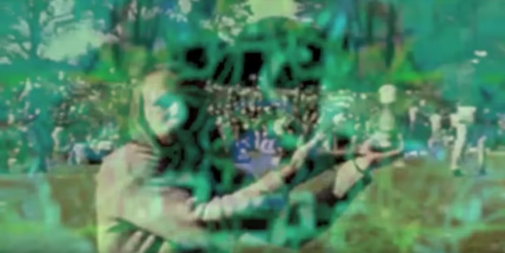

<iframe src="https://w.soundcloud.com/player/?url=https%3A//api.soundcloud.com/tracks/207420084&amp;color=%23ff5500&amp;inverse=false&amp;auto_play=false&amp;show_user=true" title="SoundCloud player" height="20" loading="lazy" allow="autoplay"></iframe>

**"A Glass of Tears Half Empty" by Aura Blaze is a bombastic 6 minute epic psych anthem that may aid in quantum leaping.** It quietly enters on a simple 3-chord indie guitar strumming pattern. Nothing that special. But wait for it...

Triumphant, right? Aura Blaze uses epic horns and a driving 70s style crunch to deliver an ecstatic positivity on par with **The Go! Team -**see [We Won't Be Defeated](https://open.spotify.com/track/4vtWJcKZvtKx0oOHztInmU).

As soon as we settle into this momentum, the instrumentation is stripped away, as lush vocals deliver a powerful anthemic praise:

> Here's to loving; here goes nothing  
> I raise my glass for you  
> Tanked on your teardrops, mind in the gutter  
> I don't know what to do

In full force, the pacing delivers vigorous energy, with intensity surmounting into each new section. The falls and rises in the first half of the song verge on predictability, as the pre-chorus sections are built up to simply scream for a transition to the choruses. At times, there's an underlying jazz element, shrouded in the fuzz.

The chorus is loud and anthemic, with high-range vocal melody peaking on:

> This time I've got it all figured out  
> I won't let you down, baby, I won't

Later on in the song, the bridge uses a **Jim Morrisen**-like baritone delivery, and is perhaps the most interesting lyrically:

> I trip on Mars, I trip on you  
> Chrono-synclastic Infundibulum

Well, the dude reads his Vonnegut. The *Chrono-synclastic Infundibulum* is a quantum mechanic conundrum that characters use to travel through time and space in *The Sirens of Titan*.

In all, "A Glass of Tears Half Empty" is a fun ride. Lots of changes, diversity, even an organ solo. It's got a breakdown jam reminiscent of **The Doors**, with some sludgy experimentation and dissonant background vocals. Of course this sways and unravels into your mega chorus finale.

If you really want to dig into some "wave phenomena" [Aura Blaze-style](https://www.youtube.com/watch?v=aZgoHXmwTMc), take your shirt off, throw on a bandana, and lean hard into some thrashy earnest psych vibes. Like he said again and again, he's not gonna let you down.
