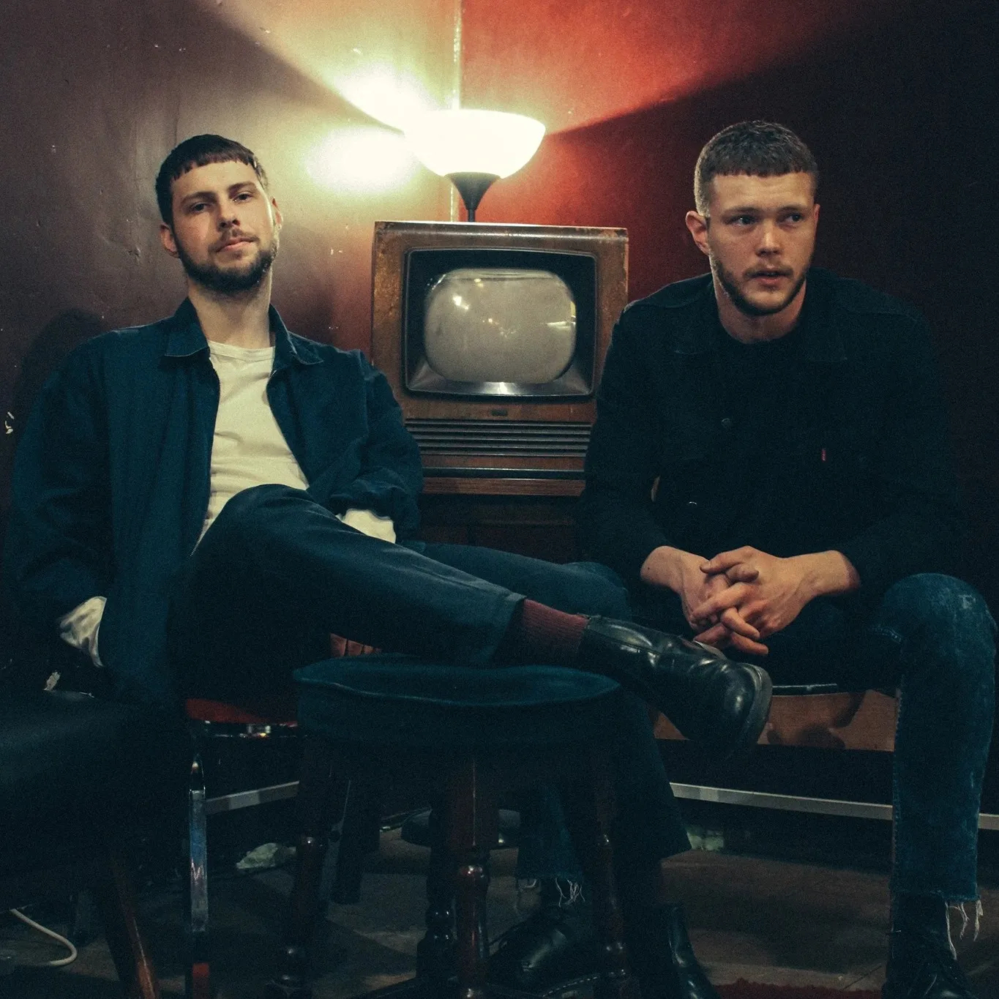

<iframe src="https://open.spotify.com/embed/track/4sT1scrkqzbIzPkofFm2XT" title="Spotify track" height="152" loading="lazy" allow="autoplay; clipboard-write; encrypted-media; fullscreen; picture-in-picture"></iframe>

**London UK duo Tuska’s brilliant “Brother” comes out of the gate swinging with warm, entrancing psychedelic pop instrumentation and compelling vocals, all under 4 minutes.**

It seems nigh impossible to bring up psychedelic pop/rock bands these days without mentioning Tame Impala’s massively influential sound over the genre. But while Tuska does draw immediate musician comparison to Tame Impala, it also offers something unique, with vocal melodies and tones not unlike Circa Survive’s Anthony Green.

Sonically, there’s a lot to love here, starting with the wide analog synth that floods your ear right when you press play, then cuts out to make space for the lead vocal to wail, “You can roll your eyes,” smashing directly into the 1st chorus: a huge, anthemic wave of sound, with sparkling tambourine rolling in the background.

In the first verse, the band opts for an unexpected minimal instrumental dropout, as only the lead vocals, steady drums, and groovy bass plod along. As the cut progresses, percussive synth stabs add a whimsical feel, and the vocal harmonies present throughout continuously add loads of sonic interest, often choosing slightly atypical 4ths and other intervals.

The highlight of “Brother” is the heavy breakdown “prechorus” section that occurs at 1:18 and again at 2:28, featuring huge, weird filtered guitars and eerie vocals, as the drums provide fills between the massive hits. It’s a super creative move, and one that I imagine would sound incredible in a live setting.   
Ending the song is the incredible chorus once more, this time with even more depth, provided by stabbing arpeggiating synths. Truly a fantastic finish to an interesting and dynamic track.

If you’re on the hunt for an interesting, bouncy jam, “Brother” deals whimsy and groove in spades, and if you follow Tuska on social media, it seems like they dabble in a little bit of fun there too. In the bio section on Tuska’s Facebook page, only the coy phrase “Here to make the kids bop.” can be found. Let’s hope they’re around even more in 2018 to keep making the kids (and maybe even the adults) bop.

<figure><figcaption>Tuska Tuska is a London-based band comprised of Richard Sturges and Rob Weaver. Their new EP, S.E.P is out now. <a href="https://soundcloud.com/tuskaofficial">Soundcloud</a> | <a href="https://open.spotify.com/track/4sT1scrkqzbIzPkofFm2XT">Spotify</a> | <a href="https://www.facebook.com/tuskaofficial/">Facebook</a> | <a href="https://twitter.com/tuskaofficial">Twitter</a> |</figcaption></figure>

Listen to "Brother" and many more artists we've covered on the blog here:

<iframe src="https://open.spotify.com/embed/playlist/7hHyuev0jvp5SIMzLYnm4X" title="Spotify playlist" height="352" loading="lazy" allow="autoplay; clipboard-write; encrypted-media; fullscreen; picture-in-picture"></iframe>

