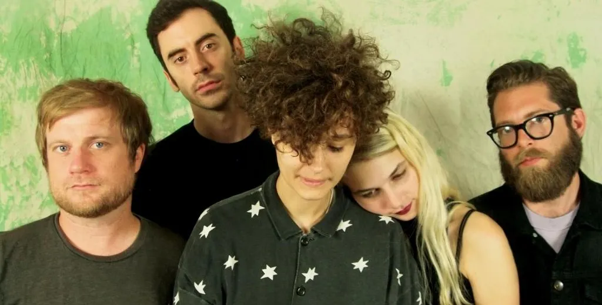

<iframe src="https://open.spotify.com/embed/track/6P3UZDkxobtDlUdnpr6u2Q" title="Spotify track" height="152" loading="lazy" allow="autoplay; clipboard-write; encrypted-media; fullscreen; picture-in-picture"></iframe>

**Tender Age’s single *Get High* is something of an anthem to those not ready to wake up and face the world, who opt to remain in a dream-like state instead.**

An instant clash of sound takes over the moment the song begins, and a chorus of soft, whispery vocals reminiscent of everyone’s favorite shoegazers from the 90s takes over. The indistinguishable lyrics are swept away carefully through the reverberating walls of sound, while immersing the hooks in a fuzz that promises to push the listener forward.

Despite the blankets of sound, the melodic catch in *Get High* is enough to reel in any listener looking for a heavy dose of nostalgia and warmth. *Get High* is an exciting collision of the droll, dreariness of shoegaze, with an upbeat dreampop twist. Tender Age gently nods to its predecessors, while looking in a different direction.

R.I.Y.L. Chapterhouse, Slowdive, My Bloody Valentine, Ride, Swirlies

<figure><figcaption><strong>Tender Age</strong> — Shoegaze band from Portland, OR.</figcaption></figure>
