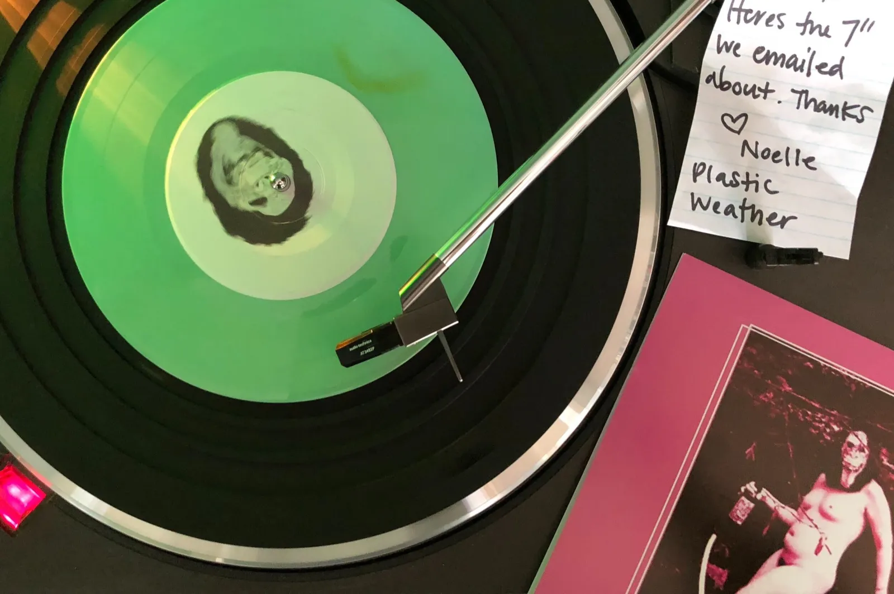

It’s always great to find a present in the mail that’s not an Amazon package for one of my roommates — so thank you Portland OR-based Plastic Weather for sending this one over.

<figure><figcaption>Plastic Weather - a "bratty synth punk from Portland, Oregon."</figcaption></figure>

Plastic Weather's self-titled 4-song 7" EP debut is a raw dancey disaster. Rehashing an 80s post-punk sound, the band uses trashy synth, chorusey guitars, disco beats, and distant vocals yells to let out the nightmaric energy.

Side A is driving drums and fuzzy guitars, with echoing vocals. Atonal at times, it’s an ear-splitting vigor in a minor-mode that just won’t let up. If this band was called *Dead! at the Disco* I wouldn't mind.

My favorite is side B. "Doppelgänger" uses a keyboard/organ that sounds like The Doors. "For Now" is a bit slower, with a heavy delay on the guitar (which i’m a sucker for). The hi-hat has some interesting work, and the overall trance of it sounds like a Joy Division B-side.

They cite musical influences like Le Tigre, The-B-52’s, and others. Plastic Weather is feminist, it’s Portland, it’s weird. Also, loving the pink and green record artwork.

You can purchase Plastic Wather’s vinyl EP on their [Bandcamp](https://plasticweather.bandcamp.com/album/plastic-weather). For you Portlanders (or Portlandians?), check out Plastic Weather's [vinyl release show](https://www.facebook.com/events/163390174493951/) on May 19th!

Also, if you’d like to submit YOUR project’s record for review, please [contact me here](/about) and I’ll give you an address.

<figure><figcaption><strong>Plastic Weather</strong> — <em>(Dead! at the Disco)</em> <a href="https://www.facebook.com/plasticweather/">Facebook</a> | <a href="https://www.instagram.com/plasticweather/">Instagram</a> | <a href="https://plasticweather.bandcamp.com/album/plastic-weather">Bandcamp</a> | <a href="https://soundcloud.com/plasticweather">Soundcloud</a></figcaption></figure>
