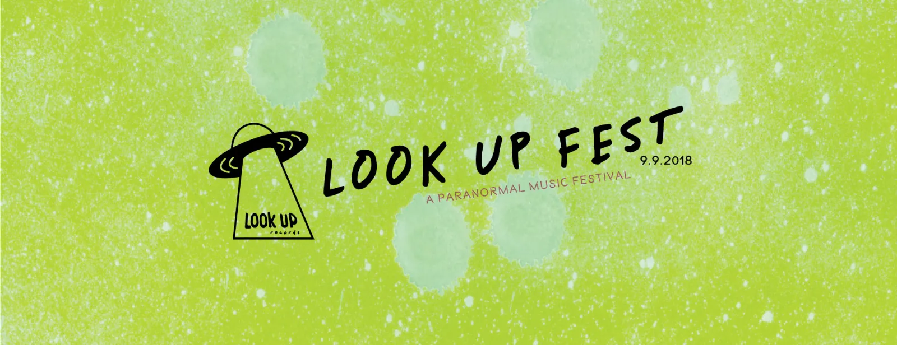

Announcing **Look Up Fest**, the new lodge for high strangeness in the Pacific Northwest.   
  
Organized by [Look Up Records](https://www.facebook.com/LookUpRecordsSeattle/), **Look Up Fest is a single day paranormal mini music festival and multimedia art exhibition held in Georgetown**, aka the Upside Down.  
  
With a curated single stage featuring local psychedelic dream pop bands, quality beer on tap, and multimedia art experiences on the theme of **paranormal encounters**, Look Up Fest is a community-driven, artist-run, accessible experience, where we invite attendees to join in a surreal, suspension of disbelief.  
  
Look Up Fest exposes attendees to a dreamy sound; an ethereal headspace appealing to anyone with an affinity for Stranger Things, Twin Peaks, X Files, UFO documentaries, missing time, mysterious forces, or other dark shadows. If you want to believe, come out to Look Up Fest.  
  
For **music**, we're featuring big name local bands and lesser-known promising local musicians. Our lineup includes [Hibou](https://www.facebook.com/hibouband/), Seattle's shoegaze-frosted dream pop project helmed by Peter Michel. Peter is also helping to curate and organize this event! Next up is [Whitney Ballen](https://www.facebook.com/whitney.ballen.5) creating visceral, vulnerable, and resilient tunes backed by an uncanny voice.

We've also got [Sleeping Lessons](https://www.facebook.com/sleepinglessonsmusic/), the latest Seattle indie-rock band on the block. We're excited to showcase [Sea Salt](https://www.facebook.com/seasaltmusic/), a new indie pop band founded by Kurtis Roy. [Shimmertraps](https://www.facebook.com/ShimmertrapsOfficial/), a 5-piece from Bellingham will put you in a trance. Last but not least, [SWYM](https://www.facebook.com/SWYMMERS/) will bring a dreamy psychedelic journey to melodic fruition.  
  
But that's not it! We wouldn't organize a great lineup and just call it quits. For this event, we are featuring a **reading of paranormal stories** provided by [The Society for Liminal Cartography](https://www.facebook.com/liminalmaps/) aka. [Liminal Seattle](https://www.facebook.com/groups/liminalseattle/). Liminal Seattle provides a map of the strange, wonderful, and unexpected at LiminalSeattle.com. It is a user-submitted map of local paranormal encounters, ranging from fairies, ghosts, bigfoot sightings, time travelers, extraterrestrials, ultra-terrestrials, crow conferences, and more. At Look Up Fest, they will be sharing some favorite local legends, and offering a booth to share your own spooky occurrences.

We're also excited to be featuring soundscapes by [Sam Peterson](https://www.facebook.com/sam.peterson.10), and visuals by John Theroux aka [Blazinspace](https://www.facebook.com/Blazinspace/) - this will be his 3rd Look Up Event!

Stay tuned for updates as we run features on the artists involved!  
  
All Ages - $10 adv / $12 drs  
BUY TICKETS: <https://www.eventbrite.com/e/look-up-fest-tickets-47895481675>  
FULL EVENT INFO: [https://www.look-up-records.com/look-up-fest](https://l.facebook.com/l.php?u=https%3A%2F%2Fwww.look-up-records.com%2Flook-up-fest&h=AT3hETuqwULxwYup4OU9eSpsRf6a1hfLy3GixNEHNVSINha9zPQoSU3BsOlUm0QqTXNBEGIf2C0R_PJbgrdZbkWXzMCmglkms9IDp4hr7u54zp6cTfboO701-Jwr6OM-9gDUG5E)
