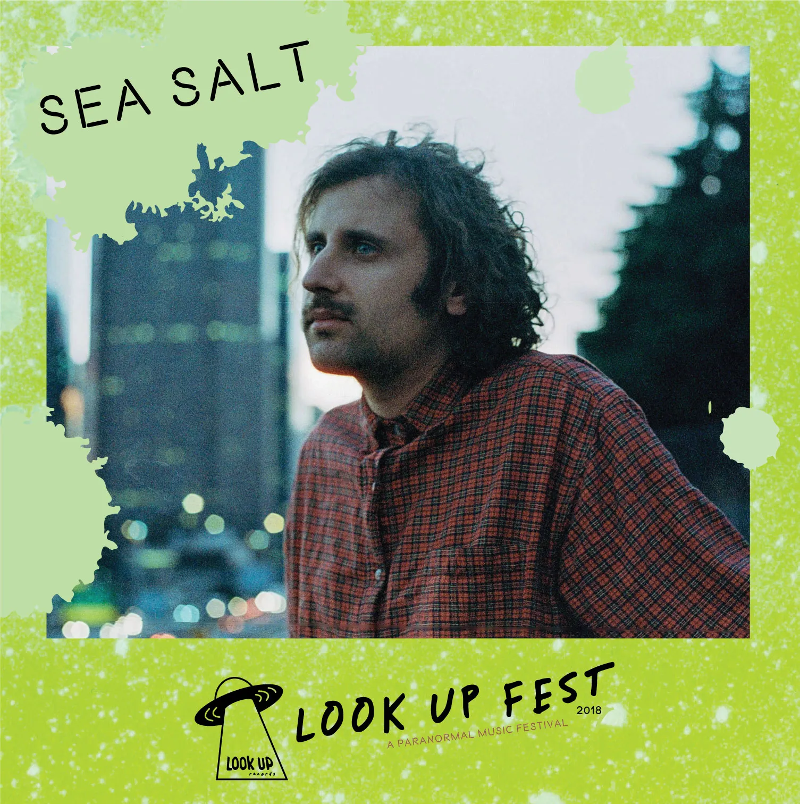

**Kurtis Roy** couldn’t have chosen a better moniker than“**Sea Salt**.” **Like his music, it evokes both the marine and the crystalline.**

”Frames,” from his recent demo might have been recorded in an aquatic lair. Guitar chords shimmer beneath the reverb, like effervescence escaping from the depths. Kurtis Roy’s voice surfs on the ebb and flow of synths. “I’m a lonely child, I’m alone for now,” he sings, a kid lost in a waterlogged dream-world.

Loneliness returns on the more downtempo “Pillow,” from the same demo. He croons about his lover’s desire to circle ‘round his head. Though he he wants to let her in, yet something keeps him distant - his relationship with her is cracked like the screen of a dropped phone.

These tunes from Sea Salt evoke the reveries of 80s indie bands like Felt and Galaxie 500, as well as contemporaries such as Beach House. Take a dive into this music - the water’s fine.

<figure><figcaption><strong>Sea Salt</strong> — Sea Salt is an indie pop band founded by Kurtis Roy. Catch Sea Salt playing at Look Up Fest 2018! <a href="https://www.facebook.com/seasaltmusic/">Facebook</a> - <a href="https://www.instagram.com/seasaltmusic/">Instagram</a> - <a href="https://open.spotify.com/artist/5AahDCyki46rJWc8EcxbwM?si=kTOhPJ3eQ5eI3TzL-BJCkw">Spotify</a> - <a href="https://twitter.com/seasaltmusic">Twitter</a></figcaption></figure>
