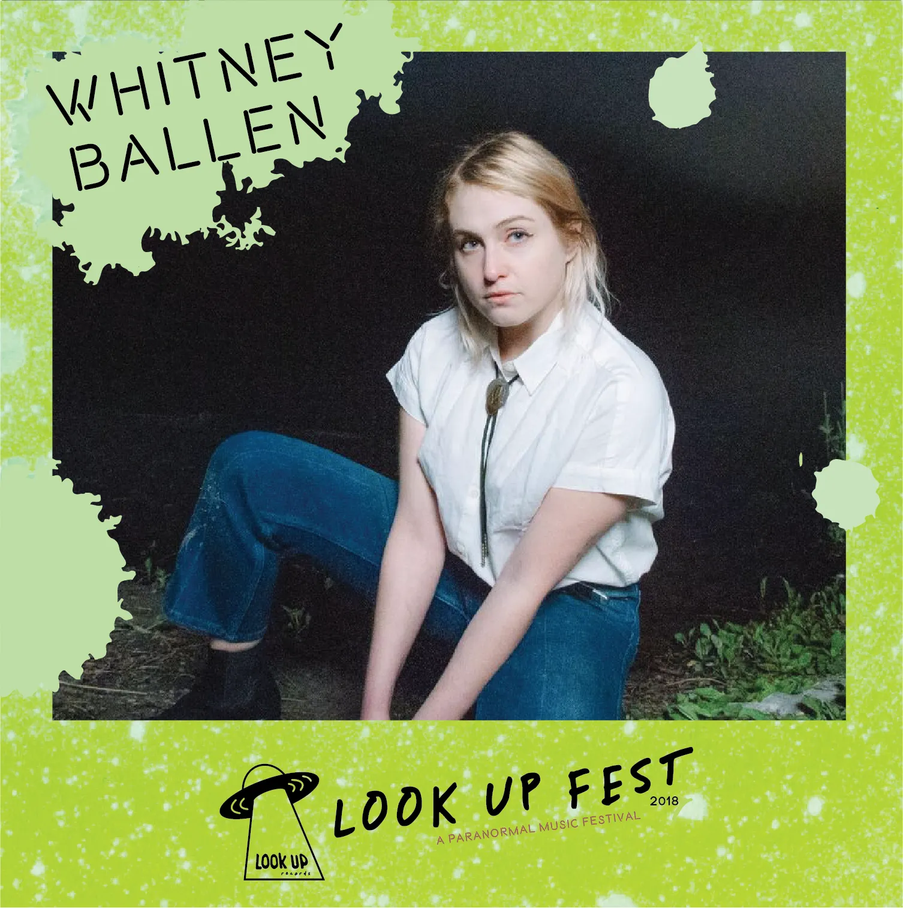

Whitney Ballen’s new record, *You're A Shooting Star, I'm A Sinking Ship* will be released August 24th on Father/Daughter Records.

We’ve been treated to two singles, *Go* and *Rainier,* from the upcoming full-length, and they serve as a sneak-peek into the new era for Ballen. Still haunting, tender and emotive, but with an extra kick.

<iframe src="https://open.spotify.com/embed/album/25svpXRm7EmsivRJslAuWP" title="Spotify album" height="352" loading="lazy" allow="autoplay; clipboard-write; encrypted-media; fullscreen; picture-in-picture"></iframe>

<iframe src="https://open.spotify.com/embed/album/2l0terdd0Wp8JItwVWWqJt" title="Spotify album" height="352" loading="lazy" allow="autoplay; clipboard-write; encrypted-media; fullscreen; picture-in-picture"></iframe>

*Go* opens with a soft buildup that welcomes Ballen’s delicate and graceful vocals begging to “go, forget about me, I know it’s easy.” Her voice drifting daintily through the spaces, reminiscent of Múm’s former vocalist, Kría Brekkan’s, gentle and ethereal tones. *Go* takes us to the place we hope to eventually reach when trying to move on - a readiness to finally push someone away wrapped tightly around the pain of truly letting go. The breakdown pleading “why don’t you leave”, is packed and poignant, making it difficult for any of us to just forget her name and leave.

Meanwhile, *Rainier* pushes back into the torments of missing a former love. My initial concern that she released a song about watery beer was quickly alleviated with her whispery strains of, “trying my best not to call you, I want to tell you about my coffee. I want to send you pictures of Mount Rainier.” Her voice quivers slightly with pain so visceral it evokes pangs of agony from the smallest pieces of missing someone, like wanting to share the menial parts of your day to wishing they would spend the night in your bed. She then cries, “I’m sorry” with enough anguish to stretch mountaintops.

With these two singles out, it is safe to anticipate *You’re A Shooting Star, I’m A Sinking Ship* to be as immensely haunting and other-worldly as her other releases while packing even more of a storm. I’ve always been struck by her ability to take the wondrous Pacific Northwest scenery - mist, clouds and mountains - and intertwine it seamlessly with the heavy weight of being human and the range of emotion that comes with it. With *Go* and *Rainier*, I am in awe, yet again, of her ability to extract the painful and burdensome parts of being alive and synthesize it into a heavenly creation.

<figure><figcaption>Whitney Ballen Catch Whitney Ballen and her band playing at Look Up Fest 2018!</figcaption></figure>
