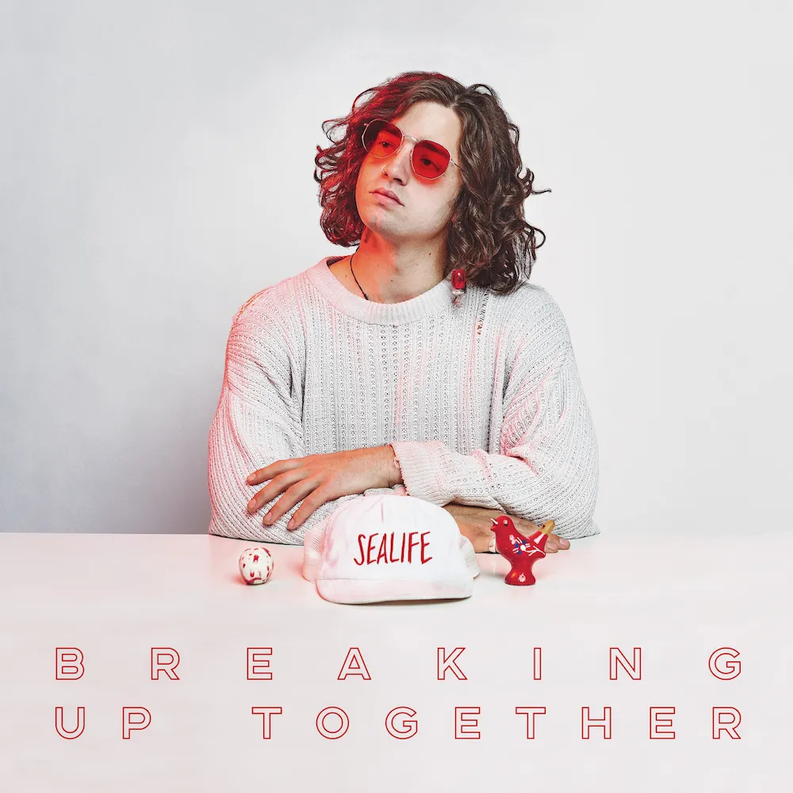

Just a few days away... on Monday Sealife's single "Breaking Up Together" is abducted and streamable from the global cloud consciousness. Here's a teaser of visual component, coming to life on the same day:

<iframe src="https://www.youtube-nocookie.com/embed/cvFPu7ATmbE" title="YouTube video" loading="lazy" allow="accelerometer; encrypted-media; gyroscope; picture-in-picture; web-share" referrerpolicy="strict-origin-when-cross-origin" allowfullscreen></iframe>

[**Sealife**](/sealife), the latest addition to the Look Up Records roster, brings love-coated psychedelic pop from Seattle straight to your heart. We'll be putting out the first single by Sealife on Monday, September 3rd, 2018.

<figure><figcaption>Artwork for Breaking Up Together, by Sealife. To be released on 9/3 by Look Up Records.</figcaption></figure>

### About Sealife

Originating from bedroom pop and stream-of-consciousness songwriting, Sealife pulls from Sade, Steely Dan, and The Smiths to craft lush sonic dreams. With a nod to Seattle grunge, Sealife is no stranger to fuzz or esoteric lyrics.

Sealife is led by **Brennan Moring**, who also sings and plays keys for Seattle psych poppers [Peyote Ugly](/blog/review-white-feather-by-peyote-ugly). Brennan began writing poetry and playing guitar at an early age, but after learning piano, he began a conquest for total instrumental control in his songwriting and storytelling. Now, with Sealife, he’s writing love songs from the perspective of the ghost that quietly waits up for you at night.

### Follow Sealife

We're proud to be working with Sealife, and are very excited to share this paranormal love saga with you... Stay tuned for the album release dates, music videos, and more!

