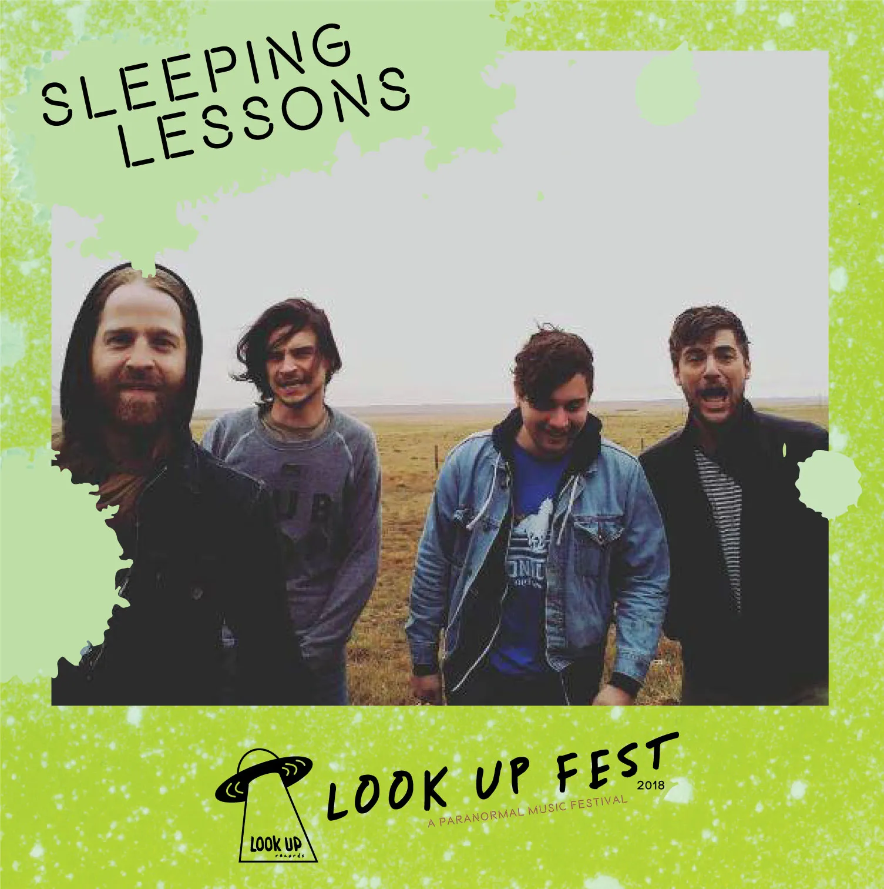

Following a triumphant and melodic one minute introduction appropriately titled, Intro, Seattle’s  
indie rockers Sleeping Lessons burst into their 2016 full-length, Red Sprites, with grace.

<iframe src="https://open.spotify.com/embed/album/7KCv5UOtSpWhujDS8SCXvv" title="Spotify album" height="352" loading="lazy" allow="autoplay; clipboard-write; encrypted-media; fullscreen; picture-in-picture"></iframe>

Chasing Ghosts, the album’s catchy and poppy second track, offers insight to what the rest of the album has to offer, without jumping in too quickly. The five-minute track starts with strong hooks and a hard-to-resist danceable beat, easing into a more moody, slow-feel as it comes to an end.

The album carries itself elegantly through all nine tracks, each offering something unique but cohesive. Overall the synth-oriented record feels like a lot of coping and learning about the world under a veil of high-energy, upbeat and dreamy tunes.

1995 marks a moment of definition for Red Sprites. They sing that “we’re all floating back to 1995”, and then crash into the moment we all hope for in an album: the big heart-drop. The chorus explodes into an array of atmospherics in unison; a divine showcase of this quartet’s synergy, before drifting back into the rest of the album.

Red Sprites ends with the song titled, K, a slow and stripped-down version of the Sleeping Lessons we’ve come to know. This gentle track delivers a sense of closure while highlighting the versatility of the band and striking chords reminiscent of Kevin Morby’s Harlem River era. K pulls on the heartstrings and rips off the veil, a fitting end to Red Sprites.

<figure><figcaption>Sleeping Lessons Catch Sleeping Lessons playing at Look Up Fest 2018!</figcaption></figure>
