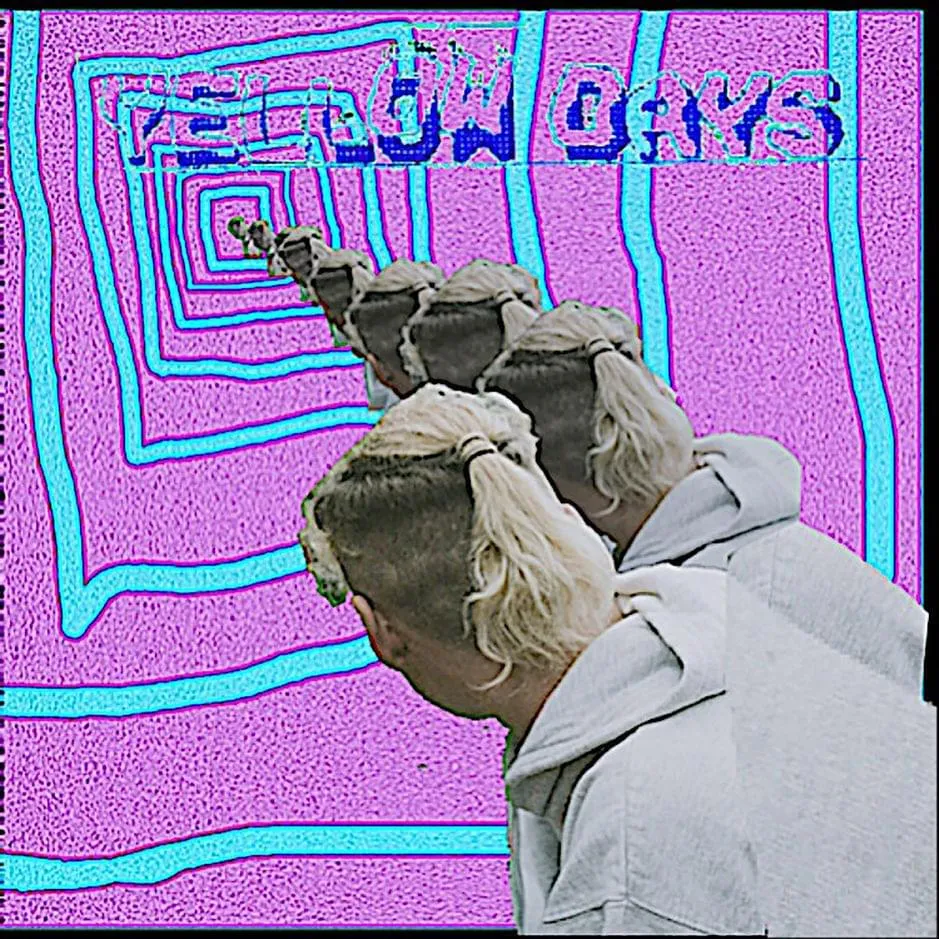

<iframe src="https://open.spotify.com/embed/track/1kLXQonNqsJxCPFkUet3pV" title="Spotify track" height="152" loading="lazy" allow="autoplay; clipboard-write; encrypted-media; fullscreen; picture-in-picture"></iframe>

One of the hardest thing to accept in life is change. We’re used to living a life of routine and monotony, and when things change or don’t go our way we quickly resent it.

*The Way Things Change* by Yellow Days does such a good job of explaining the beauty and excitement of change and how we just have to keep going, because ultimately everything is going to change so why not just accept it now.

The song uses a synthetic funky vibe layered over the strain of the Yellow Days voice. Midway through the song there's a bouncy piano melody that reminds me of listening to 80’s funk music with my parents while we are driving down the highway just enjoying life.

In the first opening parts of this song there's this sense of melancholy and detatchment - “my friends think my soul is dead.” When something changes it becomes dead and the change symbolizes the new or the rebirth.

Towards the last minute of the song the melodic structure begins to slow until there is no words, just a somber beat playing to the end, which can be seen as a moment of self-realization; Yellow Days accepts that things change, and the only thing we can do is just keep on going.

<figure><figcaption>Yellow Days</figcaption></figure>
