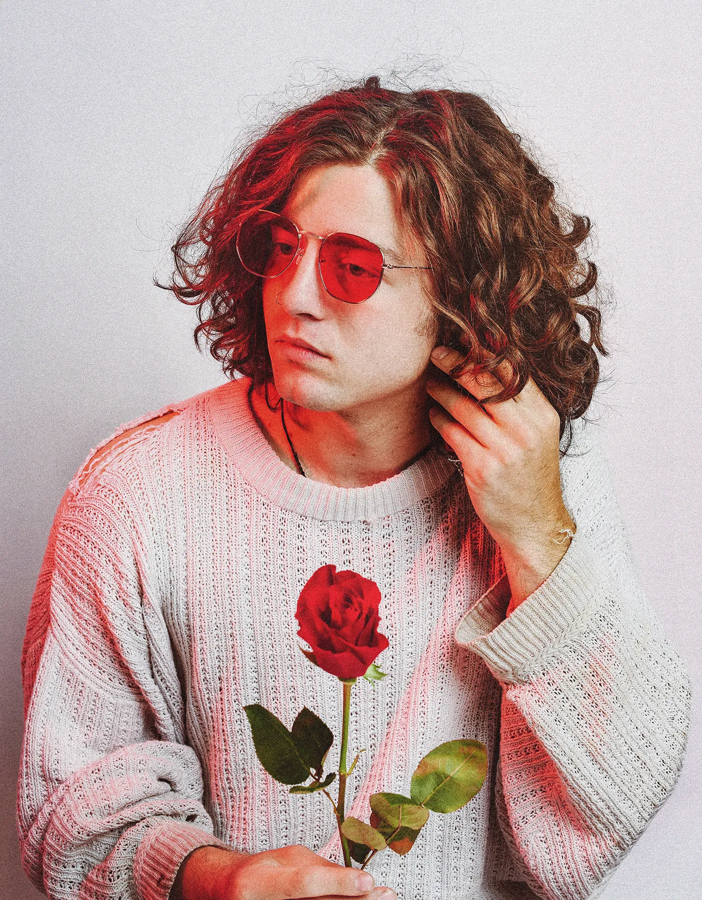

A Paler Shade of White by Sealife is out today! Released to all major streaming platforms.

## LISTEN on [SPOTIFY](https://open.spotify.com/album/5UtD6sAmrdWdyTLnGgyRQz?si=i4DDnDz4Qfip34UGjjNafA):

<iframe src="https://open.spotify.com/embed/album/5UtD6sAmrdWdyTLnGgyRQz" title="Spotify album" height="352" loading="lazy" allow="autoplay; clipboard-write; encrypted-media; fullscreen; picture-in-picture"></iframe>

Also available on [ITUNES](https://music.apple.com/us/album/a-paler-shade-of-white/1434123148), [SOUNDCLOUD](https://soundcloud.com/sseeaalliiffee), [BANDCAMP](https://sseeaalliiffee.bandcamp.com/releases), and more.

Sealife, the newest edition to Look Up Records, brings a love-coated psychedelic chill wave from Seattle straight to your heart. Sealife's debut album, A Paler Shade of White, is art imitating life; a chronological documentation of emotional renaissance.

## PURCHASE YOUR COPY

Fans of Beach House, Cocteau Twins, Future Islands, or The Ocean Blue will dig this electro chill tone. With a nod to classic Steely Dan, soulful Sade, and a Seattle grunge crunch, Sealife’s blend is discovering new sonic moods.

## About Sealife

Originating from bedroom pop and stream-of-consciousness songwriting, Sealife pulls from Sade, Steely Dan, and The Smiths to craft lush sonic dreams. With a nod to Seattle grunge, Sealife is no stranger to fuzz or esoteric lyrics.

Sealife is led by **Brennan Moring**, who also sings and plays keys for Seattle psych poppers [Peyote Ugly](/blog/review-white-feather-by-peyote-ugly). Brennan began writing poetry and playing guitar at an early age, but after learning piano, he began a conquest for total instrumental control in his songwriting and storytelling. Now, with Sealife, he’s writing love songs from the perspective of the ghost that quietly waits up for you at night.

### Follow Sealife

We're proud to be working with Sealife, and are very excited to share this paranormal love saga with you... Stay tuned for the album release dates, music videos, and more!

