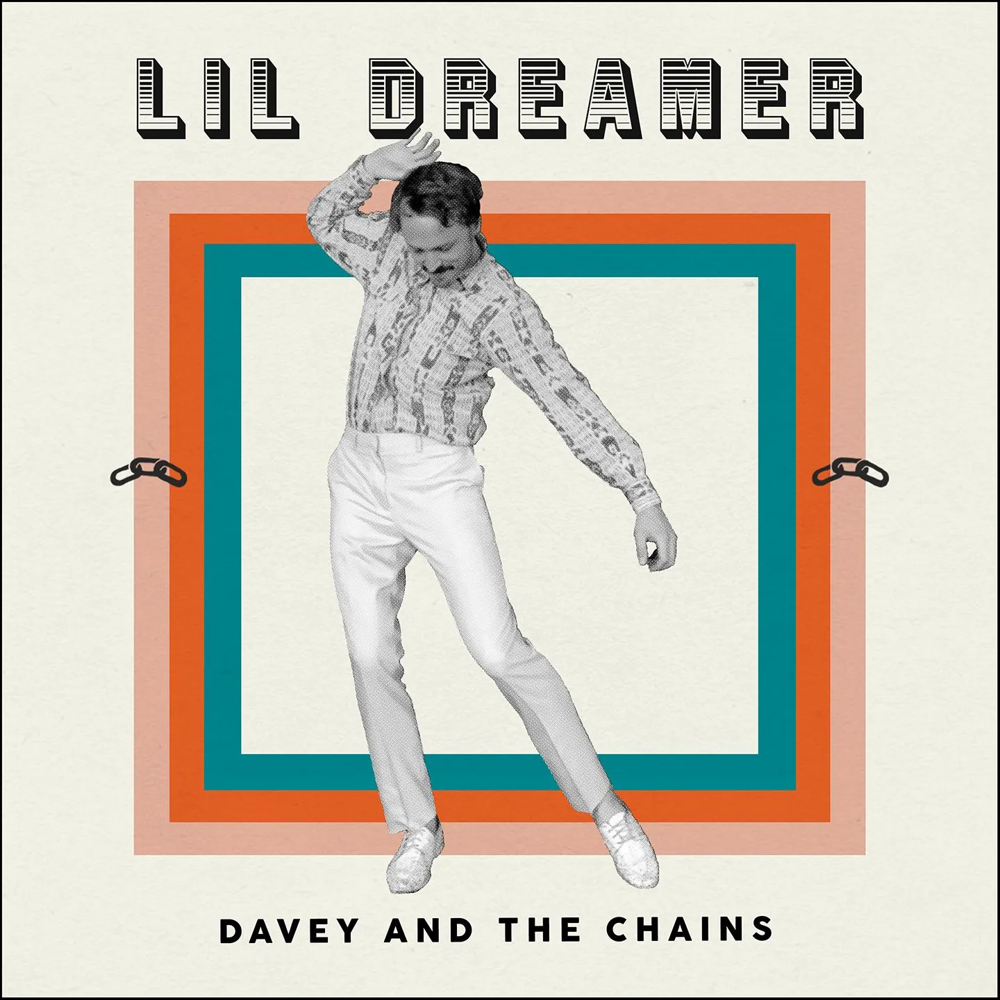

<iframe src="https://open.spotify.com/embed/track/7kIVQE7yephqf4MsLk1rs0" title="Spotify track" height="152" loading="lazy" allow="autoplay; clipboard-write; encrypted-media; fullscreen; picture-in-picture"></iframe>

Feel like there’s always a driver in the passenger side? Ready to hit the road alone? Take a load off and put the pedal to the metal while the sun still bakes the asphalt.

Take a listen to *Lil Dreamer* by **Davey and the Chains**, the new classic getaway vibe. It’s disco fueled nitro to accelerate the soul away from past love.

It doesn’t get much more feel good than this while retaining sincerity and taste. The song opens on dancey drums with a muted 70s tone supporting a jangley syncopated rhythm guitar, like Orange Juice’s *Rip it Up*. This accompanies a saturated chorus style vocal delivery paralleled by smooth guitar that harmonizes like warm silky glass.

The classic guitar crunch takes me back to the Rolling Stones, The Who, or Iggy Pop. The bouncey vibe reminds me of Eagles, or *Abracadabra* by Steve Miller Band.

Lil Dreamer flirts with all that retro decadism, but the modern guitar tone and reverb vocals give it a modern edge, aligning it with revivalists like Ariel Pink.

> “Got the pedal down heavy with my gettaway song … better off moving on without you…”

The bridge kicks it up into the atmosphere with an anthemic cut-time section. Then we ease back into that powerpop groove as we drive West, steppin’ outta dodge and cruisin into the sunset.

Lil Dreamer is off [Shimmy](https://open.spotify.com/album/32vMjHXfNV0We90jafuo6D?si=3Awr3HDyRQ-xpRRSahGk4Q), the new album by Davey and the Chains, a vinyl crunchy number full of ol’ foot knockers.

<figure><figcaption><strong>Davey and the Chains</strong> — Listen to their new album, Shimmy</figcaption></figure>

* * *

This song was sent to use on SubmitHub! If you’d like to be featured please submit there. Also, follow the Spotify playlist of song reviews below!

<iframe src="https://open.spotify.com/embed/playlist/7hHyuev0jvp5SIMzLYnm4X" title="Spotify playlist" height="352" loading="lazy" allow="autoplay; clipboard-write; encrypted-media; fullscreen; picture-in-picture"></iframe>

