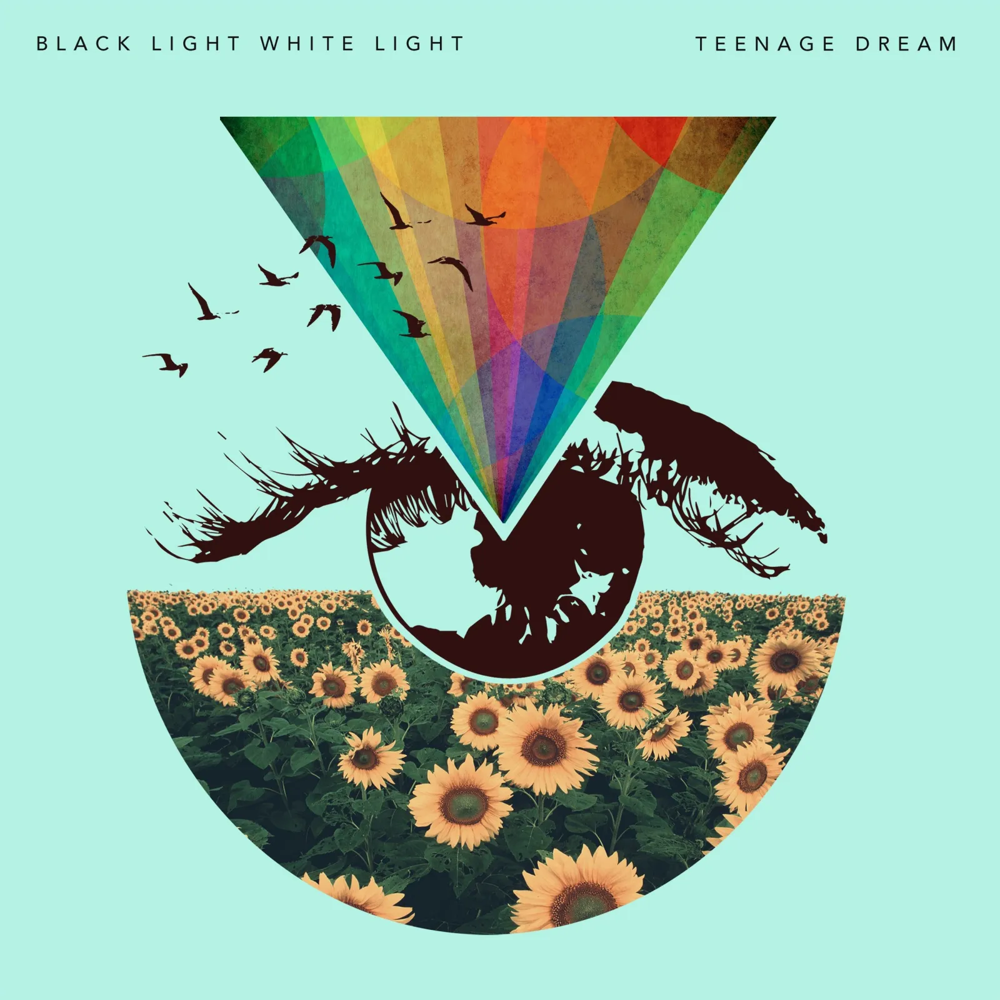

<iframe src="https://open.spotify.com/embed/track/3f0htpmzd517aVMC1QqsON" title="Spotify track" height="152" loading="lazy" allow="autoplay; clipboard-write; encrypted-media; fullscreen; picture-in-picture"></iframe>

Bring out the citar for this one. *Teenage Dream* by **Black Light White Light** embodies the neo-psych rock tone.

It opens on rising electricity, as distant echoes cascade like shimmery magic from all sides. Modern synths pair ethereal vocal melodies.

A drum groove pounds along with cascading string melodies. Teenage Dream has an unabashed adoption of that rainbow-colored kaleidoscopic 70s psych vibe.

Hailing collectively from Malmo, Sweden and Copenhagen, Denmark, **Black Light White Light** is a Scandinavian update to a middle-eastern gazey psychedelic vogue.

Avant-garde in the right ways, Teenage Dream delivers aesthetic flair throughout. Midway, it collapses into a cerebral vocal and string mood, to only rise into more bombastic ethereal positivity. Up and down like an exciting dream.

Those who like the **Temples** or **Holydrug Couple** might find a special place in their heart for Black Light White Light as well.

<figure><figcaption><strong>Black Light White Light</strong> — Teenage Dream is on their new album, Horizons.</figcaption></figure>

* * *

## SUBMIT

This song was sent to use on SubmitHub! If you’d like to be featured please submit there.

## Follow

Follow the Look Up Song Reviews Playlist for more great music:

<iframe src="https://open.spotify.com/embed/playlist/7hHyuev0jvp5SIMzLYnm4X" title="Spotify playlist" height="352" loading="lazy" allow="autoplay; clipboard-write; encrypted-media; fullscreen; picture-in-picture"></iframe>

