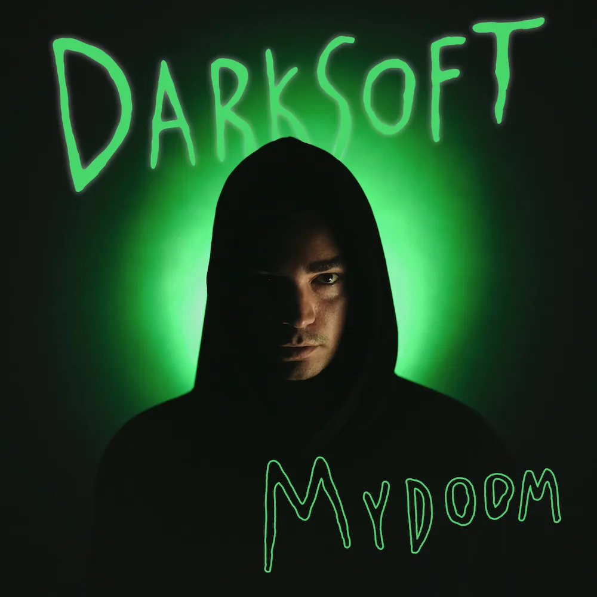

[Darksoft](/darksoft) announces the worldwide release of their first single! Listen to *Mydoom* below on **Spotify**:

<iframe src="https://open.spotify.com/embed/track/21AWPeMpbHxar2nPBea5RK" title="Spotify track" height="152" loading="lazy" allow="autoplay; clipboard-write; encrypted-media; fullscreen; picture-in-picture"></iframe>

You can also listen to the Darksoft single on all major streaming platforms. Here are other links:

- [SOUNDCLOUD](https://open.spotify.com/track/21AWPeMpbHxar2nPBea5RK)
- [BANDCAMP](http://darks0ft.bandcamp.com/)

ARTIST SPOOKMENT  
Black hats. Resource vampires. Botnet masters. Malware. Distanced through haunted screens, we rely on spooky contact that we don’t fully understand. At times, dark forces lurk on the other end, with a motive to con. Always a silhouetted hooded presence, the hacker has become our modern portrayal of Death; captor to the mind and its web of memories. As we stare deeper and deeper into the glowing comfort of this synthetic deception, trust has become the challenge of our modern paradigm, and the cyberscape the new Great Unknown. Swirling out of this virtual vortex, *Brain (2018)* is named after the first ever computer virus from the year 1986, with all songs named after infamous viruses that followed.

<figure><figcaption>Album for the Darksoft single Mydoom</figcaption></figure>

We’ve also got a super DIY music video in the works, it stars Bill as a dream-surfing computer hacker. Updates on that soon!

[Darksoft](/darksoft), the latest addition to Look Up Records, evokes an alternative sound. Darksoft creates a nostalgia for late 90s sadcore. Using an Elliot Smith and Bright Eyes vocal style, crunch guitar like Staryflyer 59 or Superheaven, and an overall garagey sound reminiscent of shoegaze.

### About Darksoft

Bill Darksoft, hailing from Seattle, leads the Darksoft project. He runs Look Up Records, studied creative writing at UW, and has played with many other Seattle acts over the years.

### Follow Darksoft

We’re very excited to share the single and the full album with you! More news on the way…

