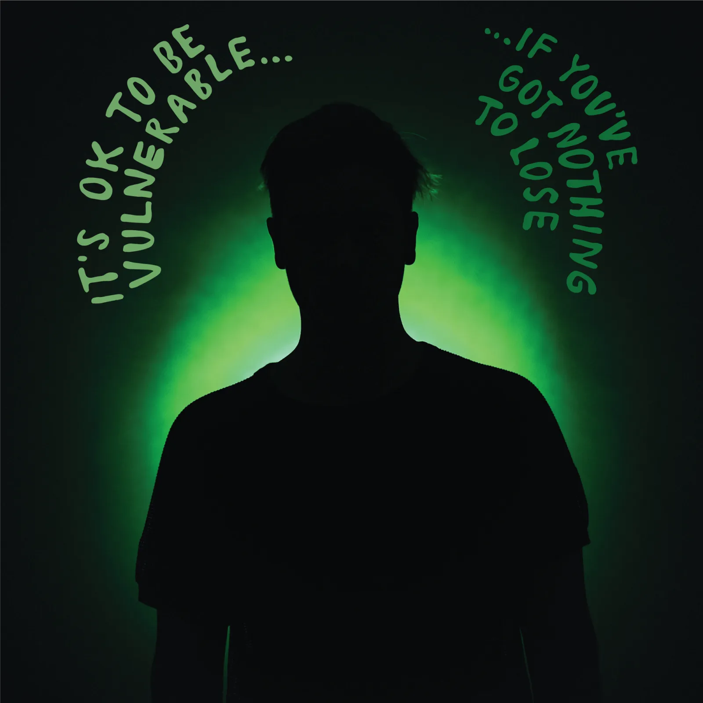
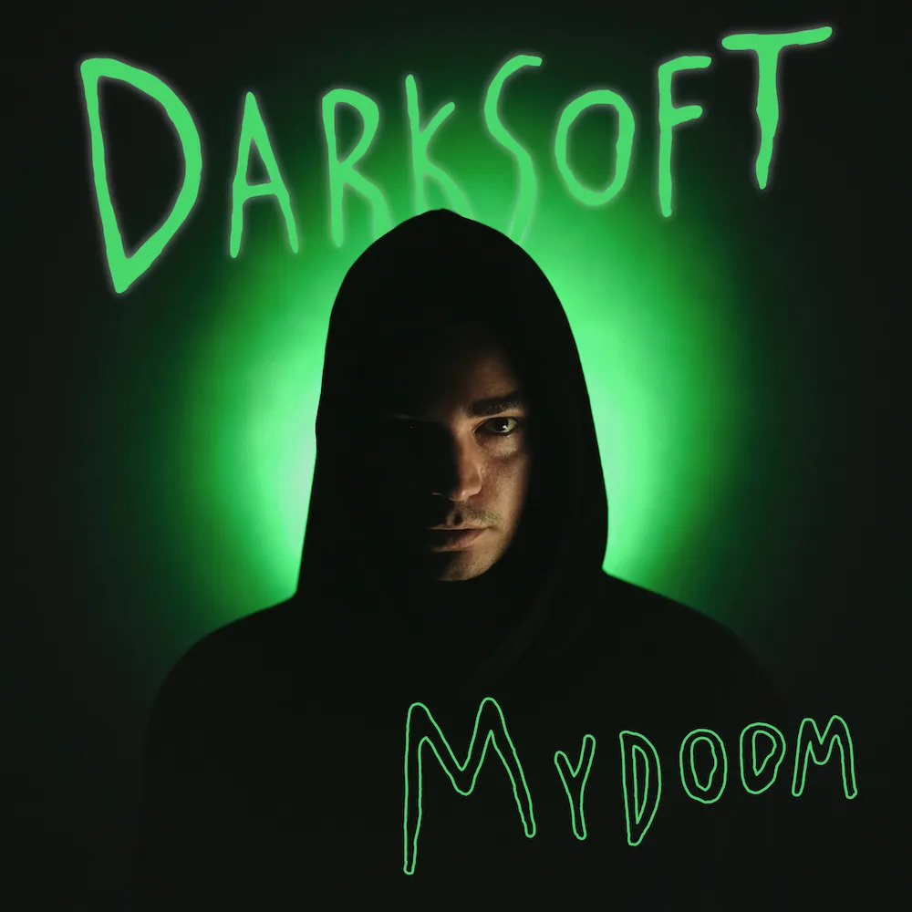

Mydoom, the first track off Darksoft’s upcoming full-length, *Brain*, slowly swells far beyond its trancey intro. Darksoft’s vocals enter with an air of dreariness and monotony while the instrumentation continues to fill the surrounding spaces.

<iframe src="https://open.spotify.com/embed/album/73YDKiWDBXsUGPzlMxdnCS" title="Spotify album" height="352" loading="lazy" allow="autoplay; clipboard-write; encrypted-media; fullscreen; picture-in-picture"></iframe>

Lyrically, Mydoom bounces around the straightforward and the poetic. He warns that “*it’s nothing personal, I’m just doing my job*”. Later asking, “*how much data did they exploit yesterday*”? The cyber-oriented album plays on feelings of uneasiness surrounding the man-made and the virtual, while seeking a root in reality.

Darksoft’s strong vocals carry these feelings further as he raises the pitch and the stakes, singing, “*it’s okay to be vulnerable if you’ve got nothing to hide*”.

Mydoom is a first look at Darksoft’s disillusionment with the vast and dark-world of screens, a theme carried throughout Brain.

The track is at its most compelling when reminding listeners it’s okay to be vulnerable, as long as “*you’ve got nothing to lose*.”

### PREORDER THE ALBUM:
