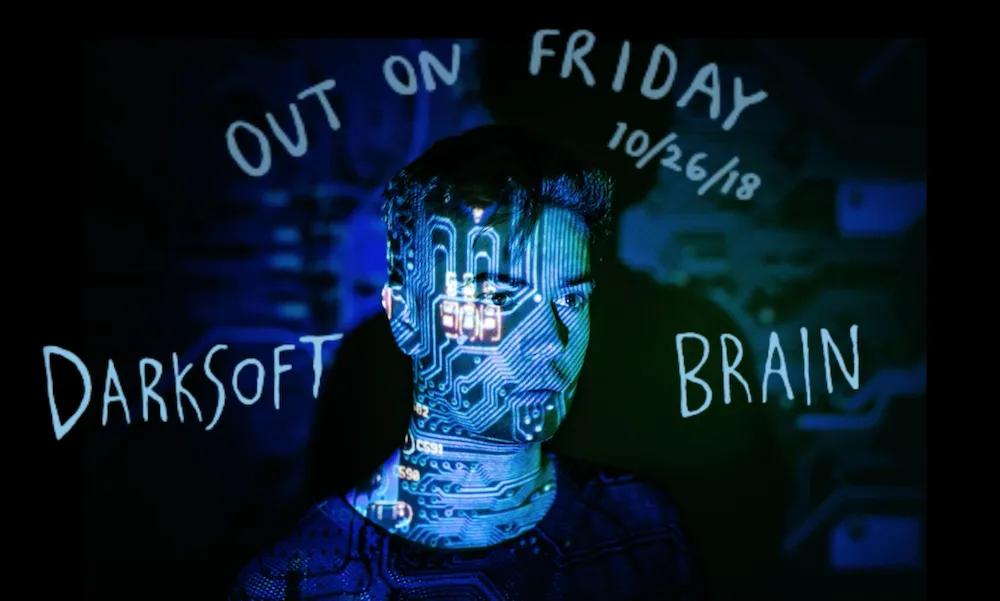
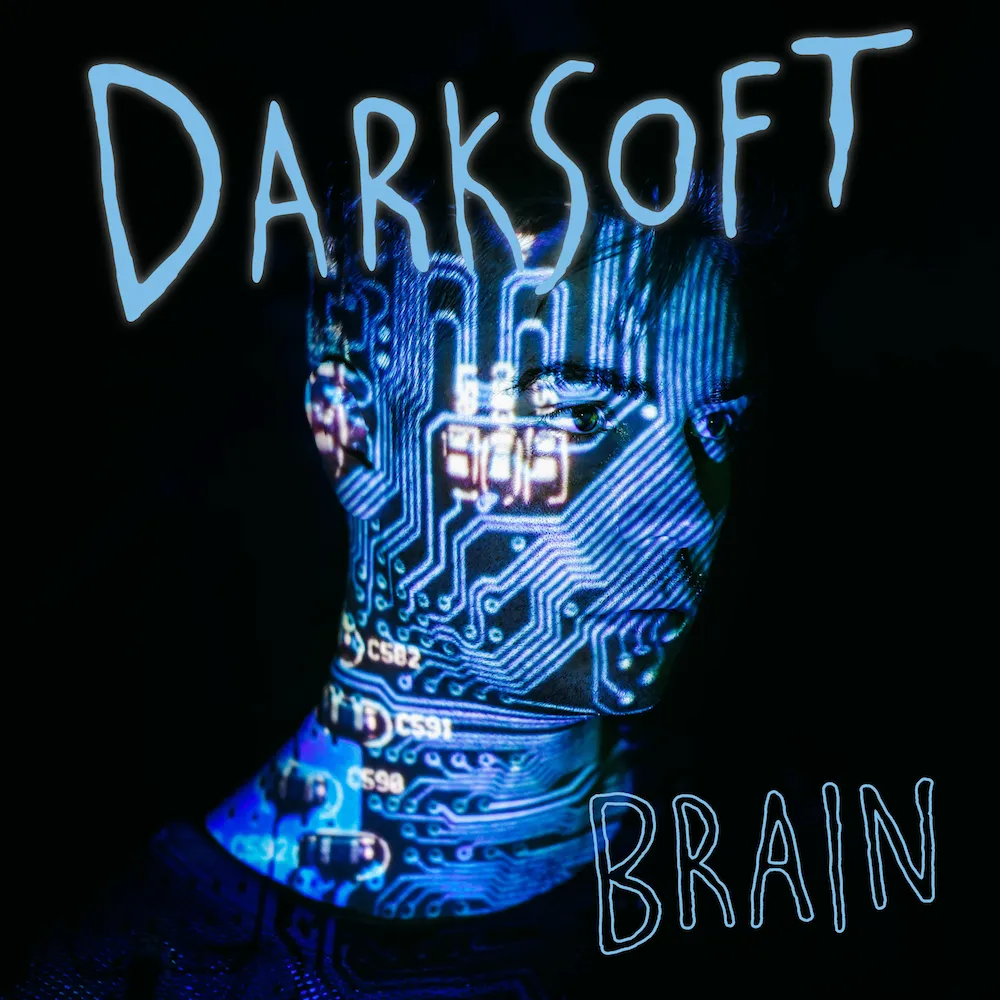
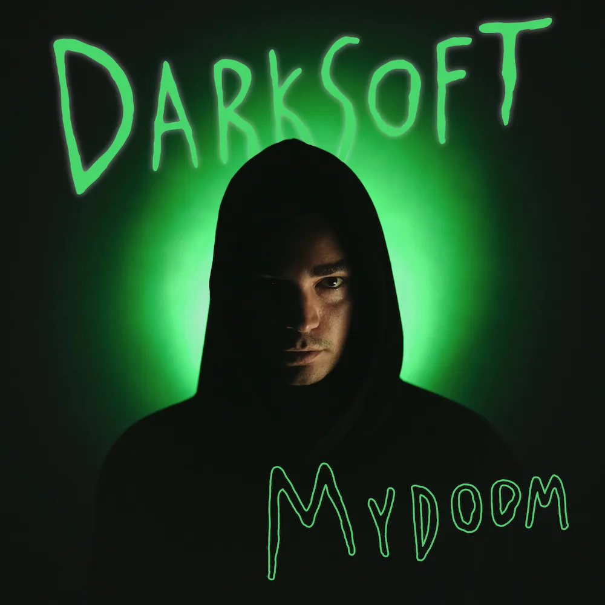
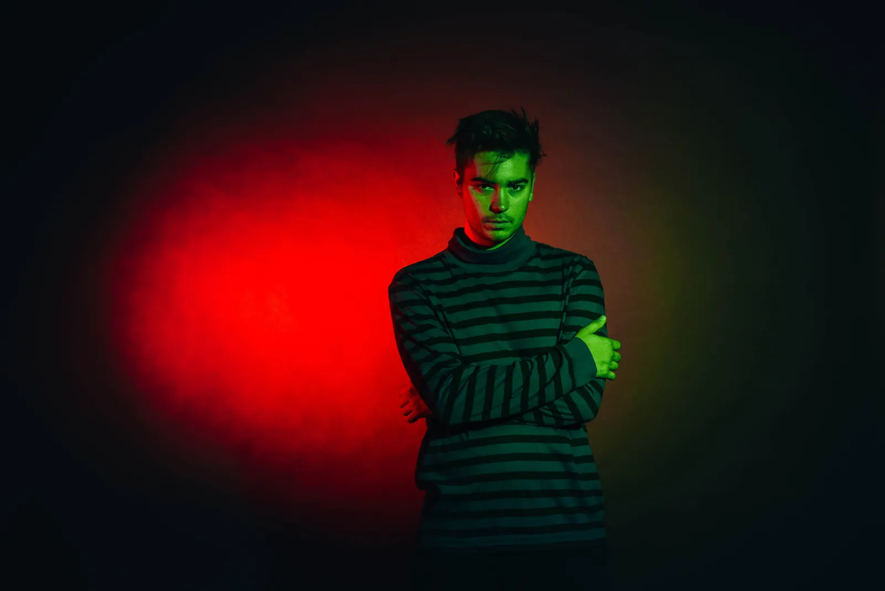

Very excited to announce the imminent worldwide release of *Brain*, a 9-song album by [Darksoft](/darksoft). It’s going live on **Friday 10/26**.

### Press & Radio:

Please [Contact Us here](/about) for **private pre-release streams** or **digital downloads** for airplay. To get a taste, we’ve already released a single, *Mydoom* below on **Spotify**:

<iframe src="https://open.spotify.com/embed/track/21AWPeMpbHxar2nPBea5RK" title="Spotify track" height="152" loading="lazy" allow="autoplay; clipboard-write; encrypted-media; fullscreen; picture-in-picture"></iframe>

You can also listen to the Darksoft single on all major streaming platforms. Here are other links:

- [SOUNDCLOUD](https://soundcloud.com/darks0ft/mydoom)
- [BANDCAMP](http://darks0ft.bandcamp.com/)

ARTIST SPOOKMENT  
Black hats. Resource vampires. Botnet masters. Malware. Distanced through haunted screens, we rely on spooky contact that we don’t fully understand. At times, dark forces lurk on the other end, with a motive to con. Always a silhouetted hooded presence, the hacker has become our modern portrayal of Death; captor to the mind and its web of memories. As we stare deeper and deeper into the glowing comfort of this synthetic deception, trust has become the challenge of our modern paradigm, and the cyberspace the new Great Unknown. Swirling out of this virtual vortex, *Brain (2018)* is named after the first ever computer virus from the year 1986, with all songs named after infamous viruses that followed.

<figure><figcaption>Album artwork for the debut Darksoft album Brain, out 10/26 on Look Up Records</figcaption></figure>

<figure><figcaption>Album for the Darksoft single Mydoom</figcaption></figure>

<iframe src="https://www.youtube-nocookie.com/embed/xtBCyytqcs8" title="YouTube video" loading="lazy" allow="accelerometer; encrypted-media; gyroscope; picture-in-picture; web-share" referrerpolicy="strict-origin-when-cross-origin" allowfullscreen></iframe>

We’ve also got a super DIY music video in the works, it stars Bill as a dream-surfing computer hacker. Updates on that soon!

[Darksoft](/darksoft), the latest addition to Look Up Records, evokes an alternative sound. Darksoft creates a nostalgia for late 90s sadcore. Using an Elliot Smith and Bright Eyes vocal style, crunch guitar like Staryflyer 59 or Superheaven, and an overall garagey sound reminiscent of shoegaze.

### About Darksoft

Bill Darksoft, hailing from Seattle, leads the Darksoft project. He runs Look Up Records, studied creative writing at UW, and has played with many other Seattle acts over the years.

<iframe src="https://www.youtube-nocookie.com/embed/cJqlp8ohCLI" title="YouTube video" loading="lazy" allow="accelerometer; encrypted-media; gyroscope; picture-in-picture; web-share" referrerpolicy="strict-origin-when-cross-origin" allowfullscreen></iframe>

### Follow Darksoft

Stoked to put out this album, it means a lot to have you listen. Thanks for the support.

