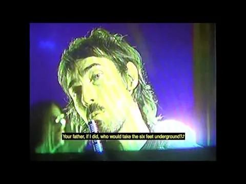

Joe McKee’s “I’ll Be Your Host” is an electro magnetic field that beckons the paranormal to glide under the skin. Float with this disembodied voice into a mystic soundscape of cascading melodies over a saturated acoustic folk delivery.

<iframe src="https://open.spotify.com/embed/track/6p8IqWyQh8PNSbwj1tqvPw" title="Spotify track" height="152" loading="lazy" allow="autoplay; clipboard-write; encrypted-media; fullscreen; picture-in-picture"></iframe>

Materializing into a liminal mist, I’ll Be Your Host depicts an eerie nighttime realm. Delayed vocals, reverbed guitar, and synths swirl like an 80s fantasy film. Behind the shimmer is a dark premonition; something’s haunting Joe from 6 ft underground…

In ghost lore, a host body is one that a spirit inhabits. The vacant form of Joe Mckee appears to be open to hosting foreign entities, at least for a time:

> “I’m just a vehicle for a ghost”

Host to the spirit of a creative trip, we catch glimpses of the mind corridors of a wide-eyed imagination; a playful allure for the other side.

> “All of my creations are invisible.. exaggerations, aren’t they?”

Hearts are beating like bees in this atmospheric yet organic soundscape. Lyrics seem to acknowledge something awry. Something about an Albatross? What’s going on, Joe?

> “They don’t belong to me… I have to set them free”

We all harbor ideas that just need to be let out. The melodies and chord changes have a Muse ballad quality to it, pulling on a dreamy romance as ectoplasm drifts through the air. There’s an idilic sax solo that takes itself way too seriously and I love it.

Keeping the astral well fed with each elemental breath, let’s hope Joe will let the right vibes in, and can exorcise the nagging spooks. For us listeners, we’ll just live inside the song, zoning out on Mars with the phantasms that haunt Joe McKee, his song now the host for our own apparitions…

<iframe src="https://www.youtube-nocookie.com/embed/yQ5lYad7P6k" title="YouTube video" loading="lazy" allow="accelerometer; encrypted-media; gyroscope; picture-in-picture; web-share" referrerpolicy="strict-origin-when-cross-origin" allowfullscreen></iframe>

<figure><figcaption>Joe Mckee</figcaption></figure>

* * *

## SUBMIT

This song was sent to us on SubmitHub! If you’d like to be featured please submit there.

## Follow

Follow the Look Up Song Reviews Playlist for more great music:

<iframe src="https://open.spotify.com/embed/playlist/7hHyuev0jvp5SIMzLYnm4X" title="Spotify playlist" height="352" loading="lazy" allow="autoplay; clipboard-write; encrypted-media; fullscreen; picture-in-picture"></iframe>

