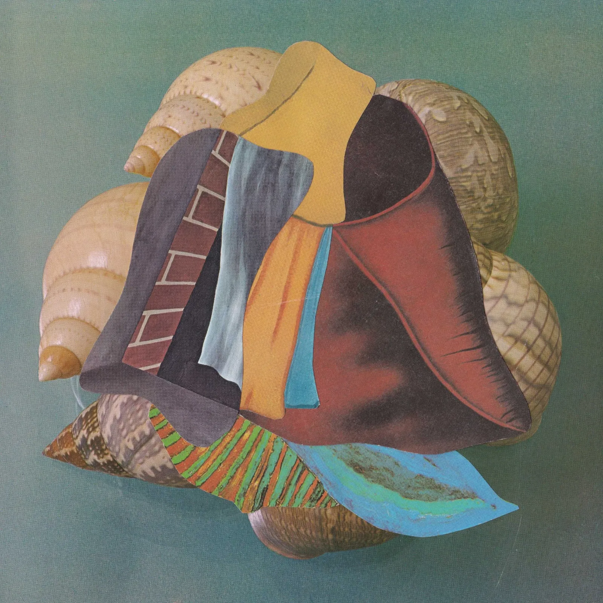

Dive into a slow motion fall with “Soon Enough,” the picture perfect soundtrack to draining the color out of time.

<iframe src="https://open.spotify.com/embed/track/3vcV3Sd1CGxx6pRYCAy89P" title="Spotify track" height="152" loading="lazy" allow="autoplay; clipboard-write; encrypted-media; fullscreen; picture-in-picture"></iframe>

FOLLOW OUR PLAYLIST

<iframe src="https://open.spotify.com/embed/playlist/7hHyuev0jvp5SIMzLYnm4X" title="Spotify playlist" height="352" loading="lazy" allow="autoplay; clipboard-write; encrypted-media; fullscreen; picture-in-picture"></iframe>

“Soon Enough” by Still Parade transcends spacetime with slow arpeggiated keyboards in the minor key of a spooky old horror movie. A crunchy keyboard enters, with a bright tone and a vinyl, vintage flourish. Calming, airy vocals describe “a picture perfect sunset.”

70s styled muted and amp-compressed hip-hop drums enter with a kinetic bass; rhythm to keep the head bobbing at walking pace.

> “I don’t want to fall, but I see the world around me is going to change…”

MacDemarco-esque guitars pluck lazily, while string pads enter to build the intensity of the moment. Tambourine adds a subtle change to a new verse, which flows naturally from step to step through organic orange haze.

Overall it feels like a slow motion tranquility, as jaded vocals question the changing times all around. We all fall soon enough, so why not capture the beauty of the “edge and the unknown” all at once?

> “I don’t want to fall, but soon enough these colors are going to change”

Soon Enough is irreverent to a distinct beginning or end, instead capturing a thought space where time is constant, yet meaningless, drained of its color.

With well-produced luscious sounds, filter sweeps, and tape effects, the style is a simple yet psychedelic groove right out of the moment. Listeners of Tame Impala, POND, or MacDemarco should similarly vibe with Still Parade.

<figure><figcaption>Still Parade</figcaption></figure>

* * *

## SUBMIT

This song was sent to us on SubmitHub! If you’d like to be featured please submit there.

## Follow

Follow the Look Up Song Reviews Playlist for more great music:

<iframe src="https://open.spotify.com/embed/playlist/7hHyuev0jvp5SIMzLYnm4X" title="Spotify playlist" height="352" loading="lazy" allow="autoplay; clipboard-write; encrypted-media; fullscreen; picture-in-picture"></iframe>

