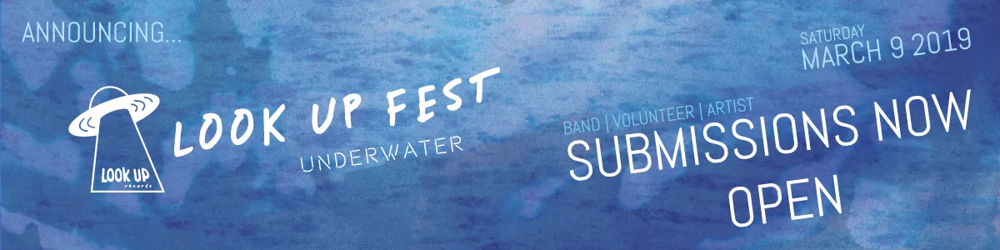
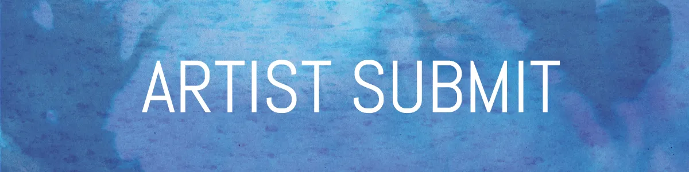
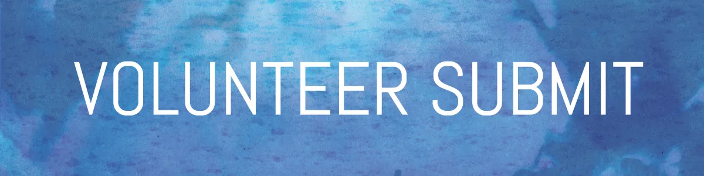
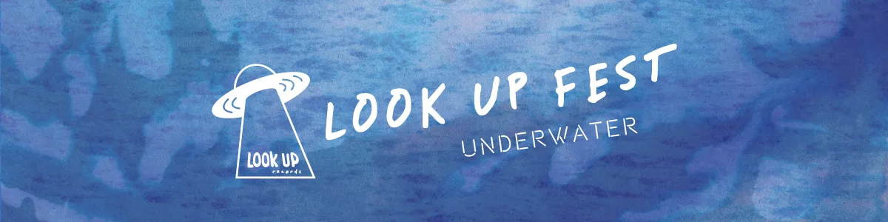
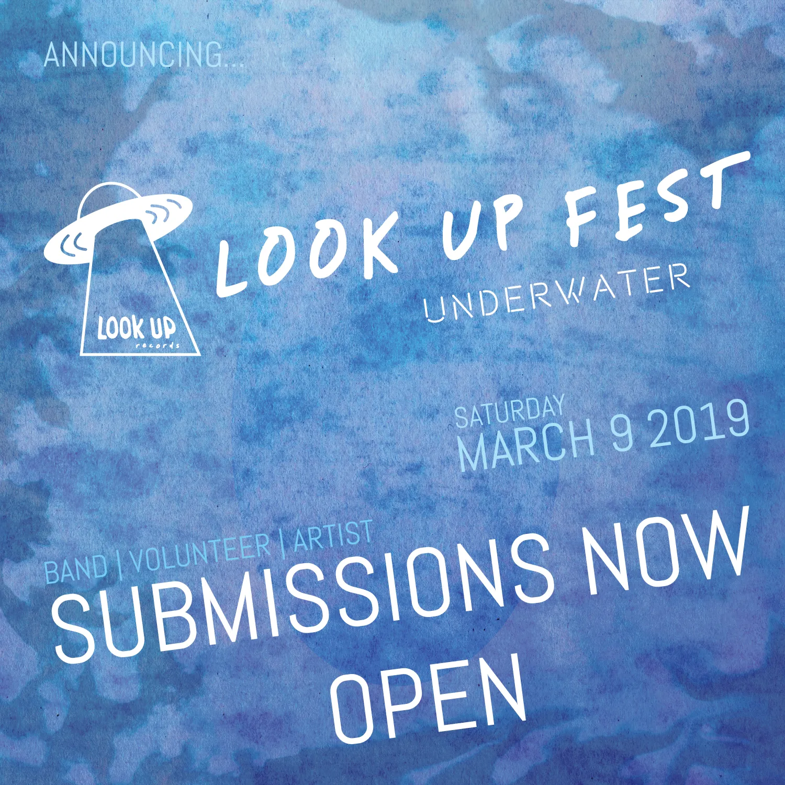

*Announcing the return of Look Up Fest, the lodge for high strangeness in the Pacific Northwest.*

On March 9th 2019 at **Look Up Fest: Underwater** we'll emerge from the watery depths of winter... expanding to **2 stages** featuring great local musicians, interactive art, and a cause dedicated to fighting **climate change**. We also aim to provide a Northwest alternative to folks not heading to SXSW.

## [RSVP](https://www.facebook.com/events/319231818664403/) | [BUY TICKETS](https://www.eventbrite.com/e/look-up-fest-underwater-tickets-52174358912)

[OFFICIAL EVENT PAGE](/lufu)

ARTIST SUBMISSIONS NOW OPEN. SUBMIT BELOW:

<figure></figure>

LOOK UP FEST IS A SINGLE DAY MINI MUSIC FESTIVAL AND MULTIMEDIA ART EXHIBITION HELD IN THE UPSIDE DOWN, AKA GEORGETOWN.

With two curated stages featuring local psychedelic dream pop bands, quality drinks, beautiful lighting installations by Blazinspace, and multimedia art experiences on the theme of aquatic paranormal encounters, Look Up Fest is a community-driven, artist-run, accessible event, where we invite attendees to join in a surreal suspension of disbelief.

FROM UNKNOWN WATERY DEPTHS, CREATURES OF THE DEEP ASCEND.

>  “A brand-new confab of music, visual art, good beer and strange vibes” 
>
> — Jonathan Zwickel, City Arts

At Look Up Fest: Underwater we will submerge ourselves into the bioluminescent darkness, only to rise over the course of 6 hours through sonic and visual experience, until we ascend into the light above the surface.

WE ALSO NEED MORE VOLUNTEERS FOR THIS EVENT! SUBMIT BELOW:

<figure></figure>

STAGES WILL BE AT BASE EXPERIMENTAL ARTS SPACE & YAW THEATER (AT EQUINOX IN GEORGETOWN)

Look Up Fest exposes attendees to an ethereal headspace, appealing to anyone with an affinity for The Abyss, Sphere, Stranger Things, Twin Peaks, X Files, UFO documentaries, missing time, mysterious forces, or other dark shadows of the deep. If you want to believe, come out to Look Up Fest.

## [RSVP](https://www.facebook.com/events/319231818664403/) | [BUY TICKETS](https://www.eventbrite.com/e/look-up-fest-underwater-tickets-52174358912)

OFFICIAL EVENT PAGE

## **HELP US SHARE THE CALL FOR SUBMISSIONS!**

