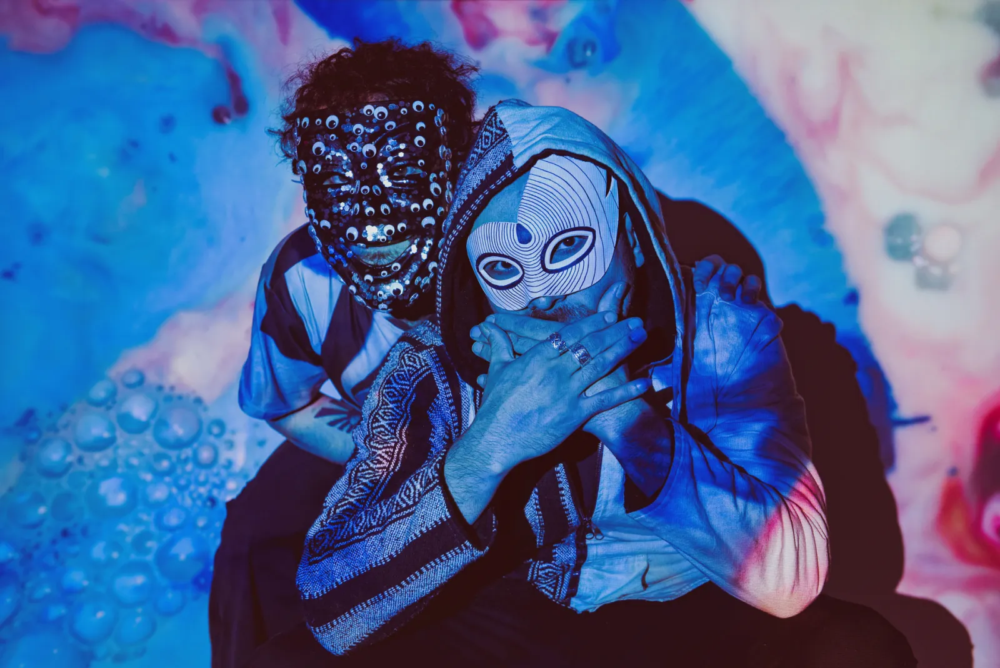
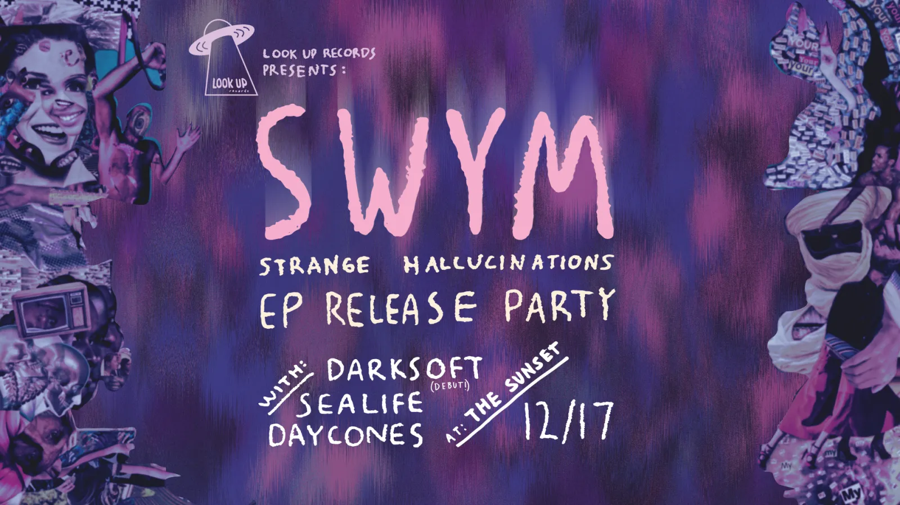

### Announcing a new addition to the Look Up roster… [SWYM](/swym).

### Born along the shores of the Mystic, carried among the clouds, and submerged into the sweet waters of the Pacific Northwest, **SWYM** brings their dreamy psychedelic journey to melodic fruition.

<figure><figcaption>We release SWYM’s Strange Hallucinations on 12/17</figcaption></figure>

### Following a self-RELEASED debut album *Mirror Box*, Look Up Records is excited to add **SWYM** to THE roster and release their upcoming **EP**, ***Strange Hallucinations***, liquifying into existence on **12/17**.

<figure><figcaption>Alt-psych rock duo SWYM bring swirling delays, stratospheric reverb, and phase-shifted everything.</figcaption></figure>

### Attend the release show at The Sunset on 12/17 with [Darksoft](/darksoft), [Sealife](/sealife), and Daycones.

<figure></figure>
