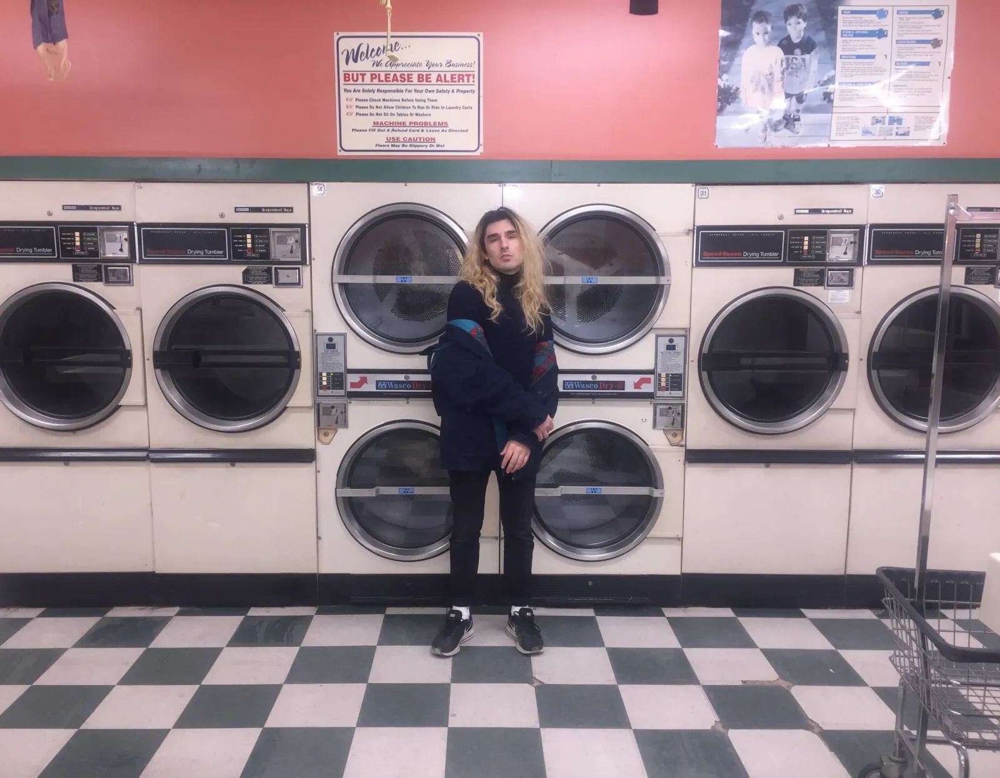

With a psychedelic feel, compressed drums, rhythmic 80s style bass, and warm analog synths, *You Will Fill My Head* will make you head bob with the depressed and obsessed.

<iframe src="https://open.spotify.com/embed/track/0jQlU4iPRzcwthBTRqXBzh" title="Spotify track" height="152" loading="lazy" allow="autoplay; clipboard-write; encrypted-media; fullscreen; picture-in-picture"></iframe>

Trying to stop describing things as “retro” so I won’t here. *You Will Fill My Head* is more sophisticated than just some mimicry of the decades.

These analog synths, and catchy vocal melodies with a soft androgynous delivery are infectious. Really dig the overall combination.

A more electro **Connan Mockasin**? Sort of reminds me of a depressed **Walter Meego**; plunged under slow water and updated to the current sound. It’s got that bouncy electronic pop delivery, yet with a more introspective, soft, dreamy approach.

**Gi Smee**, bedroom fantasy pop mastermind of **wwoman**, notes **Gus Dapperton** and Jaakko Eino Kalevi as influences.

This nightwalk is in a minor key with that semitone feel, on the edge of uneasiness and comfort all at once. Cult rock, depression pop, suicide soul, wwoman’s not short on poetic ways to describe their sound.

Home alone and not able to stop thinking… about some one, some past… No one knows it. The head’s full of it and you just cant’ stop….This feel is going to the grave.

<figure><figcaption>wwoman obsessive undead fantasy polka pop</figcaption></figure>

* * *

## SUBMIT

This song was sent to us on SubmitHub! If you’d like to be featured please submit there.

## Follow

Follow the Look Up Song Reviews Playlist for more great music:

<iframe src="https://open.spotify.com/embed/playlist/7hHyuev0jvp5SIMzLYnm4X" title="Spotify playlist" height="352" loading="lazy" allow="autoplay; clipboard-write; encrypted-media; fullscreen; picture-in-picture"></iframe>

