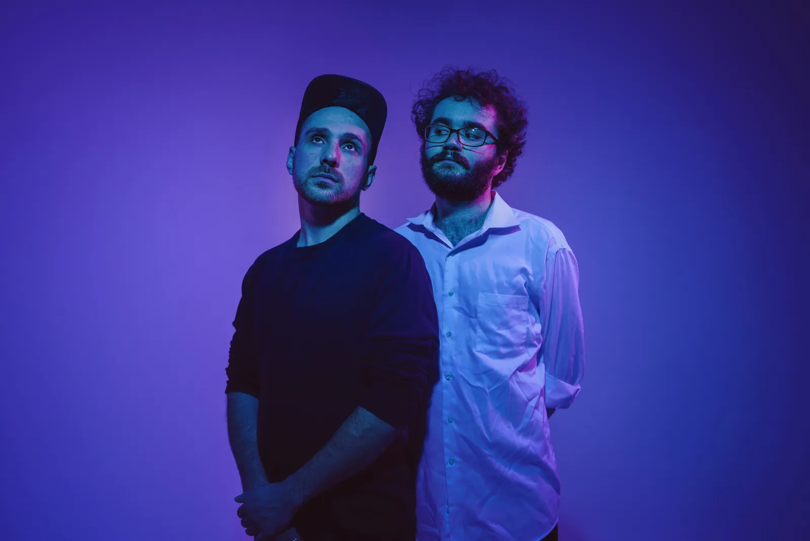
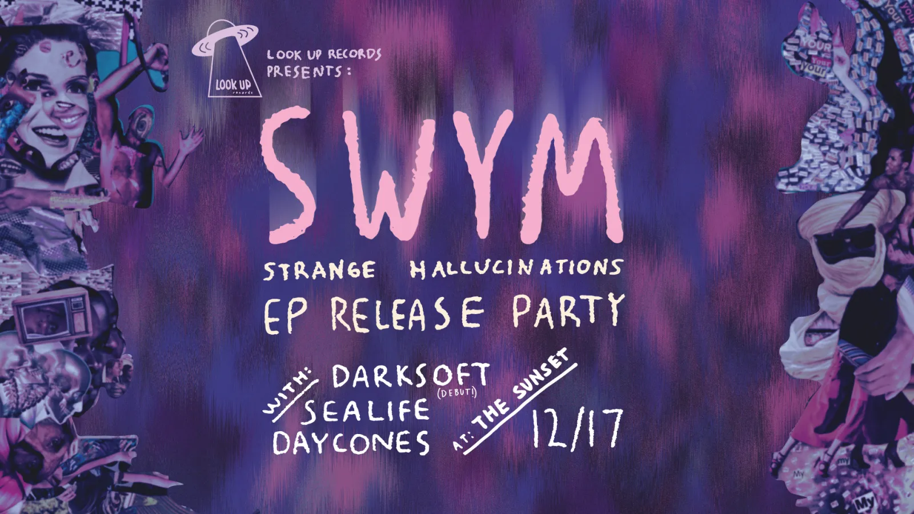

### The new single from [SWYM](/swym) is live! Listen here:

<iframe src="https://open.spotify.com/embed/track/2cGBK2Eysm5XX7bO8JybVn" title="Spotify track" height="152" loading="lazy" allow="autoplay; clipboard-write; encrypted-media; fullscreen; picture-in-picture"></iframe>

### Born along the shores of the Mystic, carried among the clouds, and submerged into the sweet waters of the Pacific Northwest, **SWYM** brings their dreamy psychedelic journey to melodic fruition.

<figure><figcaption>We release SWYM’s Strange Hallucinations on 12/17</figcaption></figure>

### Following a self-RELEASED debut album *Mirror Box*, Look Up Records is excited to add **SWYM** to THE roster and release their upcoming **EP**, ***Strange Hallucinations***, liquifying into existence on **12/17**.

<figure><figcaption>Underwater soul band SWYM</figcaption></figure>

### Attend the release show at The Sunset on 12/17 with [Darksoft](/darksoft), [Sealife](/sealife), and Daycones.

<figure></figure>
