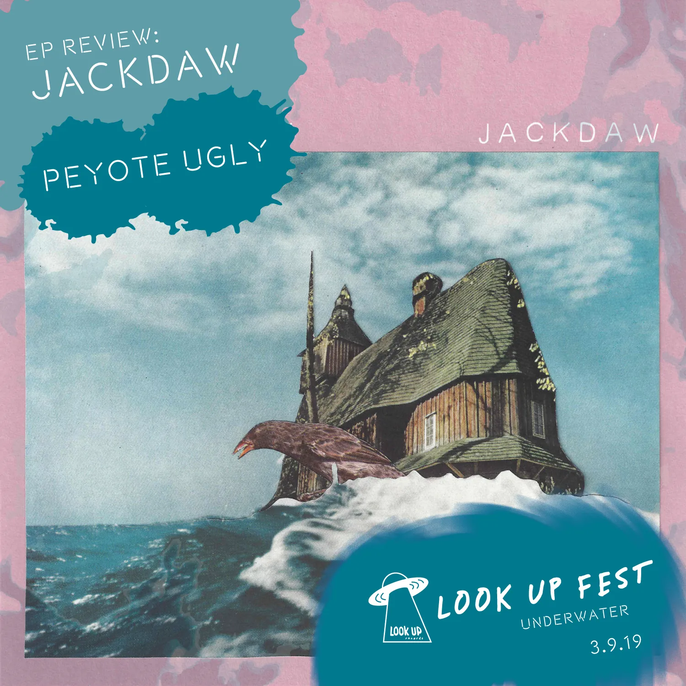
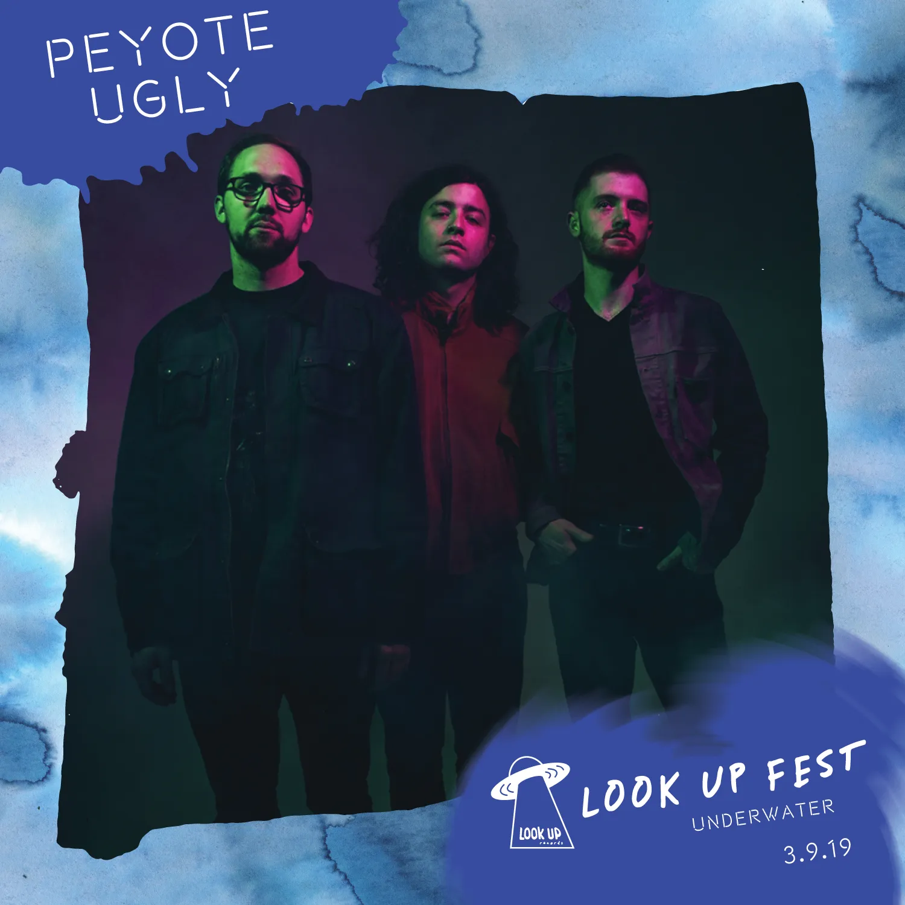

<figure></figure>

Psychedelic rock trio, Peyote Ugly, have delivered stunning blends of psychedelic rock to lull the listener into dream worlds. This follow up project to Peyote Ugly’s 2017 self titled EP slides through the eardrums and leaves you humming along, entranced.

<iframe src="https://open.spotify.com/embed/album/3kC53ACGzMar9UP2Cwg48N" title="Spotify album" height="352" loading="lazy" allow="autoplay; clipboard-write; encrypted-media; fullscreen; picture-in-picture"></iframe>

The gritty psychedelic landscape that is maneuvered through the EP sings a tale through glistening synths and deep memorable guitar hooks. Like a wave overtaking a surfer, the tracks “Home” and “Over and Over”, drown the listener in moody melodies and laid back impressive vocals.

The EP also pairs spacey guitar ambience with groovy vocal melodies, in “Where’d you run?” and “Tidal Wave”, creating an anthem easily listened to on repeat.

You can drown yourself in psychedelic beats by Jackdaw on Bandcamp, Spotify, and Apple Music. You can also check them out live at Chop Suey on January 27th with Tents and Eastern Souvenirs, and at Base on March 9th for the Look Up Fest: Underwater.

<figure><figcaption>Peyote Ugly Catch them at LUFU!</figcaption></figure>

* * *

<figure></figure>

<iframe src="https://open.spotify.com/embed/playlist/6G59RkXfRIWVMeFTAXALQo" title="Spotify playlist" height="352" loading="lazy" allow="autoplay; clipboard-write; encrypted-media; fullscreen; picture-in-picture"></iframe>

* * *

## SUBMIT

IF YOU’D LIKE TO BE FEATURED ON OUR BLOG, SUBMIT HERE:

## LOOK UP IS ON SPOTIFY

MUSIC RELEASED BY LOOK UP RECORDS:

<iframe src="https://open.spotify.com/embed/playlist/49RDluP18DORLrsmO2V1nn" title="Spotify playlist" height="352" loading="lazy" allow="autoplay; clipboard-write; encrypted-media; fullscreen; picture-in-picture"></iframe>

