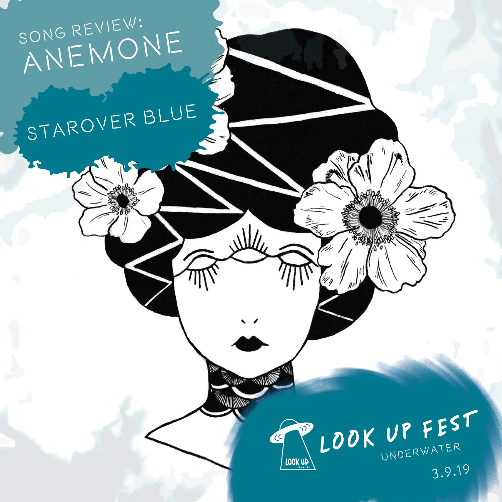
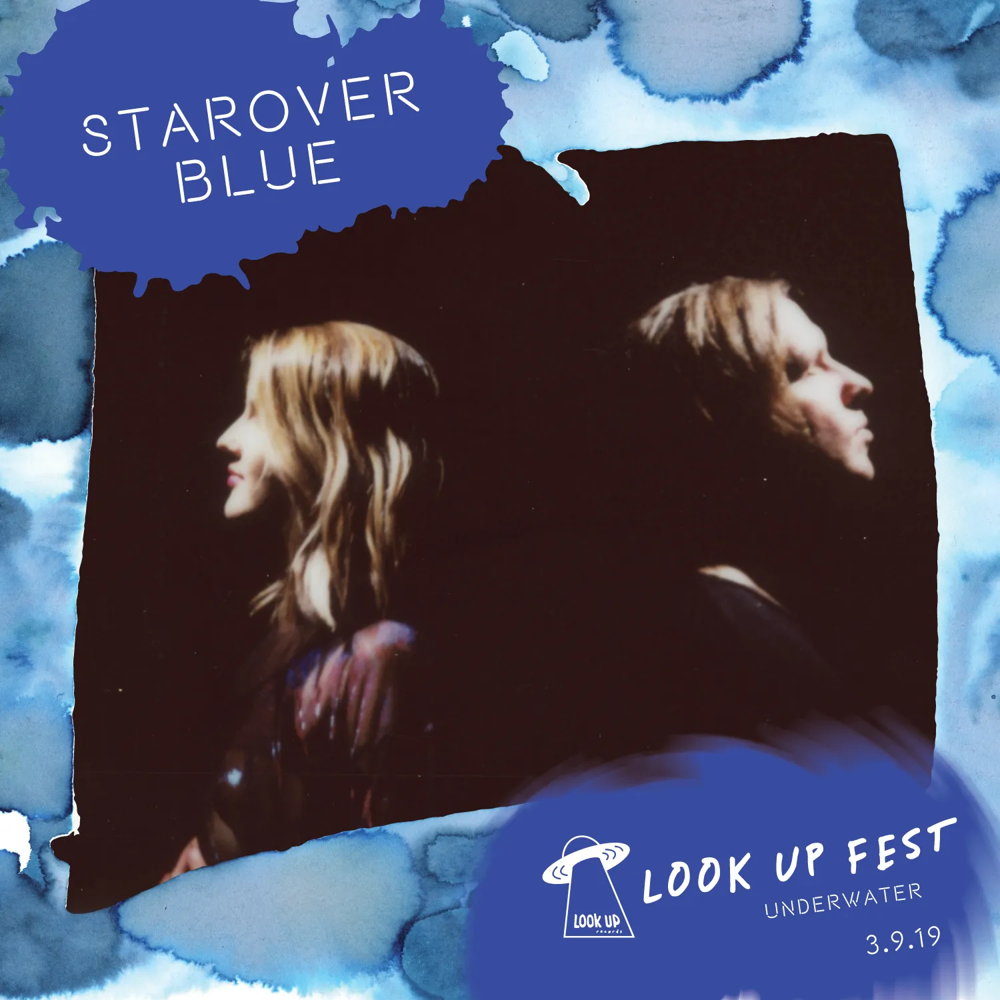

<figure></figure>

Like any classic dreamy pop-ballad, the low, lilting tones and airy snyth in “Anemone” make you want to put on a gauzy dress and dance around in the moonlight.

<iframe src="https://open.spotify.com/embed/album/28zRgAPhISVkrctR85KIk4" title="Spotify album" height="352" loading="lazy" allow="autoplay; clipboard-write; encrypted-media; fullscreen; picture-in-picture"></iframe>

Each note feels like a soft step - hesitant but purposeful. The song definitely has a direction it wants to go. It’s just choosing to go there at it’s own peaceful pace. Fittingly, the lyrics are ambiguous, sad, and impossible to get out of your head. The soundscape invokes aesthetics of a modernized Kate Bush music video; think “Running Up That Hill.”

Certainly the hazy, pastel overtones of the song are reminiscent of artists like Kate Bush, or Mazzy Star. So, next time you want to star in your own 90’s rom-com, make sure you give “Anemone” a spot on the soundtrack.

<figure><figcaption><strong>Starover Blue</strong> — Catch them at LUFU!</figcaption></figure>

* * *

<figure></figure>

<iframe src="https://open.spotify.com/embed/playlist/6G59RkXfRIWVMeFTAXALQo" title="Spotify playlist" height="352" loading="lazy" allow="autoplay; clipboard-write; encrypted-media; fullscreen; picture-in-picture"></iframe>

* * *

## SUBMIT

IF YOU’D LIKE TO BE FEATURED ON OUR BLOG, SUBMIT HERE:

## LOOK UP IS ON SPOTIFY

MUSIC RELEASED BY LOOK UP RECORDS:

<iframe src="https://open.spotify.com/embed/playlist/49RDluP18DORLrsmO2V1nn" title="Spotify playlist" height="352" loading="lazy" allow="autoplay; clipboard-write; encrypted-media; fullscreen; picture-in-picture"></iframe>

