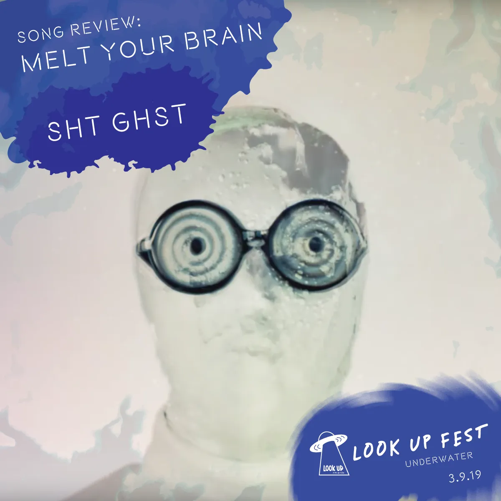
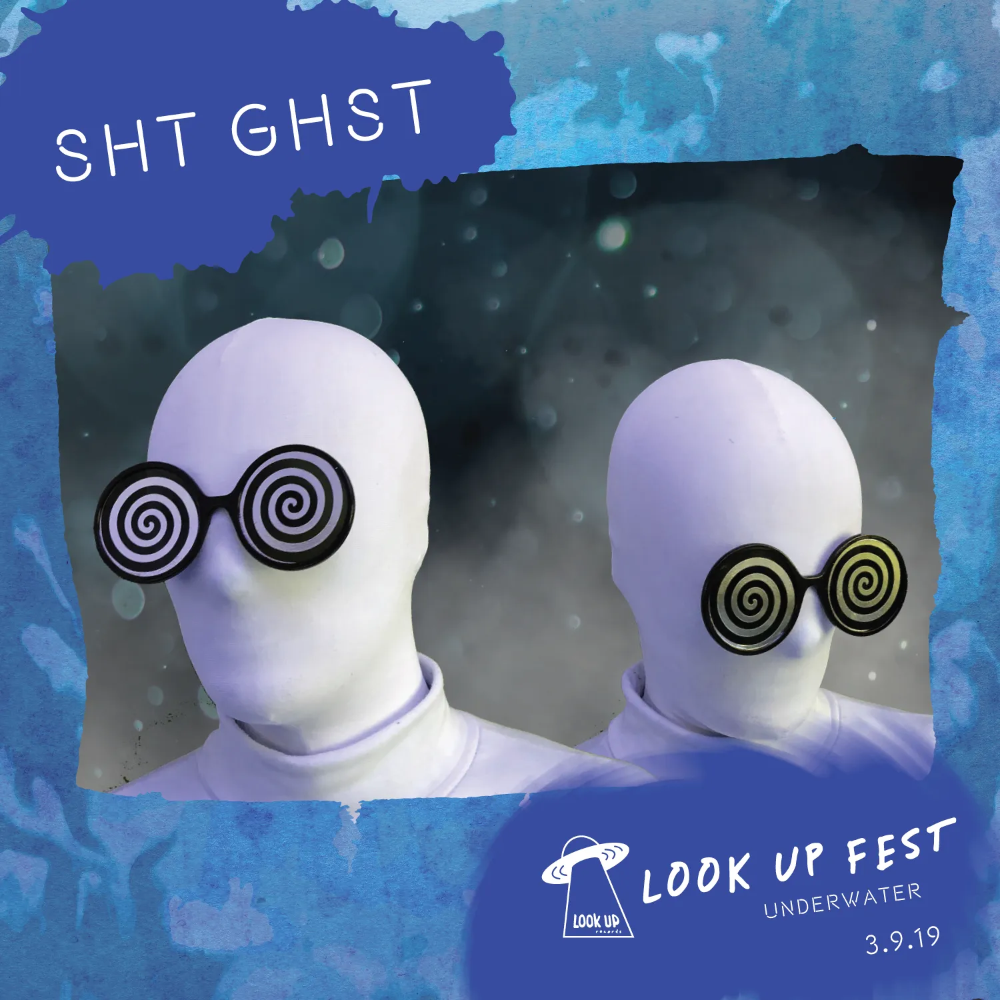

<figure></figure>

The aqueous sounds of SHT GHST are not only music but a haunting. SHT GHST takes the questions and introspection of life and translates it into sound. This beautifully laborious endeavor gives the audience illusions of water and wonderfully cascading melodies.

<iframe src="https://open.spotify.com/embed/track/4lW2tQ7qg8dvoXTWbUFXhN" title="Spotify track" height="152" loading="lazy" allow="autoplay; clipboard-write; encrypted-media; fullscreen; picture-in-picture"></iframe>

Wonderful music that reverberates through the listeners on their newest release, Melt Your Brain. SHT GHST takes aesthetics and dripping guitar melodies and blends them together into a theatrical package. This haunting ethereal soundscape is entrancing, and seduces the ears.

Listen to SHT GHST on Bandcamp, Spotify, and Apple Music. See SHT GHST headline Look Up Fest: Underwater on March 9th at Fred Wildlife Refuge, and come for other local musicians too, like Antonioni, Moon Darling, Shimmertraps, Sealife, and others.

<iframe src="https://www.youtube-nocookie.com/embed/hDaKq46DuaM" title="YouTube video" loading="lazy" allow="accelerometer; encrypted-media; gyroscope; picture-in-picture; web-share" referrerpolicy="strict-origin-when-cross-origin" allowfullscreen></iframe>

<figure><figcaption>SHT GHST Catch them at LUFU!</figcaption></figure>

* * *

<figure></figure>

<iframe src="https://open.spotify.com/embed/playlist/6G59RkXfRIWVMeFTAXALQo" title="Spotify playlist" height="352" loading="lazy" allow="autoplay; clipboard-write; encrypted-media; fullscreen; picture-in-picture"></iframe>

* * *

## SUBMIT

IF YOU’D LIKE TO BE FEATURED ON OUR BLOG, SUBMIT HERE:

## LOOK UP IS ON SPOTIFY

MUSIC RELEASED BY LOOK UP RECORDS:

<iframe src="https://open.spotify.com/embed/playlist/49RDluP18DORLrsmO2V1nn" title="Spotify playlist" height="352" loading="lazy" allow="autoplay; clipboard-write; encrypted-media; fullscreen; picture-in-picture"></iframe>

