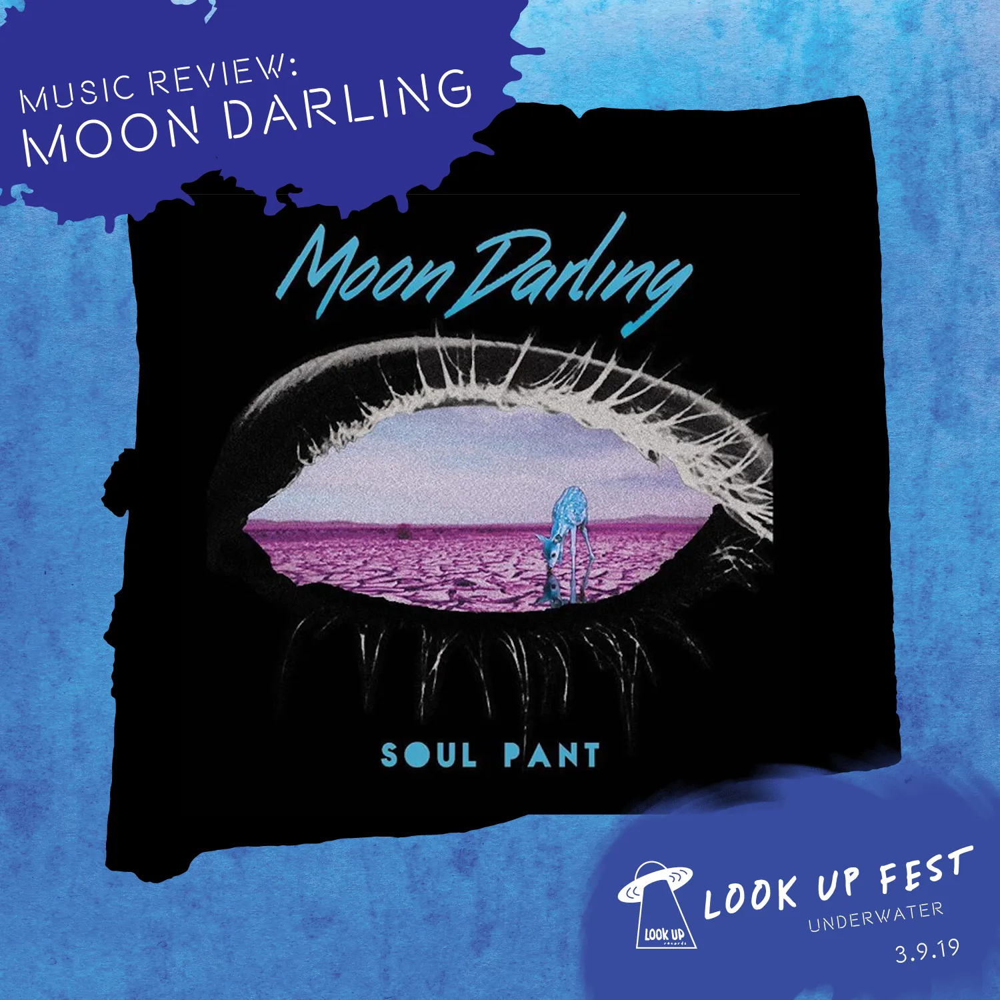
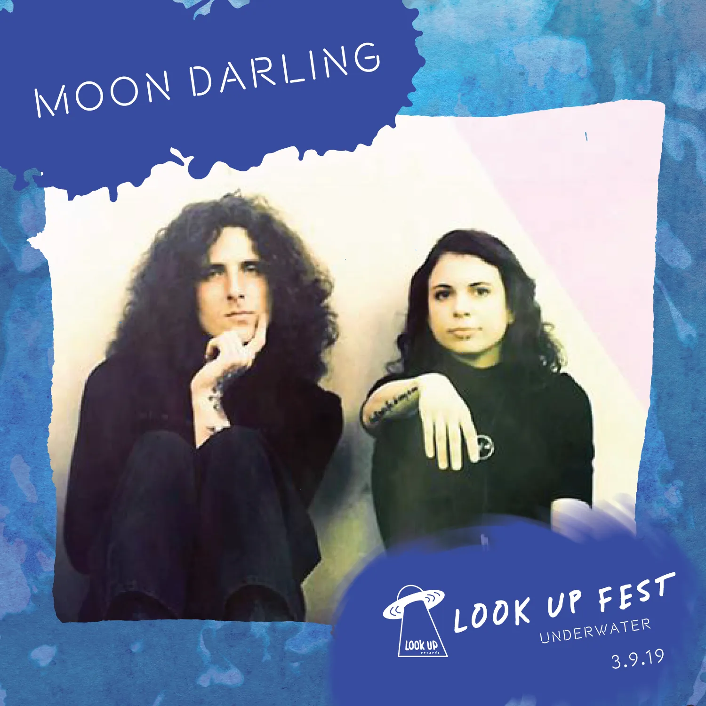

<figure></figure>

Grooving along to Moon Darling makes you finally understand why your grandparents get so nostalgic for the 60s.

The cover art for their EP *By The Light Of The Moon* alone is enough to draw you in, making it all the more enjoyable when you get into the heart of their songs. **Moon Darling’s strength lies in how the band manages to modernize the genre without losing sight of psych rock’s origins**. This is especially true on behalf of drummer, whose fast and punchy beats breathe new life into what it means to be a drummer in a psych band.

<iframe src="https://open.spotify.com/embed/album/0zitPJA94cpHrDgdsDbizV" title="Spotify album" height="352" loading="lazy" allow="autoplay; clipboard-write; encrypted-media; fullscreen; picture-in-picture"></iframe>

Of course, each member brings something important with them. The ending guitar solo in “Learned Amongst The Sky” make you want to get down on your knees and angstily howl into the wind. Together with the bass, the song almost feels like something you would tango to; intricate, romantic, and layered. To top it all off, the vocals are filled with a powerful swagger strong enough to turn every head in the room.

On their latest release “Soul Pant,” the lead vocalist’s delivery is alluring, becoming all the more tempting with every high note he hits. So next time you’re hanging out with friends and dreaming of days before your time, introduce them to Moon Darling.

<iframe src="https://open.spotify.com/embed/album/48C0Fl8MkcmC1mjQE1JYIg" title="Spotify album" height="352" loading="lazy" allow="autoplay; clipboard-write; encrypted-media; fullscreen; picture-in-picture"></iframe>

<figure><figcaption>Moon Darling Catch them at LUFU!</figcaption></figure>

* * *

<figure></figure>

<iframe src="https://open.spotify.com/embed/playlist/6G59RkXfRIWVMeFTAXALQo" title="Spotify playlist" height="352" loading="lazy" allow="autoplay; clipboard-write; encrypted-media; fullscreen; picture-in-picture"></iframe>

* * *

## SUBMIT

IF YOU’D LIKE TO BE FEATURED ON OUR BLOG, SUBMIT HERE:

## LOOK UP IS ON SPOTIFY

MUSIC RELEASED BY LOOK UP RECORDS:

<iframe src="https://open.spotify.com/embed/playlist/49RDluP18DORLrsmO2V1nn" title="Spotify playlist" height="352" loading="lazy" allow="autoplay; clipboard-write; encrypted-media; fullscreen; picture-in-picture"></iframe>

