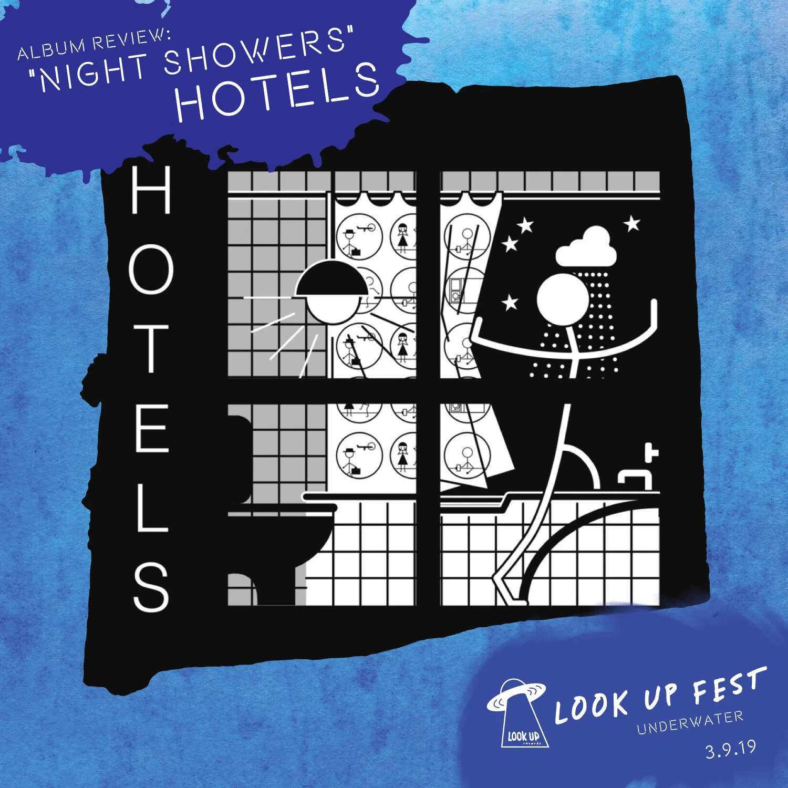
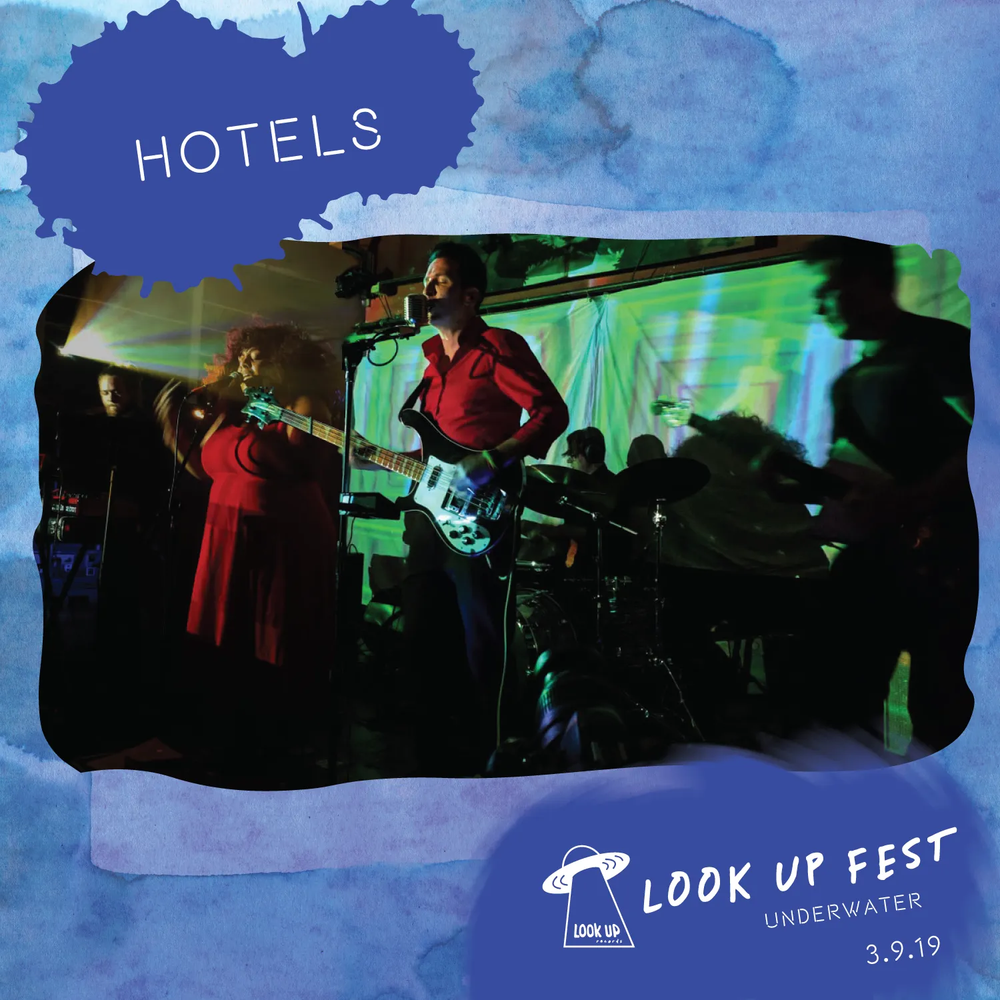

<figure></figure>

HOTELS describes themselves as a dark pop noir collective, providing melodic whimsies and space filling resonance. The group’s discography spans multiple genres collecting a wonderfully even mix of ethereal sound washes akin to psychedelia and surf pop.

<iframe src="https://open.spotify.com/embed/album/0f2bIueU0s91iXJkECtM8O" title="Spotify album" height="352" loading="lazy" allow="autoplay; clipboard-write; encrypted-media; fullscreen; picture-in-picture"></iframe>

They also have more melodic lyricisms that hum in the listener’s ears and get hooked. These memorable tracks collect and become a full discography that breaks down walls of genre and sells multiple feelings of euphoria, daydreams, and specters.

Their use of multiple instruments on their latest release, Night Showers, fills the songs with frenzied surf pop vibes and fantastical sounds from another world. The use of violin, vibraphone, cello, and trumpet, create a wonderful timbre and a diverse polyphonic sound experience.

Support HOTELS on Bandcamp, and check them out with Shimmertraps, Darksoft, and Sealife, and many others on March 9th for **Look Up Fest: Underwater**.

<figure><figcaption>HOTELS Catch them at LUFU!</figcaption></figure>

* * *

<figure></figure>

<iframe src="https://open.spotify.com/embed/playlist/6G59RkXfRIWVMeFTAXALQo" title="Spotify playlist" height="352" loading="lazy" allow="autoplay; clipboard-write; encrypted-media; fullscreen; picture-in-picture"></iframe>

* * *

## SUBMIT

IF YOU’D LIKE TO BE FEATURED ON OUR BLOG, SUBMIT HERE:

## LOOK UP IS ON SPOTIFY

MUSIC RELEASED BY LOOK UP RECORDS:

<iframe src="https://open.spotify.com/embed/playlist/49RDluP18DORLrsmO2V1nn" title="Spotify playlist" height="352" loading="lazy" allow="autoplay; clipboard-write; encrypted-media; fullscreen; picture-in-picture"></iframe>

