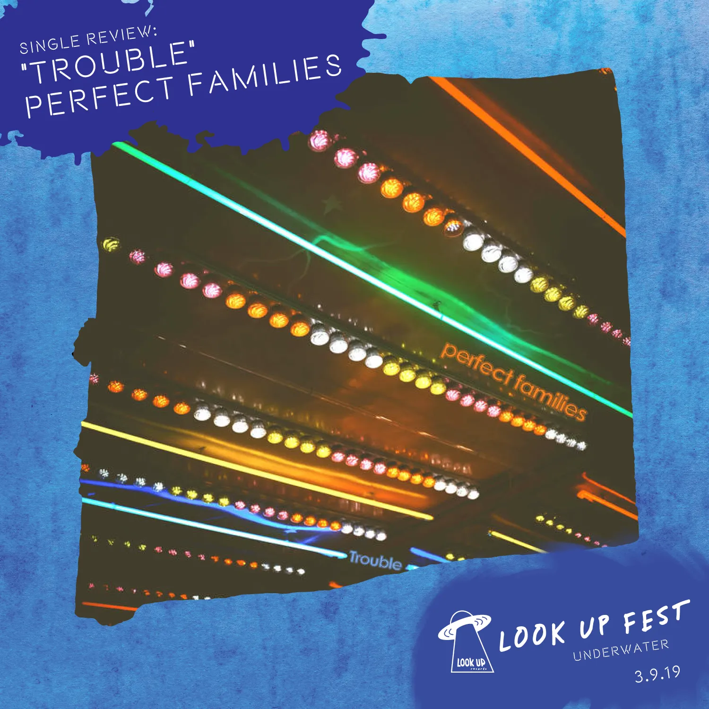
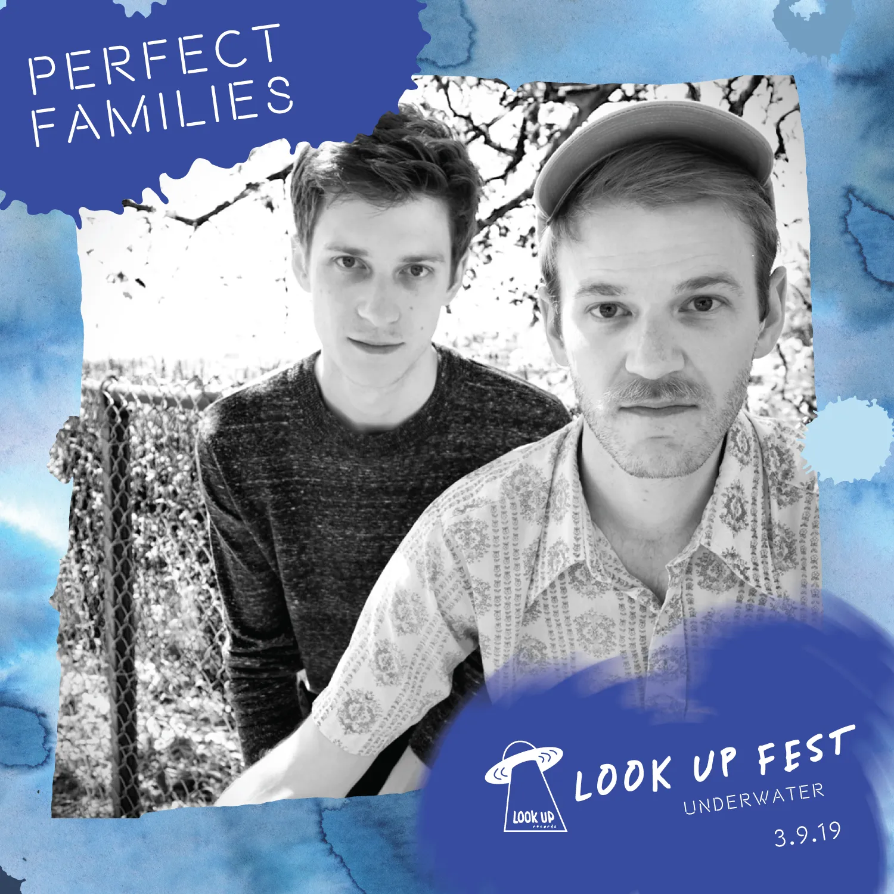

<figure></figure>

Adeptly named “Trouble”, Perfect Families’s latest single brings some high energy into the world of hazy, aquatic dream pop.

<iframe src="https://open.spotify.com/embed/track/3scEPZR6pyjedtH2MFkeaL" title="Spotify track" height="152" loading="lazy" allow="autoplay; clipboard-write; encrypted-media; fullscreen; picture-in-picture"></iframe>

There are some beautiful melodies that at times make you want to just sway along and stare at your shoes, but it purposefully clashes with powerful guitar riffs and vocals that can only be described as soft grunge. The lyrics spell out the familiar feeling of unrequited love and the sheer force it produces.

With a beautiful cover that is both bright and muted, this new single will get you in the mood for Look Up Fest Underwater along with other wistful acts, happening at Fred Wildlife Refuge on March 9th.

<figure><figcaption>PERFECT FAMILIES Catch them at LUFU!</figcaption></figure>

* * *

<figure></figure>

<iframe src="https://open.spotify.com/embed/playlist/6G59RkXfRIWVMeFTAXALQo" title="Spotify playlist" height="352" loading="lazy" allow="autoplay; clipboard-write; encrypted-media; fullscreen; picture-in-picture"></iframe>

* * *

## SUBMIT

IF YOU’D LIKE TO BE FEATURED ON OUR BLOG, SUBMIT HERE:

## LOOK UP IS ON SPOTIFY

MUSIC RELEASED BY LOOK UP RECORDS:

<iframe src="https://open.spotify.com/embed/playlist/49RDluP18DORLrsmO2V1nn" title="Spotify playlist" height="352" loading="lazy" allow="autoplay; clipboard-write; encrypted-media; fullscreen; picture-in-picture"></iframe>

