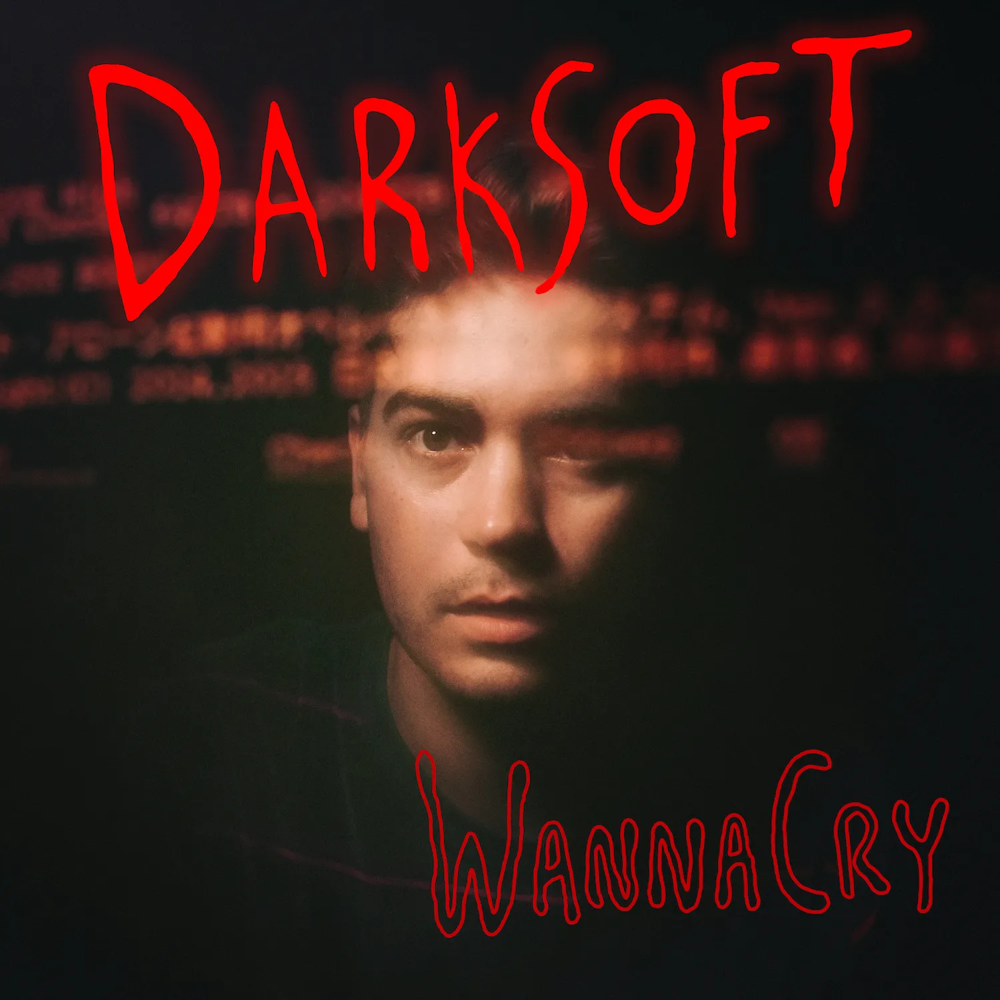

Darksoft has paired up with Collin Snider of Dreamboat VISTA to create a music video for their new single **Wannacry**. It will be debuted at Look Up Fest: Mars on 9/7!

👨‍🚀Collin's idea is brilliantly simple; we're experimenting with reflections and colors to describe an emotional journey from the perspective of a Martian explorer's helmet. We feel it will represent the claustrophobia of the digital age, the main theme in Wannacry.

We were super impressed by Dreamboat VISTA’s recent work on the Beverly Crusher music video for Scared, and think they're gonna kill it on this vid too. Collin's been awesome to whiteboard ideas with as we conceptualize the project.

Very excited! Stay tuned for progress and #BTS

## TEASER

> [View this post on Instagram](https://www.instagram.com/p/Bz0hRXyHkH4/)
>
> [A post shared by Dreamboat VISTA (@dreamboatvista)](https://www.instagram.com/p/Bz0hRXyHkH4/) on Jul 12, 2019 at 7:54am PDT

## $ PURCHASE A **DOWNLOA**D ON [BANDCAMP](https://darks0ft.bandcamp.com/track/wannacry)

<iframe src="https://bandcamp.com/EmbeddedPlayer/track=1717232021/size=small/bgcol=ffffff/linkcol=de270f/transparent=true/" title="Bandcamp player" height="42" loading="lazy"></iframe>

## [MORE ABOUT DARKSOFT HERE](/darksoft)

## SONG CREDITS

released July 25, 2019

Written and Produced by Darksoft

Mixed and Mastered by Mathieu Riede of L453RL4Dy Studios

© Look Up Records

## LYRICS

We could live alone

In our twin cold

Seeing polar sides

To every dime

wanna wanna cry

wanna wanna cry

What is compromise

If you don’t know jack

All the data tied

Up in their stack

Wanna wanna find

A piece of piece of mind

And maybe it’s not as bad as they all say

What’s wrong with life?

Just a cog in gig economy

Aren’t you satisfied?

You wanna run wanna run

Out of the system

You wanna wanna you wanna wanna ….

Fly… away…

Let’s fly… away…

Can’t you read alone?

I’m in debt on the phone

Info over load

Broken shadow

If they wash your time

Hide your feelin’

Till the end of life

end of life

Maybe they just wanna give us all a say

But I can’t help but feel

Like a pawn in some conspiracy

What am I used to fight?

Am I lined with the right history?

Who are you working for?

Are you buried in your day to day?

I know, it shows

I know, it shows …

So we live alone

In our twin code

Seein polar sides

To every lie

wanna wanna cry

you wanna wanna cry

But you don’t know how… or why
