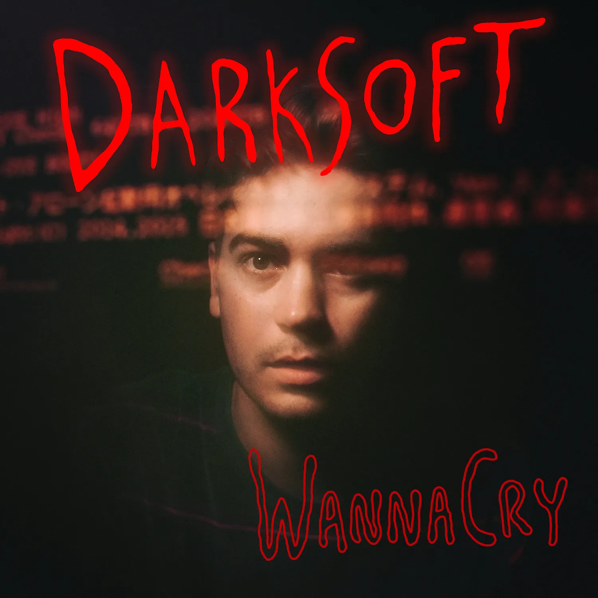

Look Up Records has released **Wannacry**, a new single by [**Darksoft**](/darksoft)**.**

Prior to a fall 2019 release of Darksoft's sophomore album "Meltdown" comes Wannacry. In Wannacry, Seattle-based Darksoft uses dreamy vocals, grungey catchy guitars, and a head bop beat. Packing a lot in one song, Darksoft sonically depicts the changeups and downs that is modern life.

## LISTEN BELOW on **SPOTIFY**:

<iframe src="https://open.spotify.com/embed/track/6vB4rU77MBaWyqQ0A1NBN5" title="Spotify track" height="152" loading="lazy" allow="autoplay; clipboard-write; encrypted-media; fullscreen; picture-in-picture"></iframe>

## [MORE ABOUT DARKSOFT HERE](/darksoft)

## A VISUALIZATION:

Named after the Wannacry ransomware, the song lyrics depict disillusionment with the digital age. With all the extreme opinions, dissent, and weirdness circling around us constantly everywhere you look on the web, it’s left everything really polarized. You end up questioning reality and what you believe in. Walk off the sting of it all with Wannacry.

## MUSIC VIDEO OUT: 9/7

Darksoft has paired up with DreamboatVISTA to create a music video for Wannacry. It will be debuted at Look Up Fest: Mars on 9/7!

> [View this post on Instagram](https://www.instagram.com/p/Bz0hRXyHkH4/)
>
> [WANNACRY \* Coming Soon Featuring: @darks0ft Created by @dreamboatvista](https://www.instagram.com/p/Bz0hRXyHkH4/)
>
> A post shared by  [Dreamboat VISTA](https://www.instagram.com/dreamboatvista/) (@dreamboatvista) on Jul 12, 2019 at 7:54am PDT

## SONG CREDITS

released July 25, 2019

Written and Produced by Darksoft

Mixed and Mastered by Mathieu Riede of L453RL4Dy Studios

© Look Up Records

## LYRICS

We could live alone

In our twin cold

Seeing polar sides

To every dime

wanna wanna cry

wanna wanna cry

What is compromise

If you don’t know jack

All the data tied

Up in their stack

Wanna wanna find

A piece of piece of mind

And maybe it’s not as bad as they all say

What’s wrong with life?

Just a cog in gig economy

Aren’t you satisfied?

You wanna run wanna run

Out of the system

You wanna wanna you wanna wanna ….

Fly… away…

Let’s fly… away…

Can’t you read alone?

I’m in debt on the phone

Info over load

Broken shadow

If they wash your time

Hide your feelin’

Till the end of life

end of life

Maybe they just wanna give us all a say

But I can’t help but feel

Like a pawn in some conspiracy

What am I used to fight?

Am I lined with the right history?

Who are you working for?

Are you buried in your day to day?

I know, it shows

I know, it shows …

So we live alone

In our twin code

Seein polar sides

To every lie

wanna wanna cry

you wanna wanna cry

But you don’t know how… or why
