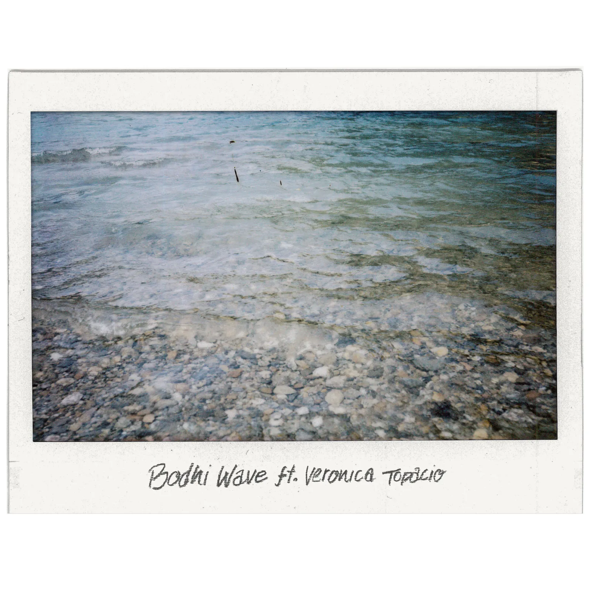

Look Up has just released a new single by **Sealife**! Listen to **Bodhi Wave (feat. Veronica Topacio)**:

<iframe src="https://open.spotify.com/embed/track/1xX0LEghpZ73HOqmOIjs6Q" title="Spotify track" height="152" loading="lazy" allow="autoplay; clipboard-write; encrypted-media; fullscreen; picture-in-picture"></iframe>

Chill out in the waves with Sealife. This simple tune flows in and out of reality with dreamy synths, ultra-crisp production, and Grade A Sealife flourishes. It features a catchy vocal pattern sung by **Veronica Topacio**, a member of [**La Fonda**](https://www.lafondamusic.com/) and a rising figure in the Seattle music scene. Hope you enjoy!

### ALSO LISTEN ON:

<a class="button" href="https://sseeaalliiffee.bandcamp.com/">BANDCAMP</a> <a class="button" href="https://music.apple.com/us/album/bodhi-wave-feat-veronica-topacio/1473315558?i=1473315561">APPLE MUSIC</a> <a class="button" href="https://www.deezer.com/us/album/104045572">DEEZER</a>

Well my body’s a wave

And my body’s a wave

Well my body’s a wave

And my body’s a wave

And my mind is a slave

When the heart misbehaves,

And the waters awake

And your eyes are a lake

And the tide is a breath

That is tied to your nets,

And you’re born in a hearth

And reversed in the surf

By the skin of your teeth

You’re returned to the earth,

And your mind is a prayer

And your will is a lathe

And your dreams are the truth (what’s real)

And my body's a wave

<a class="button" href="/sealife">LEARN ABOUT SEALIFE HERE</a>

