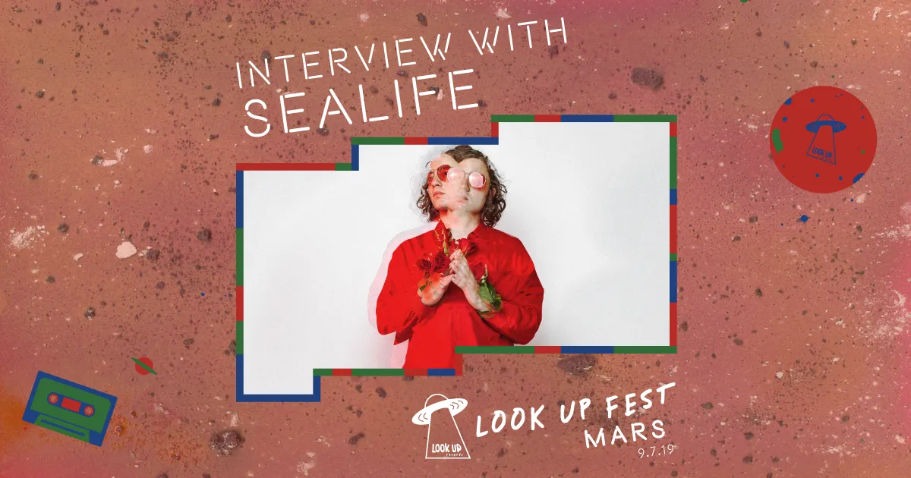
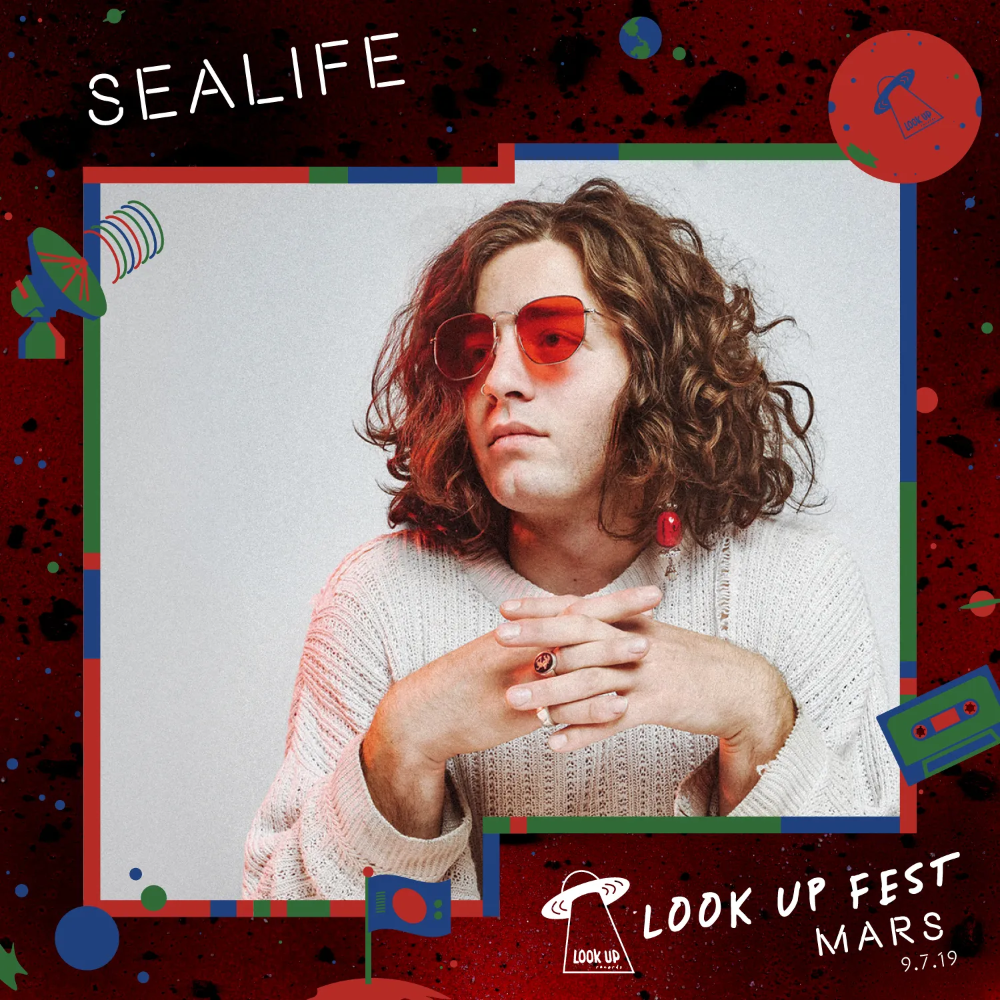

Listening to Sealife is an immersion of sunshine coated psych-pop. Brennan Moring, who also plays keys and sings for Peyote Ugly, takes total control in songwriting and storytelling. I had the opportunity of having some of my questions answered about his latest release, Bodhi Wave, and what Sealife has in store for us at the [Look Up Fest: Mars](/mars).

**A Paler Shade Of White really gives a freeing experience from start to finish. What inspired that specific sound?**

A Paler Shade of White is a chronological story about a break up. It takes you through the mourning process from both perspectives, and eventually out the other side; to new relationships and old flames. The 5 stages of grief are all in there somewhere..

**Bodhi Wave has been such a fun track to rock this summer. How did working with Veronica Topacio come about?**

Veronica is an angel and she's got an angel's voice. She's a very experienced singer, and was super fun to work with. I never had any intention of singing on this one, so I pretty much wrote the song with her in mind, on vocals.

**What can your audience expect from your set at the Mars Look Up Festival?**

A lotta new stuff! Something like 15 songs in 30 min? Just me n my guitar + some backing tracks. The backing track is one long track with no stops, so no clapping till the end, k?? I've got 2 new albums in the works, one of which is a 5-minute album. ie. 5 one-minute tracks that flow into each other. You'll hear some of those too. And a not so secret special-guest, later in the set!

<iframe src="https://open.spotify.com/embed/artist/70hDlhAk9WX3XPtaCzarlx" title="Spotify artist" height="352" loading="lazy" allow="autoplay; clipboard-write; encrypted-media; fullscreen; picture-in-picture"></iframe>

<figure><figcaption>Sealife Catch Sealife at Look Up Fest: Mars on 9/7!</figcaption></figure>

## Listen to other bands playing on Mars:

<iframe src="https://open.spotify.com/embed/playlist/1qFoOoG5BXuKqOFrHhQSnp" title="Spotify playlist" height="352" loading="lazy" allow="autoplay; clipboard-write; encrypted-media; fullscreen; picture-in-picture"></iframe>

